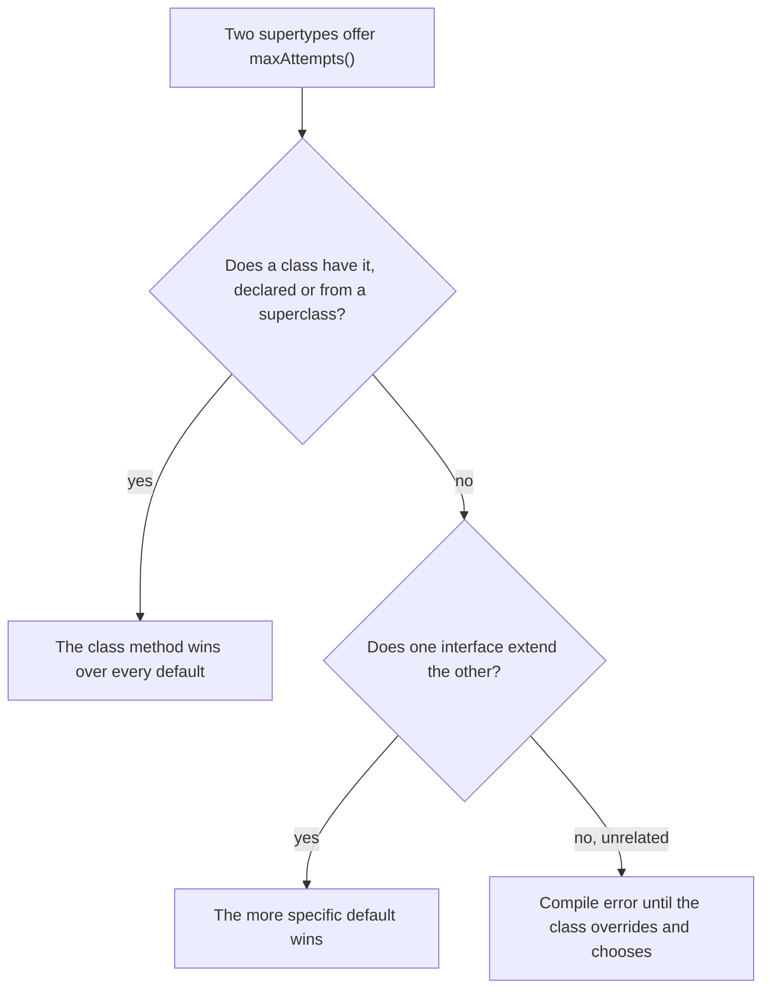

# 2.3.1. Inheritance

The platform team ships a new `payments-api` jar with one addition: a default method
`maxAttempts()` in the `Idempotent` interface, announced as backward compatible. `Refund`
implements `Idempotent` and the team's own `Retryable`, which already has a `maxAttempts()`
default. The refund service picks up the jar without being rebuilt. `key()` keeps working; the
first call to `maxAttempts()` fails with `IncompatibleClassChangeError: Conflicting default
methods`, and the service's next build doesn't compile.

A subtype is bound to what its supertypes promise and to how they change later. Unit 2.1.4 covered
the mechanics of `extends` (hidden fields, `super`, self-calls, access); this unit covers when to
use it, for classes and for interfaces with default methods.

## A Subclass Can Be Used Wherever Its Superclass Is, So It Inherits Every Promise the Superclass Makes

`java.util.Properties` extends `Hashtable<Object, Object>` to reuse its storage. A caller sets a
timeout with the inherited `put`:

```java
Properties config = new Properties();
config.setProperty("host", "db.example.com");
config.put("timeout", 30);                       // Hashtable.put, inherited

System.out.println("get(\"timeout\"):         " + config.get("timeout"));
System.out.println("getProperty(\"timeout\"): " + config.getProperty("timeout"));
System.out.println("size(): " + config.size()
        + ", stringPropertyNames(): " + config.stringPropertyNames());
Map<Object, Object> asMap = config;              // a Properties is a Map
System.out.println("as a Map: " + asMap.containsKey("timeout"));
try {
    config.store(new StringWriter(), null);
} catch (ClassCastException e) {
    System.out.println("store(): " + e);
}
```

```text
get("timeout"):         30
getProperty("timeout"): null
size(): 2, stringPropertyNames(): [host]
as a Map: true
store(): java.lang.ClassCastException: class java.lang.Integer cannot be cast to class java.lang.String (java.lang.Integer and java.lang.String are in module java.base of loader 'bootstrap')
```

`getProperty` returns `null`, so a caller that passes a default gets its default timeout
without a word, and `store` fails at save time, far from the `put` that caused it. A rule a
subclass puts in one override covers that method only. A caller holding a `List` runs the
object's own methods (unit 1.3.1), so on a subclass of `ArrayList` that checks in `add`, the
inherited `set` runs unchecked: it replaces the element without calling `add`.

`extends` makes the subclass a subtype: code that accepts a `Map<Object, Object>` accepts a
`Properties` and may put any object in it, because the superclass promised that works. A table
that holds only strings can't keep that promise and its own at once, and the javadoc can only ask:
"Their use is strongly discouraged". A subclass can't hide an inherited public method (unit
2.1.4), and overriding it to throw breaks the callers that use it, a violation of the Liskov
substitution principle (unit 8.1.3).

Extend only when every caller of the superclass may use the subclass without knowing it. To
reuse code without that promise, hold the other object in a field and expose only what you mean
(unit 8.4.1). `equals` is where a broken promise shows first; unit 1.5.1 has that case.

## A Class Open to Subclassing Needs a Final Skeleton and Protected Hooks; Otherwise Make It final

Every export must write two audit lines. The base class writes them around a step each format
fills in, and a bulk exporter overrides `export` to write all rows in one call:

```java
import java.util.ArrayList;
import java.util.List;

abstract class Exporter {
    static final List<String> audit = new ArrayList<>();   // stands in for the compliance log
    final List<String> out = new ArrayList<>();

    public void export(List<String> rows) {
        audit.add(name() + ": started");
        for (String row : rows) write(row);
        audit.add(name() + ": exported " + rows.size() + " rows");
    }

    protected abstract void write(String row);

    String name() { return getClass().getSimpleName(); }
}

class CsvExporter extends Exporter {
    @Override protected void write(String row) { out.add(row); }
}

class BulkExporter extends Exporter {
    @Override public void export(List<String> rows) { out.addAll(rows); }   // one call, not one per row

    @Override protected void write(String row) { out.add(row); }
}
```

Both export the same three rows:

```text
CsvExporter wrote 3 rows
BulkExporter wrote 3 rows
audit: [CsvExporter: started, CsvExporter: exported 3 rows]
```

Every test of the bulk exporter checks its rows and passes, and its exports are missing from
the audit. Nothing told its author that `export` carried a duty, and nothing stopped them
replacing it.

Declaring the skeleton `public final void export(...)` turns that override into a compile error:

```text
Exporters.java:24: error: export(List<String>) in BulkExporter cannot override export(List<String>) in Exporter
    @Override public void export(List<String> rows) { out.addAll(rows); }   // one call, not one per row
                          ^
  overridden method is final
1 error
```

This is the template method pattern. The base class owns the order of the steps and every rule
around them, and subclasses fill in `protected` hooks: abstract ones they must write, or empty
ones they may. `protected` keeps callers in other packages from running a step on its own,
outside the skeleton; code in the same package still can (unit 2.1.4). The rules the skeleton
owns include the failure path: when a step throws, its cleanup must still run, so it goes in a
`finally`.

A class designed this way documents which of its methods call which, as
`AbstractCollection.addAll` does ("This implementation iterates over the specified collection,
and adds each object returned by the iterator"), because subclasses depend on it (unit 2.1.4). It
calls no overridable method from its constructor (units 2.1.1 and 2.1.2). A class not designed
for subclassing should be `final`, as `String` and `Integer` are; a `sealed` class names the
subclasses it allows (unit 2.5.1).

<!-- practice 1 -->

## A Class Method Beats a Default, a More Specific Interface Beats Its Parent, and Any Other Conflict Is Yours to Resolve

A class has one superclass but may implement many interfaces, and since Java 8 interfaces carry
code, so two supertypes can offer the same method. Refunds are safe to retry, and the platform
team gives `Idempotent` a default. Predict what a refund returns:

```java
public class ClassWins {
    interface Idempotent { default int maxAttempts() { return 5; } }
    static class Payment { public int maxAttempts() { return 1; } }
    static class Refund extends Payment implements Idempotent { }

    public static void main(String[] args) {
        Idempotent refund = new Refund();
        System.out.println("refund.maxAttempts(): " + refund.maxAttempts());
    }
}
```

```text
refund.maxAttempts(): 1
```

A class's method, declared or inherited from a superclass, beats any default, even when the call
goes through the interface, and the order in which the class lists its supertypes plays no part.
There is no warning, and refunds are tried once.
The default runs only if `Refund` declares the method and returns
`Idempotent.super.maxAttempts()`, which calls the default of a direct superinterface. Had
`Payment.maxAttempts()` been package-private in `Refund`'s package, `Refund` wouldn't compile:
the inherited method would implement a public interface method with weaker access. From another
package it compiles, and the call through `Idempotent` throws `IllegalAccessError`.

A default that `Payment` itself inherits from an interface doesn't count as a class method. If
`Payment` gets `maxAttempts()` from a default in a `Retryable` interface it implements, `Refund`
inherits two defaults:

```text
Inherited.java:5: error: types Idempotent and Retryable are incompatible;
    static class Refund extends Payment implements Idempotent { }
           ^
  class Refund inherits unrelated defaults for maxAttempts() from types Idempotent and Retryable
1 error
```

When one interface extends the other, its override is more specific and wins without an error: a
class that implements both `Retryable` and `Idempotent extends Retryable` gets `Idempotent`'s 5.
`Retryable.super.maxAttempts()` then doesn't compile ("redundant interface Retryable is extended
by Idempotent"), so a class can't reach past the more specific default, just as it can't call
`super.super.m()`. When the two are unrelated, the class must override the method and choose, or
combine:

```java
@Override public int maxAttempts() {
    return Math.max(Retryable.super.maxAttempts(), Idempotent.super.maxAttempts());
}
```

Interfaces have no instance fields, so no state can be inherited twice, which is the diamond
problem in languages with several superclasses. Only behaviour can collide.



<!-- practice 2 -->

## Adding a Default Method Can Break Implementers: Their Source Stops Compiling and Their Old Class Files Fail at the Call

The opening's failure is this conflict, arriving through an upgrade. `Refund implements
Retryable, Idempotent` was compiled when only `Retryable` had a `maxAttempts()` default. Version
2 of `Idempotent` adds one:

```java
public interface Idempotent {
    String key();
    default int maxAttempts() { return 5; }    // added in v2
}
```

The same `Refund.class`, run against version 1 and then version 2, then compiled against version 2:

```text
--- against v1
key(): refund-42
maxAttempts(): 3
--- same Refund.class against v2
key(): refund-42
Exception in thread "main" java.lang.IncompatibleClassChangeError: Conflicting default methods: Retryable.maxAttempts Idempotent.maxAttempts
	at Refund.maxAttempts(Refund.java)
	at Refund.main(Refund.java:7)
--- recompiling against v2
app/Refund.java:1: error: types Retryable and Idempotent are incompatible;
public class Refund implements Retryable, Idempotent {
       ^
  class Refund inherits unrelated defaults for maxAttempts() from types Retryable and Idempotent
1 error
```

The class loads and every other method works; only the call to the conflicting method throws, so
the service starts and fails later, in the middle of a refund. The reverse case is harmless: if an
implementing class already has a public method with the same signature and return type, the
class's method wins and the new default never runs for it.

A default is safe for implementers that know nothing of the new method, and unsafe for those that
already inherit a method of that name from another interface. Before adding a default to a
published interface, search its implementers for the name. If you can't, put the method on a new
interface.

<!-- practice 3 -->

## Summary

- **A subclass inherits every promise of its superclass.** Callers of the superclass may use any
  inherited method on it, so extend only when all of them make sense; `Properties` shows the cost.
- **A class open to subclassing needs a final skeleton with protected hooks.** Otherwise a subclass
  can replace the method that carries the rules; a class not designed for it is `final`.
- **A class method beats a default, then the more specific interface wins.** Anything else is a
  compile error that the class resolves with `X.super.m()`, naming a direct superinterface.
- **A new default can break existing implementers.** Their source stops compiling, and class files
  built earlier throw `IncompatibleClassChangeError` at the first call.

## Reference

**Which `maxAttempts()` a class gets (Java 21):**

| It inherits the method from | Result |
|---|---|
| a superclass's public method and an interface's default | the superclass's method |
| a superclass's package-private method (same package) and an interface's default | compile error: weaker access |
| a superclass's package-private method (another package) and an interface's default | compiles; the call through the interface throws `IllegalAccessError` |
| a superclass that inherits a default, and another interface's default | compile error: unrelated defaults |
| `Retryable` and `Idempotent extends Retryable`, each with a default | `Idempotent`'s |
| two unrelated interfaces, each with a default | compile error: unrelated defaults |
| one interface's abstract method and an unrelated interface's default | compile error: doesn't override the abstract method |
| two unrelated defaults, the class compiled before the second existed | `IncompatibleClassChangeError` at the call |

**Restrictions:**

| Code | Result |
|---|---|
| `X.super.m()` where `X` is not a direct superinterface | compile error: `not an enclosing class: X` |
| `X.super.m()` where another direct superinterface extends `X` | compile error: redundant interface |
| `default String toString()` in an interface | compile error: overrides a member of `java.lang.Object` |
| overriding a `final` method | compile error: `overridden method is final` |
| `class Money extends String` | compile error: `cannot inherit from final String` |

## Challenges

1. `java.util.Stack` extends `Vector`. List the `Vector` methods that let a caller break the
   stack's order, and decide whether replacing it with `ArrayDeque` in a codebase is a refactor or
   a behaviour change.
2. Your library has an abstract `Job` class that users subclass, and its `run()` is public and not
   `final`. You want to add a timing metric around every run. What do you ship in the next minor
   version, and in the next major one?
3. You own a published interface with hundreds of unknown implementers and need a new method.
   Compare a default method, a new sub-interface, and a static helper by what each can break.

## Design Note: Why Java Allows One Superclass but Many Interfaces

A superclass contributes fields and constructors, and two superclasses raise the questions C++
has to answer: is a shared ancestor's state stored once or twice, and which constructor builds
it. Java gave classes one superclass and interfaces no instance state, so the diamond can't arise
for state. Default methods, added in Java 8 so that `Collection` could gain `stream()` and
`removeIf` without breaking every collection already written, brought it back for behaviour
only. The price is the opening's failure: a conflict the compiler would have reported surfaces
at run time in a class compiled before the conflict existed.

## Code Examples

- Test: [ShapeTest.java](src/test/java/com/github/msorkhpar/claudejavatutor/oo/ShapeTest.java)
- Source: [Shape.java](src/main/java/com/github/msorkhpar/claudejavatutor/oo/Shape.java)
- Source: [Circle.java](src/main/java/com/github/msorkhpar/claudejavatutor/oo/Circle.java)
- Source: [Rectangle.java](src/main/java/com/github/msorkhpar/claudejavatutor/oo/Rectangle.java)
