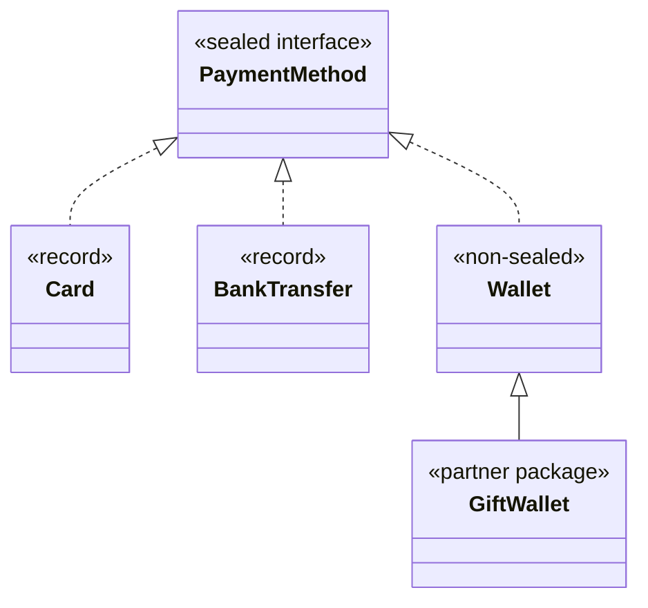

# 2.5.2. Permitted and Non-Permitted Subclasses in Sealed Classes and Interfaces

The billing library seals `PaymentMethod` to cards, bank transfers and wallets, so its fee switch
needs no `default` (unit 1.5.4). A partner team asks for its own gift wallet, which by contract
carries no fee. Someone removes `final` from `Wallet` and the build fails. A colleague adds one word
and it compiles. What does the fee switch charge the gift wallet now?

## Every Permitted Subclass Says Whether the Hierarchy Goes On: final, sealed or non-sealed

`Wallet` is in the `permits` list and implements the interface, and still fails:

```java
sealed interface PaymentMethod permits Card, Wallet {}
final class Card implements PaymentMethod {}
class Wallet implements PaymentMethod {}
```

```text
NoModifier.java:3: error: sealed, non-sealed or final modifiers expected
class Wallet implements PaymentMethod {}
^
1 error
```

javac has no default here. Open by default, one forgotten word would let any class extend
`Wallet`, and a switch over `PaymentMethod` could meet types nobody listed. Final by default, a
class meant as an extension point would be shut without anyone deciding it. So the author picks
one:

- `final`: the branch ends here;
- `sealed`, with its own permitted list: the branch goes on, closed;
- `non-sealed`: anyone may extend this class.

`non-sealed` is allowed only on a class or interface that has a sealed direct supertype. On any
other class javac refuses it with `non-sealed modifier not allowed here`.

### Records and Enums Are Already final, or sealed

A record is implicitly final, so `record Voucher(String code) implements PaymentMethod {}` needs no
modifier. Writing `final record` is allowed and redundant; `non-sealed record` doesn't even parse.
An enum is implicitly final. If a constant has a body, the enum is implicitly sealed and permits
the anonymous class of each such constant:

```java
sealed interface PaymentMethod permits Card, Cash {}
final class Card implements PaymentMethod {}
enum Cash implements PaymentMethod {
    EUR { }, USD;
}
```

```text
Cash final=false sealed=true permitted=[class Cash$1]
```

Those are the only anonymous classes a sealed type can have: unit 2.5.1 showed every
other anonymous class refused, and a class declared inside a method fails the same way (`local
classes must not extend sealed classes`). An enum takes neither `final` nor `non-sealed`
(`modifier ... not allowed here`). A permitted interface can be `sealed` or `non-sealed`, never
`final`.

## A sealed Subclass Keeps the Set Closed, but a Switch Needs a Case for It Unless It Is Abstract

Cards split into debit and credit, so `Card` becomes sealed in turn. Pause before the error: which
values can reach this switch without a case?

```java
sealed interface PaymentMethod permits Card, Wallet {}
sealed class Card implements PaymentMethod permits Debit, Credit {}
final class Debit extends Card {}
final class Credit extends Card {}
final class Wallet implements PaymentMethod {}
class Fees {
    static int fee(PaymentMethod m) {
        return switch (m) {
            case Debit d -> 10;
            case Credit c -> 25;
            case Wallet w -> 15;
        };
    }
}
```

```text
NonAbstractSealed.java:8: error: the switch expression does not cover all possible input values
        return switch (m) {
               ^
1 error
```

`new Card()` is a value of neither `Debit` nor `Credit`. The permitted subtypes cover a sealed class
only when it is `abstract` or an interface, so it has no instances of its own. Any of three changes
compiles: `abstract sealed class Card`, `sealed interface Card` (with `Debit` and `Credit` changed
to `implements`), or a `case Card c` after the two subtypes. If `Card` exists only to group the
two, make it abstract. A `default` also compiles, but then a new subtype no longer breaks the build
(unit 1.5.4).

## non-sealed Reopens One Branch, and Subtypes Nobody Listed Arrive Through Its Case

The word the colleague added was `non-sealed`, on `Wallet`:

```java
package billing;

public final class Billing {
    public sealed interface PaymentMethod permits Card, BankTransfer, Wallet {}
    public record Card(String last4) implements PaymentMethod {}
    public record BankTransfer(String iban) implements PaymentMethod {}
    public static non-sealed class Wallet implements PaymentMethod {}

    /** Fee in basis points (hundredths of a percent). */
    public static int basisPoints(PaymentMethod m) {
        return switch (m) {
            case Card c -> 290;
            case BankTransfer t -> 80;
            case Wallet w -> 190;
        };
    }
}
```

The partner compiles `public class GiftWallet extends Wallet` in its own package, against the
library jar, and charges three payments:

```text
Card -> 290 bp
Wallet -> 190 bp
GiftWallet -> 190 bp
Wallet.isSealed(): false, getPermittedSubclasses(): null
```

The gift wallet is a `Wallet`, so `case Wallet w` takes it and charges 190 bp, a fee its contract
excludes. Unit 1.5.4 showed that adding a type to a
`permits` list stops every switch without a `default`, and throws `MatchException` in code that
wasn't rebuilt. Neither happens here: the switch is still exhaustive, because every possible
subtype of `Wallet`, known or not, is a `Wallet`.



The root stays sealed: a class still can't implement `PaymentMethod` directly. Below `Wallet`, the
hierarchy is as open as any class: a switch over `Wallet` that names its subtypes also needs a
`case Wallet w` or a `default`.

The wallet arm must charge through something a subtype can override, a `feeBasisPoints()`
method on `Wallet`, or the library must keep `Wallet` final and add the gift wallet itself.

<!-- practice 1 -->

## Permitted Subclasses Live in the Sealed Type's Module, or in Its Package When There Is No Module

The library team moves `Wallet` to `billing.wallets` and compiles on the classpath:

```text
src/billing/PaymentMethod.java:3: error: class PaymentMethod in unnamed module cannot extend a sealed class in a different package
public sealed interface PaymentMethod permits Card, billing.wallets.Wallet {}
                                                                   ^
1 error
```

javac's wording names the sealed type, but the rule is about where `Wallet` lives. The same three files, with a `module-info.java` that makes them one named module, compile without
an error. In a named module the permitted subclasses may sit in any of its packages; on the
classpath they share the sealed type's package.

A sealed type and its permitted subclasses can't be split across modules; a class below a
`non-sealed` one, like the partner's gift wallet, can live anywhere. `PaymentMethod` names `Wallet`, so its module must read the
wallets module, and `Wallet` implements `PaymentMethod`, so the wallets module must read the core:
javac reports `cyclic dependence involving billing.wallets`. Without the `requires`, it reports
`package billing.wallets is not visible`.

The JVM checks the module too, as it checks the list in unit 2.5.1. We compiled the hierarchy as
one module, then ran it with `Wallet` in a module of its own, `billing.wallets`:

```text
Exception in thread "main" java.lang.IncompatibleClassChangeError: class billing.wallets.Wallet cannot implement sealed interface billing.PaymentMethod
```

> **The JVM's rule is looser than javac's.** At load time it checks the `permits` list and the
> module, and the package only for a subclass that isn't `public`. The same class files, run on
> the classpath with `Wallet` public and in its own package, loaded without an error.

<!-- practice 2 -->

## Summary

- **Every permitted subclass is `final`, `sealed` or `non-sealed`.** javac has no default; records
  are final already, and an enum is final, or sealed when a constant has a body.
- **A `sealed` subclass keeps the set closed**, but a switch covers it through its subtypes only
  when it is abstract or an interface; otherwise it needs its own case.
- **`non-sealed` reopens one branch.** The root switch stays exhaustive, and every unknown subtype
  arrives through that branch's case, with no compile error and no `MatchException`.
- **Permitted subclasses share the sealed type's module**, or its package on the classpath; the
  JVM checks the list and the module again at load time.

## Reference

**What a permitted subtype may declare (javac 21):**

| Permitted subtype | Allowed | Implicit |
|---|---|---|
| class | `final`, `sealed`, `non-sealed` | none: `sealed, non-sealed or final modifiers expected` |
| interface | `sealed`, `non-sealed` | none; `final` is `illegal combination of modifiers: interface and final` |
| record | `final` (redundant) | final |
| enum | none | final; sealed if a constant has a body |
| anonymous or local class | not allowed | — |

**Where a permitted subclass may be declared:**

| Sealed type in | javac accepts a subclass in | JVM refuses to load a subclass |
|---|---|---|
| the unnamed module (classpath) | the same package | not in the `permits` list, or not `public` and in another package |
| a named module | any package of the same module | not in the list, or in another module |

## Challenges

1. `Wallet` is `non-sealed` and three partners extend it. You want the fee switch to break the
   build when a fourth arrives. What would you change, and what does each partner have to do?
2. A sealed `Card` class has instances of its own today. List what changes, in the library and in
   every switch over `PaymentMethod`, if you make it abstract.
3. The billing team wants to ship `PaymentMethod` in one jar and the wallets in another, both on
   the module path. What has to change, and what does the split cost the next release?

## Design Note: Why the Subclass, Not the Root, Decides What Is Open

`permits` controls one level. Without a modifier on each subclass, a sealed root would close only
its direct children, and any of them could be extended freely below. Java makes each level state
its choice, so reading one declaration tells you whether the hierarchy goes on below it, and the
compiler can trust a `final` or `sealed` branch when it checks a switch.

`non-sealed` is the way to say "extension point" in the same vocabulary, and the exhaustiveness
check over the sealed root stops at that class.

## Code Examples

- Test: [SealedClassExampleTest.java](src/test/java/com/github/msorkhpar/claudejavatutor/sealedclasses/SealedClassExampleTest.java)
- Source: [SealedClassExample.java](src/main/java/com/github/msorkhpar/claudejavatutor/sealedclasses/SealedClassExample.java)