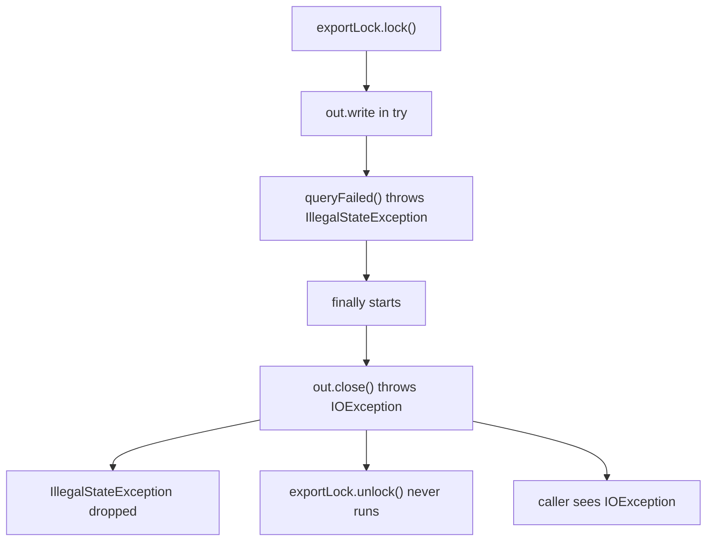

# 3.1.3 The finally block for cleanup operations

The nightly settlement export fails at 02:10. The alert reads
`java.io.IOException: flush failed: No space left on device`, thrown by the `finally` that closes the
report writer. The real failure, a query that timed out, is in no log, and the next night's export
blocks on an export lock that was never released.

## finally Runs on Every Way Out of try: return, break, continue or a Throw

This loop leaves its `try` five ways, counting the normal end:

```java
static String firstCsv(List<String> files) {
    for (String f : files) {
        try {
            if (f.startsWith(".")) continue;          // skip hidden files
            if (f.endsWith(".csv")) return f;
            if (f.equals("STOP")) break;
            if (f.isEmpty()) throw new IllegalArgumentException("empty name");
        } finally {
            System.out.println("  finally after " + (f.isEmpty() ? "\"\"" : f));
        }
    }
    return null;
}
```

```text
  finally after .tmp
  finally after notes.txt
  finally after rates.csv
returned rates.csv
  finally after notes.txt
  finally after STOP
returned null
  finally after notes.txt
  finally after ""
threw empty name
```

The compiler copies the `finally` code onto every path out of the `try`: the normal end, each
`return`, `break` and `continue`, and an exception of any type (`javap -c` shows five copies of the
`println` in `firstCsv`).

Cleanup written anywhere else misses a path. A quote service counts calls in flight and refuses new
ones at 200. If the decrement sits after the backend call, every failed call leaks one; add it to a
`catch (IOException e)` as well, and every `NullPointerException` still leaks one. After an outage of a few minutes
the gauge stays at 200 and the service refuses every request with nothing running. Unit 6.3.1
applies the same rule to `unlock()`.

## A return in finally Throws Away the Exception and the try's Result

```java
static int rowsImported(String file) {        // no throws clause, and javac accepts it
    int rows = 0;
    try {
        rows = importRows(file);              // throws IOException at row 4120
    } finally {
        return rows;
    }
}

static int version() {
    try {
        return 1;
    } finally {
        return 2;
    }
}
```

```text
rowsImported(prices-0611.csv) = 0
version() = 2
```

The file was corrupt; the caller got 0 and no error, so its retry on `IOException` never ran. When `finally` ends with `return`, `break`, `continue` or a throw
of its own, that ending replaces the `try`'s: the pending exception or return value is dropped.
javac warns only when the `finally` lint is on (`-Xlint:finally` or `-Xlint`):

```text
ReturnInFinally.java:16: warning: [finally] finally clause cannot complete normally
```

<!-- practice 1 -->

## A return Fixes Its Value Before finally Runs, but the Object Can Still Change

A metrics buffer hands its lines to a collector every ten seconds and starts a new batch:

```java
static int attemptsSoFar() {
    try {
        return attempts;
    } finally {
        attempts = 0;                       // reset for the next window
    }
}

static List<String> drain() {
    try {
        return pending;
    } finally {
        pending.clear();                    // start the next batch
    }
}
```

```text
attemptsSoFar() = 3, attempts now 0
drain() = []
```

`return attempts` copied the value 3 before `finally` ran, so the reset didn't reach the caller.
`return pending` copied a reference, and `clear()` emptied the list it points to, so every batch the
collector got was empty. Reassigning the field leaves the
returned list alone:

```java
static List<String> drainFixed() {
    try {
        return pending;
    } finally {
        pending = new ArrayList<>();        // a new list; the returned one is untouched
    }
}
```

```text
drainFixed() = [cpu=0.55, heap=0.47], pending now []
```

<!-- practice 2 -->

## An Exception From finally Replaces the One in Flight and Skips the Cleanup After It

The export from the opening:

```java
static void export(ReportWriter out) throws IOException {
    exportLock.lock();
    try {
        out.write("header");
        queryFailed();                      // IllegalStateException: query timed out
    } finally {
        out.close();                        // IOException: No space left on device
        exportLock.unlock();
    }
}
```

```text
caller sees: java.io.IOException: flush failed: No space left on device
export lock still held: true
```

The `IOException` from `close()` replaced the `IllegalStateException`, which survives as neither
cause nor suppressed. It also ended the `finally`, so `unlock()` never ran, and the next export, on another thread, waits for the lock forever.



Each cleanup step that can fail needs its own `try`, and its failure is attached to the original
with `addSuppressed`:

```java
static void exportFixed(ReportWriter out) throws IOException {
    exportLock.lock();
    Throwable primary = null;
    try {
        out.write("header");
        queryFailed();
    } catch (Throwable t) {
        primary = t;
        throw t;
    } finally {
        try {
            out.close();
        } catch (Throwable e) {
            if (primary == null) throw e;
            primary.addSuppressed(e);
        } finally {
            exportLock.unlock();
        }
    }
}
```

```text
java.lang.IllegalStateException: settlement query timed out after 30 s
	at Replaced.queryFailed(Replaced.java:16)
	at Replaced.exportFixed(Replaced.java:35)
	at Replaced.main(Replaced.java:62)
	Suppressed: java.io.IOException: flush failed: No space left on device
		at Replaced$ReportWriter.close(Replaced.java:12)
		at Replaced.exportFixed(Replaced.java:41)
		... 1 more
export lock still held: false
```

When only `close()` fails, it is rethrown: a writer that couldn't flush lost rows, and swallowing
that reports a file as complete when it isn't.

<!-- practice 3 -->

## finally Runs Only When the Thread Leaves try: exit, halt and a Killed JVM Skip It

Each case runs in its own JVM: a shutdown hook prints `hook ran`, and a thread sleeps inside a `try`
whose `finally` prints `finally ran`:

```text
System.exit(0) in try:     exit   0  hook ran
halt(0) in try:            exit   0  (nothing)
main ends, daemon in try:  exit   0  hook ran
SIGTERM while in try:      exit 143  hook ran
SIGKILL while in try:      exit 137  (nothing)
interrupt() while in try:  exit   0  interrupted, finally ran, hook ran
```

`finally` runs when the thread leaves the `try`. `System.exit` and a SIGTERM start the JVM's
shutdown: hooks run, then the JVM halts every thread where it is; per the `Runtime` javadoc,
"`finally` clauses are not executed". When the last non-daemon thread ends, the same happens to
daemon threads.
`halt` and SIGKILL skip the hooks too. An interrupt is the one case here that runs `finally`: it
ends the `sleep` with an exception, and the thread leaves `try` the ordinary way.

A lock file or temp file cleaned up only in `finally` is left behind by every deploy whose SIGTERM
arrives while a thread is in that `try`. Cleanup that must survive shutdown goes in a shutdown hook that stops the work and waits
for it (unit 6.4.1), and startup must cope with what a SIGKILL leaves.

<!-- practice 4 -->

## Summary

- **`finally` runs on every way out of `try`.** Cleanup after the block, or in a `catch`, misses
  the paths it wasn't written for.
- **A `return` in `finally` discards the exception and the result.** javac warns only with
  `-Xlint:finally` or `-Xlint`.
- **`return` fixes its value before `finally` runs.** Reassigning the variable doesn't change the
  result; mutating the object it refers to does.
- **An exception from `finally` replaces the one in flight and ends the `finally`.** Give each
  failing cleanup step its own `try`, attach its failure with `addSuppressed`, and release
  locks in an inner `finally`.
- **`finally` needs the thread to leave `try`.** `System.exit`, SIGTERM, `halt` and SIGKILL skip
  it, and so does JVM exit for a daemon thread still in `try`.

## Reference

**What reaches the caller (Java 21, ran):**

| `try` | `catch` | `finally` | Caller gets |
|---|---|---|---|
| returns 1 | | returns 2 | 2 |
| throws A | | returns, `break`s or `continue`s | no exception; `finally`'s return or jump wins |
| throws A | | throws C | C; A is lost |
| throws A | throws B (cause A) | throws C | C, with no cause and no suppressed |
| throws A | rethrows A | completes | A, after `finally` ran |

## Challenges

1. A job holds a lock, a temp file and a database connection. Write its cleanup by hand so that
   each is released when any other release fails. How many nested `try` blocks did it take?
2. Your service gets SIGTERM, and a request is in the middle of a two-phase write. What should the
   shutdown hook wait for, and for how long?
3. Turn on `-Xlint:finally` in a codebase you know. What does it find?

## Design Note: Why Cleanup Is a Block of Code

C++ releases a resource in a destructor that runs when its owning object goes out of scope. Java
objects have no such moment, so Java put cleanup in the method that acquires the resource, as a
block the compiler copies onto every exit path. The release sits next to the acquisition, but each caller
rewrites it, in order, with nested handling for each failing step.
Try-with-resources (unit 3.1.4) moved that code into the compiler for anything `AutoCloseable`;
`finally` stays for what is not a resource object: a lock, a gauge, a flag.

## Code Examples

- Test: [FinallyBlockDemoTest.java](src/test/java/com/github/msorkhpar/claudejavatutor/trycatch/FinallyBlockDemoTest.java)
- Source: [FinallyBlockDemo.java](src/main/java/com/github/msorkhpar/claudejavatutor/trycatch/FinallyBlockDemo.java)