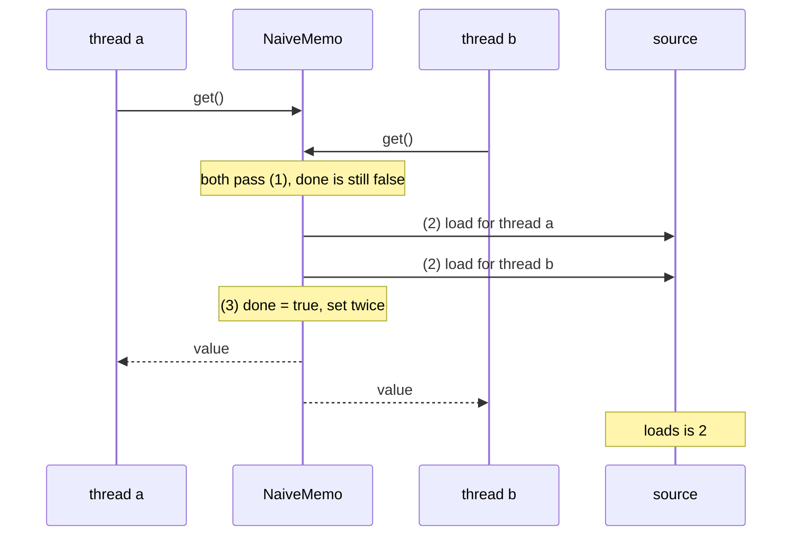

# 4.2.2. Supplier — Supplying Values On-Demand

The pricing service builds one `Supplier<RateTable>` at startup and hands it to every request
handler, "so the rate table loads lazily, once". The database dashboard shows the rates query
running 1,200 times a minute, about once per request. No handler calls the query directly.

Six rules, one per heading, say what `Supplier<T>` and its one method, `T get()`, promise and what
they don't.

## A Supplier Runs Its Body on Every get() and Remembers Nothing

Wrapping a computation in a `Supplier` defers it to `get()`, and runs it on every `get()`. The
code below calls `get()` three times. How many queries reach the database?

```java
Supplier<RateTable> rates = () -> loadRates();      // loadRates() runs the SELECT and counts it in queries
System.out.println("after creating the supplier: " + queries.get() + " queries");
RateTable a = rates.get();
RateTable b = rates.get();
RateTable c = rates.get();
System.out.println("after three get() calls:     " + queries.get() + " queries");
System.out.println("same object each time:       " + (a == b && b == c));
```

```text
after creating the supplier: 0 queries
after three get() calls:     3 queries
same object each time:       false
```

Creating the lambda ran nothing; each `get()` ran the body again and returned a new table. The
interface has no field to keep a result in, and its javadoc says there is "no requirement that a
new or distinct result be returned each time the supplier is invoked". So every handler's `get()`
paid for the query, and two `get()` calls in one method worked on two different tables. Code that
wants the result once calls `get()` once and keeps the value, or wraps the supplier in a memo.

## A Memo Written as Check-Then-Compute Loads Twice When Two Threads Arrive Together

The obvious memo keeps the result in a field. Spot the problem:

```java
import java.util.function.Supplier;

final class NaiveMemo<T> implements Supplier<T> {
    private final Supplier<T> source;
    private boolean done;
    private T value;

    NaiveMemo(Supplier<T> source) { this.source = source; }

    @Override
    public T get() {
        if (!done) {                 // (1)
            value = source.get();    // (2)
            done = true;             // (3)
        }
        return value;
    }
}
```

On one thread it loads once. At startup many handler threads ask for the table together, and two
can pass (1) before either reaches (3); both then run (2). The test below forces that without
sleeps. `race(name, memo)` wraps a load in `memo`, here `NaiveMemo::new`, and calls it from two
threads. The load counts itself in `loads`, then waits (up to a second) on a latch until the other
caller is inside the load too, as a slow query would.

```java
CountDownLatch bothInside = new CountDownLatch(2);
Supplier<String> rates = memo.apply(() -> {
    int load = loads.incrementAndGet();
    bothInside.countDown();
    try {
        bothInside.await(1, TimeUnit.SECONDS);   // the load takes a while: wait for the other caller
    } catch (InterruptedException e) {
        Thread.currentThread().interrupt();
    }
    return "rates#" + load;
});
String[] seen = new String[2];
Thread a = new Thread(() -> seen[0] = rates.get());
Thread b = new Thread(() -> seen[1] = rates.get());
a.start(); b.start();
a.join(); b.join();
System.out.printf("%-8s loads: %d, callers saw %s and %s%n", name, loads.get(), seen[0], seen[1]);
```

```text
naive    loads: 2, callers saw rates#1 and rates#2
```



The pair of tables varies from run to run (`rates#1 and rates#1` also came up), because which
write to `value` each thread reads last is a race too. On a cold start every thread that arrives
during the first load runs its own, which a rate-limited upstream rejects, and two requests in the
same second can price from two versions of the table.

A memo whose `get()` runs `cached.compareAndSet(null, source.get())` on an `AtomicReference` and
returns `cached.get()` fixes only the inconsistency: in the same test both callers always saw the
same table, and the load still ran twice.

## A Safe Memo Chooses What It Pays: a Lock, Class Initialisation, or Startup Time

Three forms load exactly once.

**Double-checked locking.** The first check skips the lock once the value exists. The second,
under the lock, stops a thread that waited for the lock from loading again:

```java
import java.util.function.Supplier;

final class LockedMemo<T> implements Supplier<T> {
    private final Supplier<T> source;
    private volatile boolean done;           // written after value, so a reader that sees true sees value
    private T value;

    LockedMemo(Supplier<T> source) { this.source = source; }

    @Override
    public T get() {
        if (!done) {                         // once loaded, no lock is taken
            synchronized (this) {
                if (!done) {                 // a caller that waited for the lock finds it loaded
                    value = source.get();    // if this throws, done stays false and the next call retries
                    done = true;
                }
            }
        }
        return value;
    }
}
```

The same test, with `LockedMemo::new`:

```text
locked   loads: 1, callers saw rates#1 and rates#1
```

The second caller blocked on the lock until the first load finished (after its one-second latch
timeout), then found `done` set. Without `volatile`, the first check would read `done` with no
lock and no ordering, and a reader could see `done == true` before it sees the write to `value`
(reordering is unit 5.1.4). The separate `done` flag also lets the memo
keep a `null` result; a memo that tests `value == null` loads again on every call when the source
returns `null`.

**The holder class.** For a value that belongs to a class rather than an object, the JVM already
has a lock that runs code once: class initialisation. A nested class is initialised the first time
it is used, and every other thread that uses it meanwhile waits for that to finish:

```java
final class Rates {
    static boolean databaseUp = false;

    static String loadRates() {
        if (!databaseUp) throw new IllegalStateException("database unavailable");
        return "rates";
    }

    private static final class Holder {
        static final String TABLE = loadRates();   // runs once, on the first table() call
    }

    static String table() { return Holder.TABLE; }
}
```

No lock, no `volatile`, and later reads are plain field reads. The price comes on failure. With the
database down we call `Rates.table()` and a `LockedMemo` of `Rates::loadRates`, then bring the
database back and call both again:

```text
holder, 1st: java.lang.ExceptionInInitializerError
locked, 1st: java.lang.IllegalStateException: database unavailable
holder, 2nd: java.lang.NoClassDefFoundError: Could not initialize class Rates$Holder
locked, 2nd: rates
```

A class whose initialiser threw is marked as failed, and the JVM never runs it again. Every later
`table()` throws `NoClassDefFoundError` until the process restarts, so a database that was down
for one second at startup takes the service down until someone redeploys.

**Computing eagerly.** A `final` field set in the constructor, or a `static final` field, needs no
memo: the value exists before any thread can ask for it. It pays when the object or class is
created, usually at startup, even in deployments that never read the table, and a failed load fails
there too. That is often what you want, since a service that can't price shouldn't accept requests.

Choose by what a failure should do. A value the service can't work without is loaded eagerly and
fails the startup. A value that is optional, or whose source may recover, goes behind double-checked
locking. The holder class fits a static value whose load can't fail, or whose failure should end
the process anyway.

<!-- practice 1 -->

## The JDK Takes a Supplier Where the Work May Not Be Needed

Several JDK methods take a `Supplier` for a value they need on one path only. The common one is
a null check's message. An order validator builds a detailed message with `describe(order)`,
which formats the whole order and counts itself in `built`:

```java
for (Order o : orders) Objects.requireNonNull(o.customer(), describe(o));
System.out.println("String message:   built " + built.getAndSet(0) + " times for 3 valid orders");

for (Order o : orders) Objects.requireNonNull(o.customer(), () -> describe(o));
System.out.println("Supplier message: built " + built.getAndSet(0) + " times for 3 valid orders");

try {
    Order bad = new Order("A-4", null);
    Objects.requireNonNull(bad.customer(), () -> describe(bad));
} catch (NullPointerException e) {
    System.out.println("on the null one:  built " + built.get() + ", " + e.getMessage());
}
```

```text
String message:   built 3 times for 3 valid orders
Supplier message: built 0 times for 3 valid orders
on the null one:  built 1, order A-4 has no customer: Order[id=A-4, customer=null]
```

Java evaluates arguments before the call, so the `String` overload formats a message for every
valid order. The `Supplier` overload builds one only when the check fails: two messages instead of
a million for a validator that runs a million times an hour and fails twice. The javadoc warns
that the supplier has a cost too: this lambda captures `o`, so creating it is an allocation, and
for a constant message the `String` overload costs less.

`Optional.orElseThrow(Supplier)` does the same for an exception: on a hit the supplier never runs,
and no exception, with its stack trace, is created. `Optional.orElse` against `orElseGet`, and
loggers that take a `Supplier<String>`, follow the same idea; unit 4.1.4 runs both.
`CompletableFuture.supplyAsync(Supplier)` is a different use: it calls `get()` later, on a pool
thread (concurrency is part 6).

<!-- practice 2 -->

## A Factory Supplier Must Return a New Object on Every Call

The other use is a factory: the method calls `get()` each time it needs a fresh object.
`Collectors.toCollection` takes one, and `TreeSet::new` makes a new sorted set per group. A sales
report groups SKUs by region; the second version passes a lambda that returns a list it already
made:

```java
List<Sale> sales = List.of(new Sale("north", "kettle"), new Sale("south", "toaster"),
        new Sale("north", "blender"), new Sale("south", "kettle"));

Map<String, TreeSet<String>> fresh = sales.stream().collect(Collectors.groupingBy(Sale::region,
        Collectors.mapping(Sale::sku, Collectors.toCollection(TreeSet::new))));

List<String> shared = new ArrayList<>();
Map<String, List<String>> same = sales.stream().collect(Collectors.groupingBy(Sale::region,
        Collectors.mapping(Sale::sku, Collectors.toCollection(() -> shared))));
```

```text
TreeSet::new     {south=[kettle, toaster], north=[blender, kettle]}
() -> shared     {south=[kettle, toaster, blender, kettle], north=[kettle, toaster, blender, kettle]}
```

`groupingBy` called the supplier once per region and added each sale to the list it got back.
Both regions got the same list, so each shows every sale. Nothing failed: it compiles, and with
one region in the test data the output is right.

`ThreadLocal.withInitial(Supplier)` is a factory on another schedule: it calls the supplier on a
thread's first `get()` and keeps the result for that thread.

```java
ThreadLocal<SimpleDateFormat> fmt = ThreadLocal.withInitial(() -> {
    formatters.incrementAndGet();
    return new SimpleDateFormat("yyyy-MM-dd");
});
Runnable work = () -> { for (int i = 0; i < 1000; i++) fmt.get(); };
Thread t1 = new Thread(work), t2 = new Thread(work);
t1.start(); t2.start(); t1.join(); t2.join();
System.out.println("withInitial: 2 threads x 1000 get() -> " + formatters.get() + " formatters");
```

```text
withInitial: 2 threads x 1000 get() -> 2 formatters
```

`SimpleDateFormat`'s javadoc says it isn't synchronized and recommends an instance per thread,
which is what the supplier gives, as long as it returns a new one.

`Stream.generate(Supplier)` calls `get()` once per element, and its javadoc calls the stream it
returns "infinite". Only a short-circuiting step such as `limit` ends it:

```java
Supplier<String> ids = () -> "id-" + calls.incrementAndGet();
System.out.println("limit(3)         " + Stream.generate(ids).limit(3).toList() + ", calls: " + calls.get());
calls.set(0);
Thread counting = new Thread(() -> System.out.println(Stream.generate(ids).count()));
counting.setDaemon(true);
counting.start();
counting.join(1000);
System.out.println("count() with no limit: still running after 1 s: " + counting.isAlive()
        + ", calls so far: " + calls.get());
```

```text
limit(3)         [id-1, id-2, id-3], calls: 3
count() with no limit: still running after 1 s: true, calls so far: 81065068
```

Without `limit`, `count()` has no point at which it would stop.

<!-- practice 3 -->

## IntSupplier and Its Siblings Return Primitives and Are Not Suppliers

`IntSupplier`, `LongSupplier`, `DoubleSupplier` and `BooleanSupplier` return primitives
(`getAsInt()` and so on). They are separate interfaces,
not subtypes of `Supplier`, so one doesn't go where the other is expected. With
`static int sum(Supplier<Integer> s)`:

```java
AtomicInteger seq = new AtomicInteger();
IntSupplier next = seq::incrementAndGet;
System.out.println(IntStream.generate(next).limit(3).sum());
// sum(next);                      // does not compile: IntSupplier is not a Supplier<Integer>
System.out.println(sum(next::getAsInt));
```

The two `println` calls print `6` and `9`. Uncommenting `sum(next)`:

```text
Primitives.java:13: error: incompatible types: IntSupplier cannot be converted to Supplier<Integer>
```

A method reference adapts one to the other, `next::getAsInt`, and boxes each value on the way.
`BooleanSupplier`
suits a switch read when asked, such as a feature flag. When the boxing matters is unit 4.1.3's
subject.

<!-- practice 4 -->

## Summary

- **A `Supplier` runs its body on every `get()` and keeps nothing.** Wrapping a load in one defers
  it; it doesn't make it happen once.
- **A check-then-compute memo loads twice under contention**, and the `compareAndSet` memo keeps
  one result but still loads twice.
- **A safe memo chooses its cost.** Double-checked locking needs `volatile` and retries after a
  failure; the holder class needs no code but turns one failed load into `NoClassDefFoundError`
  until restart; loading eagerly pays, and fails, at startup.
- **The JDK takes a `Supplier` for work it may skip**: `requireNonNull`'s message,
  `orElseThrow`'s exception.
- **A factory supplier returns a new object per call.** `() -> shared` makes every group or thread
  share one object; `Stream.generate` never ends without `limit` or another short-circuit.
- **Primitive suppliers are separate interfaces**, adapted with a method reference.

## Reference

**JDK methods that take a `Supplier`** (from the javadoc):

| Method | When it calls `get()` |
|---|---|
| `Objects.requireNonNull(T, Supplier<String>)` | only when the object is `null` (Java 8) |
| `Objects.requireNonNullElseGet(T, Supplier<? extends T>)` | only when the object is `null` (Java 9) |
| `Optional.orElseGet(Supplier)`, `orElseThrow(Supplier)` | only when empty (Java 8) |
| `Optional.or(Supplier<Optional>)` | only when empty (Java 9) |
| `ThreadLocal.withInitial(Supplier)` | on each thread's first `get()`, and again after `remove()` |
| `Collectors.toCollection(Supplier)` | each time it needs a new collection (once per group under `groupingBy`) |
| `Stream.generate(Supplier)` | once per element, without end |
| `CompletableFuture.supplyAsync(Supplier)` | once, asynchronously (by default in the common pool) |

**Memo forms** (Java 21, run in this unit):

| Form | Loads when two threads arrive together | After a failed load | Cost or limit |
|---|---|---|---|
| check-then-compute, no lock | 2 | retries | none, and wrong |
| `AtomicReference.compareAndSet` | 2, one kept | retries | none |
| double-checked locking, `volatile` | 1 | retries | a lock until loaded |
| holder class | 1 | `NoClassDefFoundError` until restart | static values only |
| eager instance field | 1, before any caller | the constructor throws | paid at startup |
| eager `static final` field | 1, before any caller | like the holder class | paid when the class is first used |

**Primitive suppliers:** `BooleanSupplier.getAsBoolean()`, `IntSupplier.getAsInt()`,
`LongSupplier.getAsLong()`, `DoubleSupplier.getAsDouble()`; none extends `Supplier`.

## Challenges

1. A memo holds a token that expires after an hour. Extend `LockedMemo` to reload it, and decide
   what callers get while one thread reloads: the old token, or a wait.
2. The upstream allows one rate-table request per second. Measure how many loads each memo form
   makes when 200 threads start together, and how long the slowest caller waits.
3. Your library takes a `Supplier<Connection>` from its caller. Write down, in its javadoc, how
   often you call `get()` and whether the caller may return the same object each time.

## Design Note: Why Supplier Has No memoize()

`Function` has `andThen` and `Predicate` has `and`, but `Supplier` has no default methods at all,
and Java 21's JDK has no memoizing supplier. A memo has to settle what this page shows has no single
answer: whether a failure is remembered or retried, whether `null` is a value, whether a waiting
caller blocks, and whether the value ever expires. The JDK left those choices to the caller; the
cost is that each codebase writes its own memo.

## Code Examples

- Source: [SupplierDemo.java](src/main/java/com/github/msorkhpar/claudejavatutor/functionalinterfaces/SupplierDemo.java)
- Test: [SupplierDemoTest.java](src/test/java/com/github/msorkhpar/claudejavatutor/functionalinterfaces/SupplierDemoTest.java)
