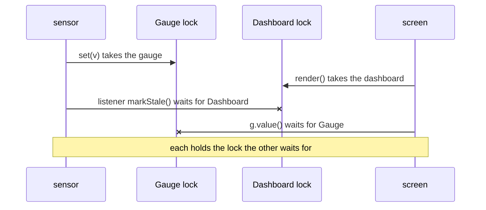

# 5.3.4. Best Practices for Safe Concurrent Programming

A monitoring dashboard froze during Monday's peak, and the on-call engineer took a thread dump
before restarting it. Two threads were `BLOCKED`: `sensor` in `Dashboard.markStale` and `screen`
in `Gauge.value`, each waiting for a monitor the other held. `Gauge` and `Dashboard` each have one
lock, each passed review on its own, and neither nests two `synchronized` blocks. The post-mortem
went through the service class by class with two questions: which threads touch this state, and
what guards it? For half the classes nobody could answer.

Most of what makes concurrent code safe is decided before the first lock: whether the state is
shared at all, whether what is shared can change, and, for the state that is left, which lock
guards it and what runs while it is held. Every output here is from Java 21 on a 20-core machine.

## State Confined to One Thread Needs No Lock, Until a Callback Runs Somewhere Else

A local variable is confined
to its thread as long as the object it refers to isn't handed to another (unit 4.4.4 shows a
parallel stream doing exactly that). State that outlives one call gets an owner: a trading service
keeps its positions in a plain `HashMap` that only the `ledger` thread, a single-thread executor,
reads or writes. Other threads don't lock the map; they submit tasks to `ledger`.

A task on the ledger thread books a trade at the current rate, which the rate service returns as a
`CompletableFuture`. `update` merges the rate into the positions and prints the name of the thread
it runs on; `answer` is a latch the program releases once the callback is attached:

```java
ledger.submit(() -> {                                      // a task on the ledger thread
    CompletableFuture<Long> rate = fetchRate("EUR/USD", cached, answer);
    switch (how) {
        case "thenAccept" -> rate.thenAccept(update);
        case "thenAcceptAsync" -> rate.thenAcceptAsync(update);
        default -> rate.thenAcceptAsync(update, ledger);
    }
}).get();
```

Pause here: which thread runs `update`? A cached rate is a future that is already complete; a
fetched one is completed later by a thread of the `io` pool:

```text
thenAccept                   cached  update ran on: ledger
thenAccept                   fetched update ran on: io
thenAcceptAsync              fetched update ran on: ForkJoinPool.commonPool-worker-1
thenAcceptAsync(.., ledger)  cached  update ran on: ledger
thenAcceptAsync(.., ledger)  fetched update ran on: ledger
```

A callback attached with a method that isn't `Async` runs on the thread that completes the future,
or, when the future is already complete, right away on the thread that attaches it. (The javadoc
promises less: any thread that calls a completion method may run it.) An `Async`
method without an executor runs it on `ForkJoinPool.commonPool()`. Only the form that names the
owner's executor keeps the update on the owner.

The rate service's test double returned completed futures, so every test ran `update` on the
ledger thread and passed. In production a rate that isn't cached arrives on an `io` thread, which
then writes the `HashMap` while the ledger thread may be writing it too: the unsynchronized map of
unit 6.5.2, in a class whose design says it needs no lock. Hand every result back to its owner
through the owner's executor: `thenAcceptAsync(update, ledger)`. Another thread that needs to
read the positions submits the read the same way, `supplyAsync(read, ledger)`.

<!-- practice 1 -->

## What Passes Between Threads Is Immutable, or Its Sender Never Touches It Again

Confined parts of a program talk through queues, and what travels is a reference. A price feed reuses one tick object to save
allocations:

```java
MutableTick tick = new MutableTick();
for (int i = 0; i < 3; i++) {
    tick.sku = skus[i];
    tick.cents = cents[i];
    queue.put(tick);
}
```

The consumer has fallen behind and takes the three entries after the third `put`. The second run
puts a new `record Tick(String sku, long cents)` each time:

```text
mutable, reused: C-300=899
mutable, reused: C-300=899
mutable, reused: C-300=899
record, new each time: Tick[sku=A-100, cents=1999]
record, new each time: Tick[sku=B-200, cents=4550]
record, new each time: Tick[sku=C-300, cents=899]
```

The queue held three references to one object, and the producer changed it after handing it over.
A `put` happens-before the `take` that removes the element (unit 5.2.2), which covers the writes
made before the `put`, not the ones after. A consumer that keeps up gets something less
predictable than three copies of the last tick: it reads fields the producer may be writing at that
moment, a data race (unit 5.3.1) that can pair one tick's SKU with another's price.

Hand an object over in one of two ways. Send an immutable value, a new record per message
with its collections copied (unit 5.2.3), and "never touched again" holds by construction. Or
transfer ownership: fill a mutable object, put it, and drop every reference to it, allocating a
new one for the next message. Nothing checks the second, so keep it for large buffers you can't
afford to copy.

## A Latch or a Queue Remembers a Signal That wait() Can Miss

`wait()` and `notifyAll()` are correct when every rule of unit 6.2.1 is kept: a condition held in a
field, checked in a loop, under the monitor that is notified. Skip the field and the order of two
threads decides the outcome. At startup the service waits until its cache has loaded, and this
time the loader is quick and notifies before the starter begins to wait:

```java
synchronized (lock) { lock.notifyAll(); }                  // the loader is done
// then, on the starter thread:
synchronized (lock) { lock.wait(); }
```

The same order with a `CountDownLatch`:

```java
CountDownLatch loaded = new CountDownLatch(1);
loaded.countDown();
boolean open = loaded.await(5, TimeUnit.SECONDS);
```

```text
notifyAll() then wait(): starter WAITING after 500 ms
countDown() then await(): true after 2 ms
```

`notifyAll()` wakes the threads that are waiting at that moment and records nothing, so the
starter waits for a notification that has already happened. The latch keeps its count: an
`await()` after the count has reached zero returns at once, and its javadoc adds that actions
before a `countDown()` happen-before the actions after a successful return from `await()` in
another thread. A `BlockingQueue` keeps its
elements, a `Semaphore` its permits (unit 6.3.2), a `Future` its result. Each has the state field,
the loop and the notification already written and tested, so application code uses them instead
of `wait()`.

Three cache loaders count down one latch, and the tax
loader throws first:

```java
Thread loader = new Thread(() -> {
    if (cache.equals("tax")) throw new IllegalStateException("tax service down");
    three.countDown();
}, cache);
```

```text
  tax loader died: tax service down
one loader threw: await(1 s) = false, getCount() = 1
```

Without its timeout the `await` would return only when interrupted. If the service may start with a cache missing,
count down in a `finally` and record the failure where the starter can see it. If it may not, the
failure has to reach the waiter: a `Future` carries the exception to `get()`.

<!-- practice 2 -->

## Write Down Which Lock Guards Each Field, and Let the Code Check It

A lock protects a field only if every access takes it, and the code shows that only to someone who
reads every method. Write the policy where the field is declared. The usual convention is
`@GuardedBy("lock")`, from the annotations of *Java Concurrency in Practice*. The JDK has no such
annotation, so this class declares its own:

```java
import java.lang.annotation.Documented;
import java.lang.annotation.ElementType;
import java.lang.annotation.Retention;
import java.lang.annotation.RetentionPolicy;
import java.lang.annotation.Target;
import java.util.HashMap;
import java.util.List;
import java.util.Map;

/** Seat holds for one performance. Thread-safe: every field below is guarded by lock. */
public class Seats {

    /** The field or method may be used only while holding the named lock. A convention: javac checks nothing. */
    @Documented
    @Retention(RetentionPolicy.CLASS)
    @Target({ElementType.FIELD, ElementType.METHOD})
    @interface GuardedBy { String value(); }

    private final Object lock = new Object();
    @GuardedBy("lock") private final Map<String, String> holder = new HashMap<>();

    public boolean hold(String seat, String customer) {
        synchronized (lock) {
            return holdLocked(seat, customer);
        }
    }

    /** Added months later, for group bookings. */
    public void holdAll(List<String> seats, String customer) {
        for (String seat : seats) holdLocked(seat, customer);    // no lock taken
    }

    @GuardedBy("lock")
    private boolean holdLocked(String seat, String customer) {
        assert Thread.holdsLock(lock) : "holdLocked called without the lock";
        return holder.putIfAbsent(seat, customer) == null;
    }

    public static void main(String[] args) {
        Seats seats = new Seats();
        System.out.println("hold(\"F12\"): " + seats.hold("F12", "Jane Doe"));
        seats.holdAll(List.of("F13", "F14"), "John Roe");
        System.out.println("holdAll(F13, F14): returned");
    }
}
```

`holdLocked` expects its caller to hold `lock` and says so twice: in the annotation for readers,
and in an `assert` for tests. `holdAll` calls it without the lock. javac compiles it without a
warning. Two runs, differing only in `-ea`:

```text
$ java Seats
hold("F12"): true
holdAll(F13, F14): returned
$ java -ea Seats
hold("F12"): true
Exception in thread "main" java.lang.AssertionError: holdLocked called without the lock
	at Seats.holdLocked(Seats.java:35)
	at Seats.holdAll(Seats.java:30)
	at Seats.main(Seats.java:42)
```

Without the check, every single-threaded test passes, and the bug shows only when two group
bookings of the same seats run at the same moment: two `putIfAbsent` calls on a `HashMap` with no lock between
them, and both customers may be told the seat is theirs. With the check, the first test that calls
`holdAll` fails and names the missing lock; Maven Surefire runs tests with `-ea` unless told not
to. Production runs without `-ea`, where the check costs next to nothing.

`Thread.holdsLock` knows only monitors. A class guarded by a `ReentrantLock` asks the lock:

```text
this thread holds it:    Thread.holdsLock(lock) = false, isHeldByCurrentThread() = true
another thread holds it: isLocked() = true, isHeldByCurrentThread() = false
```

`Thread.holdsLock(lock)` asks about the `ReentrantLock` object's monitor, which nobody holds, so
that assertion fails on every correct call. `isLocked()` is true when any thread holds the lock,
so an assertion built on it passes in an unlocked caller whenever some other thread holds it.
`isHeldByCurrentThread()` is the check; its own javadoc shows it in an `assert`. For confined state the assertion names the owner instead:
`assert Thread.currentThread() == ledgerThread`.

The class's Javadoc carries the rest of the policy: whether the class is thread-safe, which thread
owns which state, and any lock that callers must take themselves, as the javadoc of
`Collections.synchronizedList` does for iteration.

> **Static checkers.** Some analysers, such as Error Prone's `GuardedBy` check, read the annotation
> and report an unguarded access at compile time. No such tool was run for this page.

<!-- practice 4 -->

## A Call to Another Object Under Your Lock Adds That Object's Locks to Your Lock Order

Unit 6.2.1 breaks a deadlock between two accounts by always locking the lower id first, which works
when one method takes both locks and can sort them. `Gauge` and `Dashboard` each lock only
themselves:

```java
// Gauge
synchronized void set(long v) {
    value = v;
    for (LongConsumer l : listeners) l.accept(v);        // calls whoever subscribed, lock held
}

synchronized long value() { return value; }

// Dashboard, which subscribes markStale() to every gauge it shows
synchronized void markStale() { stale = true; }

synchronized String render() {
    StringBuilder sb = new StringBuilder();
    for (Gauge g : gauges) sb.append(g.name).append('=').append(g.value()).append(' ');
    stale = false;
    return sb.toString();
}
```

A `sensor` thread sets the gauge a million times while a `screen` thread renders the dashboard a
million times. Pause here: does it finish? After two seconds the program calls
`ThreadMXBean.findDeadlockedThreads()` and prints, for each thread it returns, the method it is
blocked in, the lock it waits for and that lock's owner:

```text
calls under the lock: still running after 2 s; findDeadlockedThreads(): 2 threads
  sensor in Dashboard.markStale, waits for Dashboard held by screen
  screen in Gauge.value, waits for Gauge held by sensor
```

`set` holds the gauge and, through a listener, asks for the dashboard; `render` holds the dashboard
and asks for the gauge. Each second lock is taken one call away, so neither class shows a nested
lock, and the order is set by whoever subscribed at run time.



The fix belongs in the class that calls out: hold the lock for the state, copy what the call needs,
and make the call with no lock held. *Java Concurrency in Practice* calls this an **open call**:

```java
void setOpen(long v) {
    List<LongConsumer> toCall;
    synchronized (this) {
        value = v;
        toCall = List.copyOf(listeners);                 // copy what the call needs...
    }
    for (LongConsumer l : toCall) l.accept(v);           // ...and call with no lock held
}
```

```text
open calls: both threads done in 130 ms
```

`render` still calls `value()` under the dashboard's lock, but a cycle needs both halves, and the
gauge no longer holds its lock while it waits for the dashboard. Each class can vouch only for its
own calls, so each makes the open calls it can: `render` could copy the gauge list under its lock
and read the values after releasing it. The lock is now held only for the gauge's state, the
short critical section whose throughput unit 6.2.1 measures.

With open calls, two `set` calls on different threads can notify in the opposite order to their
writes, so a listener that needs the latest value reads `value()` rather than its argument.

`findDeadlockedThreads()` also finds a cycle of `ReentrantLock`s, which the older
`findMonitorDeadlockedThreads()` doesn't:

```text
ReentrantLock cycle: findDeadlockedThreads() = 2 threads, findMonitorDeadlockedThreads() = null
```

Neither finds a cycle that runs through a `Future` (unit 6.2.1), and in Java 21 the javadoc of
both says cycles that include virtual threads are not found. Both report only what is stuck at the
moment of the call, so `null` doesn't prove the code is free of deadlocks. A test of code that can
deadlock runs it on daemon threads, waits with a timeout, and asks the detector what is stuck
before it fails; a service can run the same check from a watchdog thread and log the stacks.

<!-- practice 3 -->

## Summary

- **State confined to one thread needs no lock, until a callback runs it somewhere else.** A
  non-async callback runs on the thread that completes the future, or on the attaching thread if
  it is already complete; hand results back through the owner's executor.
- **What passes between threads is immutable, or its sender never touches it again.** A queue
  hands over a reference, and its happens-before edge covers only the writes made before the `put`.
- **A latch or a queue remembers a signal that `wait()` can miss.** `notifyAll()` records nothing;
  the library classes keep state, and a latch counts only the `countDown()` calls that happen.
- **Write down which lock guards each field, and let the code check it.** `@GuardedBy` is a
  convention javac ignores; an `assert` of `Thread.holdsLock` or `isHeldByCurrentThread()` makes
  tests catch an unguarded call.
- **A call to another object under your lock adds its locks to your lock order.** Make open calls:
  copy under the lock, call after releasing it; `findDeadlockedThreads()` names a cycle once it has
  formed.

## Reference

**Which thread runs a `CompletableFuture` callback (as observed above, Java 21):**

| Attached with | Runs on |
|---|---|
| `thenAccept`, `thenApply`, `whenComplete` on a pending future | the thread that completes the future (javadoc: or any caller of a completion method) |
| the same, on a future already complete | the thread that attaches it, before the method returns |
| `thenAcceptAsync(fn)`, any `...Async` without an executor | `ForkJoinPool.commonPool()` (javadoc: a new thread per task if its parallelism is below 2) |
| `thenAcceptAsync(fn, executor)` | a thread of `executor` |

**Hand-written handshakes and the classes that replace them:**

| With `wait`/`notify` | Class | What it keeps |
|---|---|---|
| "ready" waited for once | `CountDownLatch` | its count, which can't be reset |
| a bounded buffer | `ArrayBlockingQueue`, `LinkedBlockingQueue` | its elements |
| a result handed from a task | `Future`, `CompletableFuture` | the result or the exception |
| N threads meet before each round | `CyclicBarrier`, `Phaser` | how many have arrived this round |
| at most N threads inside | `Semaphore` | its permits |

**Who holds the lock:**

| Check | True when |
|---|---|
| `Thread.holdsLock(obj)` | the current thread holds `obj`'s monitor; `false` for a `ReentrantLock` taken with `lock()` |
| `ReentrantLock.isHeldByCurrentThread()` | the current thread holds the lock |
| `ReentrantLock.isLocked()` | any thread holds the lock |
| `ReentrantLock.getHoldCount()` | holds by the current thread; `0` if none |

**Deadlock detection (`ThreadMXBean`):**

| Method | Reports |
|---|---|
| `findDeadlockedThreads()` | threads in a cycle of monitors or ownable synchronizers such as `ReentrantLock`; `null` if none |
| `findMonitorDeadlockedThreads()` | threads in a cycle of monitors only; `null` if none |
| either, Java 21 | cycles that include virtual threads are not found |
| `getThreadInfo(ids, depth)` | for each thread, the lock it waits for (`getLockName()`), its owner (`getLockOwnerName()`) and its stack |

## Challenges

These have no single answer.

1. Take a class you know with several `synchronized` methods and write `@GuardedBy` on each field.
   Which field has no single answer, and what does that tell you about the class?
2. The ledger thread owns the positions. A risk report needs a consistent view of all of them every
   second, without stopping the ledger for long. Do you submit a copying task to the ledger, publish
   an immutable snapshot after each trade, or something else? What does each cost at 10,000 trades a
   second?
3. A listener registry delivers with open calls. A listener unsubscribes and then closes a file it
   writes to in `onEvent`; a delivery that copied the list before the unsubscribe still calls it.
   How do you guarantee "no calls after `unsubscribe` returns", and what does it cost the publisher?

## Design Note: Why Java Leaves the Locking Policy to Comments

Every Java object has a monitor, and any code with a reference can lock it. A field and the lock
that guards it are related only by what the author meant, so the compiler can't tell which
`synchronized` block protects which field and can't report the one that's missing. `@GuardedBy`,
assertions and static checkers recover part of that intent after the fact.

The stronger fix is to make the policy structural rather than written: keep the state private in a
class whose every method takes the class's own lock, or behind a single owner thread, so that no
outside code can reach the state any other way. The price is granularity: one lock or one thread
per piece of state serializes work that finer locking could run side by side.

## Code Examples

- Source: [ConcurrencyBestPractices.java](src/main/java/com/github/msorkhpar/claudejavatutor/concurrencypitfalls/ConcurrencyBestPractices.java)
- Test: [ConcurrencyBestPracticesTest.java](src/test/java/com/github/msorkhpar/claudejavatutor/concurrencypitfalls/ConcurrencyBestPracticesTest.java)
