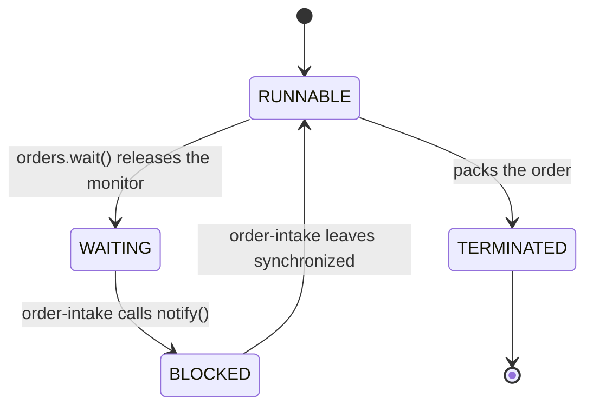

# 6.1.4. Thread Lifecycle and States

At 14:05 the checkout service stops answering. Its admin page counts the request pool's threads
by state: 200 threads, 9 `RUNNABLE`, 191 `WAITING`, 0 `BLOCKED`. The runbook says that no
`BLOCKED` threads means no lock contention and that `WAITING` threads are idle, so the on-call
engineer restarts the service. The next afternoon it happens again.

All 191 threads were waiting for the same `ReentrantLock` around the price cache. Its holder was
one of the 9 `RUNNABLE` threads, stuck in a socket read to a pricing service that had stopped
answering.

## A Tool That Shows What a Thread Dump Shows

Every example prints its threads through this helper. For each thread it prints what a thread
dump would say (the state, the lock the thread waits for and that lock's holder) and the CPU time
the thread used in the 200 ms before the snapshot, because the state alone doesn't say whether the
thread is doing any work.

```java
import java.lang.management.ManagementFactory;
import java.lang.management.ThreadInfo;
import java.lang.management.ThreadMXBean;

/** Prints, for each thread, what a thread dump would say about it, and the CPU it used meanwhile. */
public final class Dump {

    private static final ThreadMXBean MX = ManagementFactory.getThreadMXBean();

    /** Waits 200 ms so the threads reach the call they wait in, then prints one line per thread. */
    public static void print(Thread... threads) throws InterruptedException {
        long[] cpuBefore = new long[threads.length];
        for (int i = 0; i < threads.length; i++) cpuBefore[i] = MX.getThreadCpuTime(threads[i].threadId());
        Thread.sleep(200);
        for (int i = 0; i < threads.length; i++) {
            ThreadInfo info = MX.getThreadInfo(threads[i].threadId());
            if (info == null) {                         // not started, ended, or a virtual thread
                System.out.printf("%-14s %s%n", threads[i].getName(), threads[i].getState());
                continue;
            }
            long cpuMs = (MX.getThreadCpuTime(threads[i].threadId()) - cpuBefore[i]) / 1_000_000;
            String waitsFor = info.getLockInfo() == null ? ""
                    : "  waits for " + simpleName(info.getLockInfo().getClassName())
                      + (info.getLockOwnerName() == null ? "" : " held by " + info.getLockOwnerName());
            System.out.printf("%-14s %-14s cpu %3d ms%s%n",
                    info.getThreadName(), info.getThreadState(), cpuMs, waitsFor);
        }
    }

    private static String simpleName(String className) {
        return className.substring(className.lastIndexOf('.') + 1);
    }
}
```

`ThreadMXBean` is what a JMX-based admin page reads. `jcmd <pid> Thread.print` prints the state
and the lock as text, but names no owner for a thread waiting on a `ReentrantLock`. The examples
also use `daemon(name, body)`, which starts a named daemon thread whose body may throw; `crunch()`,
a few microseconds of arithmetic; `silentPricing()`, a local server that accepts connections and
never answers; and `readPrice(pricing)`, which connects to it and reads. Every output is from
Java 21.

## RUNNABLE Means the JVM Isn't Holding the Thread Back, Not That It Is Using a CPU

One thread calls the silent pricing service, one computes a report, one sleeps between two
retries. Which of them are `RUNNABLE`?

```java
ServerSocket pricing = silentPricing();
Thread call = daemon("price-call", () -> readPrice(pricing));
Thread report = daemon("report", () -> { while (true) crunch(); });
Thread backoff = daemon("retry-backoff", () -> Thread.sleep(60_000));
Dump.print(call, report, backoff);
```

```text
price-call     RUNNABLE       cpu   0 ms
report         RUNNABLE       cpu 210 ms
retry-backoff  TIMED_WAITING  cpu   0 ms
```

The thread waiting for an answer is `RUNNABLE`, like the one that used a whole core. A state
records what the JVM is doing with the thread: when the JVM parks it, in `sleep`, a lock or
`wait`, the state says so. A socket read waits inside the operating system, where the JVM has no
say, so the thread stays `RUNNABLE`. The javadoc says a
`RUNNABLE` thread "may be waiting for other resources from the operating system such as
processor".

The processor is the other resource. On a machine with 20 hardware threads we start 40 threads
that only compute, and print the first three:

```text
20 cores, 40 busy threads:
report-0       RUNNABLE       cpu 111 ms
report-1       RUNNABLE       cpu  78 ms
report-2       RUNNABLE       cpu  67 ms
```

All three are `RUNNABLE`, and in the 200 ms window each got between a third and a little over half
of a core. Java has no "running" state: running, ready to run and stuck in a native call look the
same.

So the 9 `RUNNABLE` threads on the admin page were not the 9 busiest. To see what a `RUNNABLE`
thread is doing, read its top frame: a native socket method such as `SocketDispatcher.read0`,
`Net.poll` (a read with a timeout) or `Net.accept` means it waits for the network. Or compare its
CPU time in two dumps taken a few seconds apart; `jcmd` prints it as `cpu=` on each thread's first
line.

> **Virtual threads differ.** A virtual thread in the same socket call reports `WAITING`, or
> `TIMED_WAITING` when the socket has a read timeout, because it is parked and its carrier thread
> is freed. Neither `ThreadMXBean` nor `jcmd <pid> Thread.print` lists virtual threads;
> `jcmd <pid> Thread.dump_to_file -format=json <file>` does.

<!-- practice 4 -->

## BLOCKED Means Waiting for a synchronized Monitor; a Thread Waiting for a ReentrantLock Is WAITING

The checkout incident at small scale: `price-refresh` takes the price cache's `ReentrantLock`,
then calls the silent pricing service. Two requests want the lock, and a pool worker with no work
waits in `take()`.

```java
ReentrantLock priceLock = new ReentrantLock();
CountDownLatch locked = new CountDownLatch(1);
Thread refresh = daemon("price-refresh", () -> {
    priceLock.lock();
    try {
        locked.countDown();
        readPrice(pricing);
    } finally {
        priceLock.unlock();
    }
});
locked.await();
Thread r1 = daemon("request-1", () -> { priceLock.lock(); priceLock.unlock(); });
Thread r2 = daemon("request-2", () -> { priceLock.lock(); priceLock.unlock(); });
BlockingQueue<Runnable> work = new LinkedBlockingQueue<>();
Thread w1 = daemon("worker-7", () -> work.take().run());
Dump.print(refresh, r1, r2, w1);
```

```text
price-refresh  RUNNABLE       cpu   0 ms
request-1      WAITING        cpu   0 ms  waits for ReentrantLock$NonfairSync held by price-refresh
request-2      WAITING        cpu   0 ms  waits for ReentrantLock$NonfairSync held by price-refresh
worker-7       WAITING        cpu   0 ms  waits for AbstractQueuedSynchronizer$ConditionObject
```

No thread is `BLOCKED`. The same cache guarded by `synchronized (priceMonitor)` instead:

```text
price-refresh2 RUNNABLE       cpu   0 ms
request-3      BLOCKED        cpu   0 ms  waits for Object held by price-refresh2
```

`BLOCKED` has one meaning: the thread is waiting to enter a `synchronized` block or method whose
monitor another thread holds, or to re-enter one after `wait()` (next section). The monitor is
built into the JVM. `ReentrantLock`, `Semaphore`, the blocking queues and `CountDownLatch` are
Java code: to wait, they park the thread with `LockSupport`, and a parked thread is `WAITING`, or
`TIMED_WAITING` if the park has a timeout. The state names the mechanism, not whether another
thread is in the way.

`request-1` is stuck and `worker-7` is idle, in the same state. The difference is on the right:
what each waits for, and who holds it. A thread dump shows the same:

```text
"request-1" #30 [2552603] daemon prio=5 os_prio=0 cpu=0.26ms elapsed=0.56s tid=0x0000774e98156480 nid=2552603 waiting on condition  [0x0000774e19d2e000]
   java.lang.Thread.State: WAITING (parking)
	at jdk.internal.misc.Unsafe.park(java.base@21.0.12.1/Native Method)
	- parking to wait for  <0x00000005ab8420f0> (a java.util.concurrent.locks.ReentrantLock$NonfairSync)

"worker-7" #31 [2552604] daemon prio=5 os_prio=0 cpu=1.24ms elapsed=0.55s tid=0x0000774e98157b50 nid=2552604 waiting on condition  [0x0000774e19c2e000]
   java.lang.Thread.State: WAITING (parking)
	at jdk.internal.misc.Unsafe.park(java.base@21.0.12.1/Native Method)
	- parking to wait for  <0x00000005ab84b990> (a java.util.concurrent.locks.AbstractQueuedSynchronizer$ConditionObject)

"request-3" #33 [2552606] daemon prio=5 os_prio=0 cpu=0.24ms elapsed=0.55s tid=0x0000774e9815a3d0 nid=2552606 waiting for monitor entry  [0x0000774e19a2e000]
   java.lang.Thread.State: BLOCKED (on object monitor)
	at Examples.lambda$jcmd$16(Examples.java:136)
	- waiting to lock <0x00000005ab84d920> (a java.lang.Object)
```

To find a pile-up, ask whether a thread waits for something another thread holds.
`ThreadInfo.getLockOwnerName()` answers that for a monitor and for a lock that records its owner,
such as `ReentrantLock`. A `Semaphore`, a latch or a queue has no owner, so the owner is `null`,
and the lock's class and the stack tell a stuck thread from an idle one.

An alert on the number of `BLOCKED` threads stayed at zero through the checkout incident, because
the cache had moved from `synchronized` to `ReentrantLock` a release earlier. A dump taken before
the restart would have shown 191 threads waiting for one lock held by `price-refresh`.

<!-- practice 1 -->

## A Waiting Thread Keeps Every Lock but the One It Waits On

### Spot the Problem: a Back-Off That Holds the Cache

When the pricing service fails, the cache backs off for a minute before trying again. Requests
read prices through the same object:

```java
class PriceCache {
    synchronized void refreshWithSleep() throws InterruptedException {
        Thread.sleep(60_000);                      // back off before retrying the pricing service
    }

    synchronized long price(String sku) {
        return 1999;
    }
}
```

`price-refresh` is sleeping in `refreshWithSleep()`, and two requests call `price(...)`. What are
the requests doing?

```text
price-refresh  TIMED_WAITING  cpu   0 ms
request-1      BLOCKED        cpu   0 ms  waits for PriceCache held by price-refresh
request-2      BLOCKED        cpu   0 ms  waits for PriceCache held by price-refresh
```

`sleep` gives up the processor, not the monitor: its javadoc says the thread "does not lose
ownership of any monitors". The sleeping thread holds the cache for the whole minute, and every
request that reads a price queues behind it. The same goes for a thread holding a lock while it
waits for anything else: a socket, as in the checkout incident, a `join()`, a `take()` on another
queue.

The exception is the lock a thread waits on. `Object.wait()`, called on an object whose monitor
the thread holds, releases that monitor, and only that one, while it waits; `Condition.await()`
does the same for its `Lock`. The back-off written with `wait(60_000)` on the cache:

```java
synchronized void refreshWithWait() throws InterruptedException {
    wait(60_000);                              // the same back-off, waiting on the cache's monitor
}
```

```text
price-refresh  TIMED_WAITING  cpu   0 ms  waits for PriceCache
request-1      TERMINATED
request-2      TERMINATED
```

`price-refresh` is in the same state as before but no longer owns the cache, so both requests got
their price and finished. `WAITING` and `TIMED_WAITING` differ only in the timeout (`wait()` and
`wait(60_000)`, `join()` and `join(60_000)`, `park` and `parkNanos`), and neither says whether the
thread holds a lock. The dump shows held monitors as `- locked <...>` lines in the stack, but it
prints one for a monitor released by `wait()` too (with `- waiting on` the same address above it),
and it lists held `ReentrantLock`s only with `jcmd <pid> Thread.print -l`.

### A Notified Thread Is BLOCKED Until It Gets the Monitor Back

A thread in `wait()` doesn't wake because a condition became true. It waits until another thread
calls `notify()` or `notifyAll()` on the same object or interrupts it, or until its timeout runs
out; the javadoc also allows a rare spurious wakeup. Setting a field it would check wakes nothing.
Nor does a notified thread run at once:

```java
Thread packer = daemon("packer", () -> {
    synchronized (orders) {
        orders.wait();                         // until an order arrives
    }
    crunch();                                  // pack it
});
Dump.print(packer);
Thread intake = daemon("order-intake", () -> {
    synchronized (orders) {
        orders.notify();                       // an order arrived
        Thread.sleep(1_000);                   // still holding the monitor: saving the order
    }
});
Dump.print(packer, intake);
intake.join();
packer.join();
System.out.println("after order-intake leaves: packer " + packer.getState());
```

```text
packer         WAITING        cpu   0 ms  waits for Object
packer         BLOCKED        cpu   0 ms  waits for Object held by order-intake
order-intake   TIMED_WAITING  cpu   0 ms
after order-intake leaves: packer TERMINATED
```

`wait()` returns only once the thread owns the monitor again. After `notify()` the packer goes
straight from `WAITING` to `BLOCKED` behind its notifier, until `order-intake` leaves its
`synchronized` block. Meanwhile another thread can get in first and change what the packer was
waiting for, which is why `wait()` belongs in a loop that checks its condition again (unit 6.2.1
builds it).



<!-- practice 2 -->

## getState() Is a Snapshot: Coordinate with join() or a Latch, Never by Polling a State

An indexing worker loads its configuration under a lock, then waits for jobs in `take()`. Startup
has to know when the worker is ready, and someone writes the obvious check: wait until it is
`WAITING`, as it is once it waits for jobs. This time `config-reload` holds the configuration lock
when the worker starts:

```java
Thread worker = daemon("worker", () -> {
    configLock.lock();
    try { configLoaded.set(true); } finally { configLock.unlock(); }
    ready.countDown();                         // config loaded: jobs may come
    while (true) System.out.println("handled " + jobs.take());
});
while (worker.getState() != Thread.State.WAITING) Thread.onSpinWait();  // "it's waiting for jobs"
System.out.println("worker is " + worker.getState() + ", config loaded: " + configLoaded.get());
Dump.print(worker);
```

```text
worker is WAITING, config loaded: false
worker         WAITING        cpu   0 ms  waits for ReentrantLock$NonfairSync held by config-reload
```

The worker is `WAITING` for the configuration lock, not for jobs: `WAITING` says how a thread
waits, never where. A state may also be gone a moment after you read it. We started a thread with
an empty body and read its state straight after `start()`, 10,000 times:

```text
getState() right after start(), 10,000 runs: {RUNNABLE=9994, BLOCKED=6}
```

That thread touches no lock of ours and was seen `BLOCKED` 6 times. Eight runs of the loop saw it
`BLOCKED` between 0 and 124 times, and sometimes already `TERMINATED`: the JVM's own code blocks
threads briefly. The javadoc of `getState()` says it is "designed for use in
monitoring of the system state, not for synchronization control". A `Thread.sleep(100)` before
the first job is no better: it guesses how long loading takes, and a reload that holds the lock longer
makes the guess wrong.

The signal is something the worker does at the point it means: a latch counted down once the
configuration is loaded (`ready.countDown()` above), and a bounded wait on it at startup:

```java
boolean inTime = ready.await(5, TimeUnit.SECONDS);
System.out.println("ready in time: " + inTime + ", config loaded: " + configLoaded.get());
```

```text
ready in time: true, config loaded: true
```

For "the thread has finished", `join()` is the signal (unit 6.1.2). Only the two ends of the
lifecycle hold for good: a thread is `NEW` until `start()` and never again, and once
`TERMINATED`, whether `run()` returned or threw, it stays so.

With the state check or the sleep, `start()` returns while the worker still has no
configuration, and startup carries on as if it had one: the service reports itself ready, and
anything reading the worker's configuration in that window finds none. It happens only when a
reload overlaps a start, which a test rarely does.

<!-- practice 3 -->

## Summary

- **`RUNNABLE` means the JVM isn't holding the thread back.** It covers running, waiting for a
  processor and waiting in a native call such as a socket read, so a `RUNNABLE` thread may be the
  stuck one. CPU time and the top frame tell them apart.
- **`BLOCKED` is only the `synchronized` monitor.** A thread waiting for a `ReentrantLock` is
  `WAITING`, like an idle worker. What it waits for and who holds it decide whether it is stuck,
  and an alert on `BLOCKED` alone misses every pile-up on a `ReentrantLock`.
- **A waiting thread keeps every lock but the one it waits on.** A `sleep` inside
  `synchronized` leaves every other caller `BLOCKED` for as long as it sleeps, and a notified
  waiter is `BLOCKED` until its notifier leaves.
- **`getState()` is a snapshot.** `WAITING` doesn't say where, and states change between two
  reads. Signal readiness with a latch and completion with `join()`.

## Reference

**The six states (`Thread.State`, Java 21):**

| State | Meaning | Left when |
|---|---|---|
| `NEW` | has not yet started | `start()` is called; never entered again |
| `RUNNABLE` | executing in the JVM; may be waiting for the processor or other OS resources | the thread blocks, waits or ends |
| `BLOCKED` | waiting for a monitor lock, to enter `synchronized` or to re-enter it after `wait()` | it gets the monitor |
| `WAITING` | waiting with no timeout for another thread to perform a particular action | another thread acts (notify, unpark, the joined thread ends, an interrupt), or a spurious wakeup |
| `TIMED_WAITING` | the same, with a timeout | another thread acts, or the time is up |
| `TERMINATED` | has completed execution, by returning or by an uncaught exception | never |

**The state a waiting thread shows (Java 21, platform threads unless noted):**

| Waiting in | State | Lock owner reported |
|---|---|---|
| entering `synchronized` held by another thread | `BLOCKED` | yes |
| `Object.wait()` / `wait(ms)` | `WAITING` / `TIMED_WAITING` | no (the monitor is released) |
| `Condition.await()` / `await(timeout)` | `WAITING` / `TIMED_WAITING` | no (the lock is released) |
| `Thread.sleep(ms)` | `TIMED_WAITING` | no lock |
| `Thread.join()` / `join(ms)` | `WAITING` / `TIMED_WAITING` | no |
| `LockSupport.park()` / `parkNanos` | `WAITING` / `TIMED_WAITING` | no lock |
| `ReentrantLock.lock()`, `lockInterruptibly()`, lock held | `WAITING` | yes |
| `ReentrantLock.tryLock(timeout)`, lock held | `TIMED_WAITING` | yes |
| `ReentrantLock.lock()` on a fair lock (`new ReentrantLock(true)`, `FairSync`), lock held | `WAITING` | yes |
| `Semaphore.acquire()`, `CountDownLatch.await()` | `WAITING` | no |
| `BlockingQueue.take()` / `poll(timeout)` | `WAITING` / `TIMED_WAITING` | no |
| `Future.get()` (`FutureTask`, `CompletableFuture`) | `WAITING` | no |
| a loop of `Thread.yield()` or `Thread.onSpinWait()` | `RUNNABLE` | — |
| socket `accept` / `read`, with or without a timeout | `RUNNABLE` | — |
| socket `accept` / `read` on a virtual thread | `WAITING` (`TIMED_WAITING` with a read timeout) | — |

**How `jcmd <pid> Thread.print` spells them:**

| State line | In the stack below it |
|---|---|
| `BLOCKED (on object monitor)` | `- waiting to lock <addr> (a Class)` |
| `WAITING (on object monitor)`, `TIMED_WAITING (on object monitor)` | `Object.wait0`, then `- waiting on <addr> (a Class)` |
| `WAITING (parking)`, `TIMED_WAITING (parking)` | `- parking to wait for <addr> (a Class)` |
| `TIMED_WAITING (sleeping)` | `Thread.sleep0` |
| `RUNNABLE` | the top frame; a native `SocketDispatcher.read0`, `Net.poll` or `Net.accept` is network I/O |
| any state | `- locked <addr> (a Class)`: a monitor this thread entered; still printed after `wait()` released it |
| any state, with `Thread.print -l` | `Locked ownable synchronizers:`, the `ReentrantLock`s this thread holds |

**Edge cases (Java 21):**

| Situation | What happens |
|---|---|
| `start()` on a thread that has started | `IllegalThreadStateException` (unit 6.1.2) |
| `run()` ends with an uncaught exception | `TERMINATED`, as after a normal return |
| `ThreadMXBean.getThreadInfo` for a thread not yet started | `null` |
| `ThreadMXBean.getAllThreadIds()` | leaves out virtual threads; `getThreadInfo` of one is `null` |
| a virtual thread waiting to enter `synchronized` | `BLOCKED`, as on a platform thread |

## Challenges

These have no single answer.

1. Design the alert that would have fired at 14:05 in the checkout service. What does it count,
   from `ThreadMXBean`, and how does it keep quiet for a pool whose workers are all idle?
2. Take three thread dumps five seconds apart from a service under load. Which differences between
   them tell you a thread is stuck, and which are just a busy system?
3. Your service moves to virtual threads. Which of this unit's diagnoses still work, which tool do
   you use instead of `jcmd Thread.print`, and how would the checkout incident look there?
4. Measure how much CPU a `RUNNABLE` thread gets as you add busy threads beyond the core count. At
   what point would a state count and a CPU graph disagree on a dashboard you know?

## Design Note: Why Java Has No RUNNING State

An operating system's scheduler knows which thread is on a core and which is waiting for one, and
`Thread.State` doesn't say. It describes a thread from the JVM's side: the javadoc calls them
"virtual machine states which do not reflect any operating system thread states". The JVM knows
when it parks a thread itself, in a monitor, in `park`, in `sleep`, so those states are exact. It
doesn't decide which runnable thread gets a core, and it doesn't see inside a system call, so
everything else is `RUNNABLE`.

That keeps the states the same on every operating system, and reading one asks nothing of it. The
price is that a state count is never a measure of work: a state needs the lock, the owner and the
CPU time beside it.

## Code Examples

- Source: [ThreadLifecycle.java](src/main/java/com/github/msorkhpar/claudejavatutor/threadbasics/ThreadLifecycle.java)
- Test: [ThreadLifecycleTest.java](src/test/java/com/github/msorkhpar/claudejavatutor/threadbasics/ThreadLifecycleTest.java)
