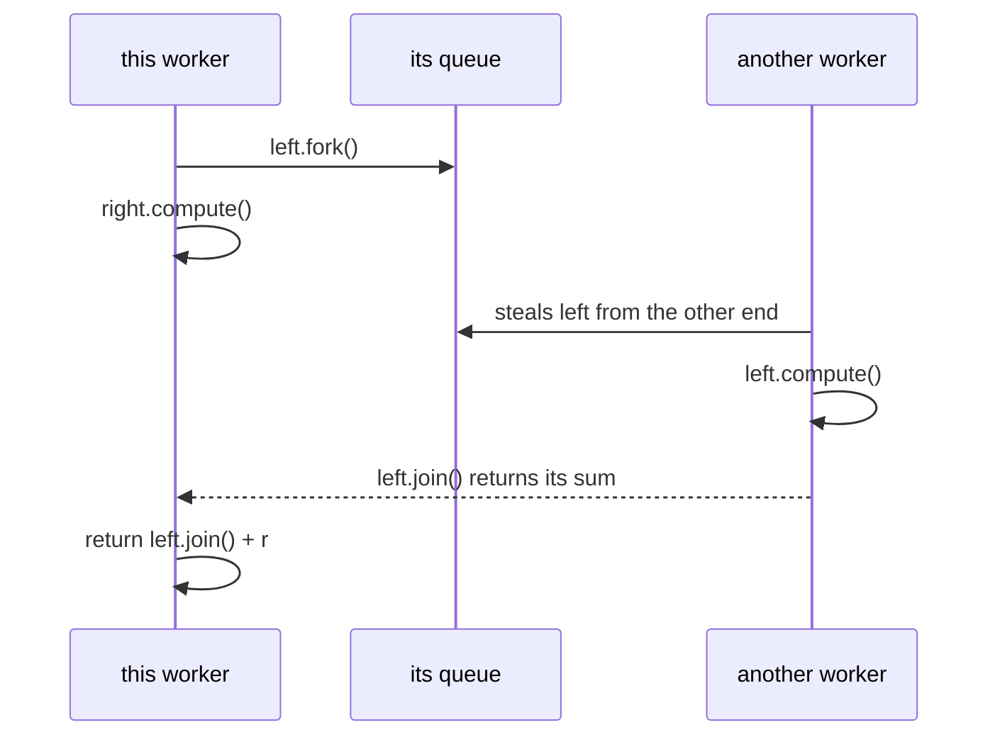

# 6.6.1. ForkJoinPool and RecursiveTask/RecursiveAction

The nightly risk report sums exposures over 8 million positions, and one thread takes too long.
A colleague parallelised it: each range of rows submits its two halves to an
`Executors.newFixedThreadPool(8)` and waits on their `Future`s. On the 50,000-row test file it
worked. The first full night it never finished, and a thread dump showed all eight pool threads
in `FutureTask.get`.

Splitting a job into halves, then halves of halves, is divide and conquer, and Java has a pool
built for it: `ForkJoinPool`, with the task types `RecursiveTask<V>` and `RecursiveAction`.

## A Task That Waits for Its Subtasks Deadlocks an Ordinary Pool; ForkJoinPool's join() Keeps Working

Here is the colleague's version. A range of 10,000 rows or fewer is summed in a loop; a larger one
is split:

```java
static long sum(ExecutorService pool, long[] a, int from, int to) throws Exception {
    if (to - from <= THRESHOLD) {
        long s = 0;
        for (int i = from; i < to; i++) s += a[i];
        return s;
    }
    int mid = (from + to) >>> 1;
    Future<Long> left = pool.submit(() -> sum(pool, a, from, mid));
    Future<Long> right = pool.submit(() -> sum(pool, a, mid, to));
    return left.get() + right.get();             // this pool thread now waits
}
```

Before reading on: why does 50,000 rows work and 8,000,000 not?

Each range that splits holds a thread while it waits for its halves. 50,000 rows split
three levels deep: 7 ranges wait, and the eighth thread runs the 8 small ranges one after
another. 8,000,000 rows make 1,023 waiting ranges. The first eight take all eight threads, and
the halves they wait for sit in the queue with no thread to run them. A bigger pool only moves the
size at which it hangs: 64 threads sum 500,000 rows and still hang on 8,000,000. Any other job
sharing the pool queues behind it for good.

The same split as a fork/join task:

```java
import java.util.concurrent.RecursiveTask;

class SumTask extends RecursiveTask<Long> {
    static final int THRESHOLD = 10_000;
    private final long[] a;
    private final int from, to;

    SumTask(long[] a, int from, int to) { this.a = a; this.from = from; this.to = to; }

    @Override
    protected Long compute() {
        if (to - from <= THRESHOLD) {                // small enough: a plain loop
            long s = 0;
            for (int i = from; i < to; i++) s += a[i];
            return s;
        }
        int mid = (from + to) >>> 1;
        SumTask left = new SumTask(a, from, mid);
        SumTask right = new SumTask(a, mid, to);
        left.fork();                                 // queue the left half
        long r = right.compute();                    // do the right half on this thread
        return left.join() + r;                      // then collect the left
    }
}
```

Both versions run on 8 threads, with a 5-second limit on the fixed pool
(`ex/Deadlock.java`, Java 21, 20 cores):

```java
ExecutorService fixed = Executors.newFixedThreadPool(8);
Future<Long> total = fixed.submit(() -> sum(fixed, exposures, 0, n));
// total.get(5, TimeUnit.SECONDS), then fixed.shutdownNow()

try (ForkJoinPool fj = new ForkJoinPool(8)) {
    long t = fj.invoke(new SumTask(exposures, 0, n));
}
```

```text
fixed pool, 50,000 rows: 2,475,000
ForkJoinPool(8), 50,000 rows: 2,475,000
fixed pool, 8,000,000 rows: no result after 5 s
ForkJoinPool(8), 8,000,000 rows: 396,000,000
```

In a `ForkJoinPool` a waiting thread keeps working. Each worker keeps its own queue of tasks, and
`fork()` puts a task on the current worker's queue and returns at once. `join()` on a task that
isn't done runs that task itself if it is still queued, or helps run the work of the worker that
took it. Only when neither is possible does the worker park, and the pool may then start a spare
thread to keep its parallelism. A worker with an empty queue takes a task from the other
end of another worker's queue. That is **work-stealing**, and it is how the left halves reach the
other seven workers. Unit 6.6.1.1 covers the pool itself.

> **Blocking still hurts.** The javadoc says the pool keeps enough threads active while tasks wait
> to join others, and doesn't promise it when they block on I/O or locks. A blocked worker runs
> nothing else, as the last section shows.

<!-- practice 3 -->

## Fork One Half, Compute the Other, Then Join

`SumTask` forks the left half, computes the right half, then joins the left. That order lets two
workers run at once: while this thread works on the right half,
the left half waits on its queue for another worker to steal.



Swap two lines, so the task joins the left half before it starts the right one:

```java
left.fork();
long l = left.join();                    // waits for the left half first
return l + right.compute();
```

Over 8 million rows with about 27 ns of arithmetic each, on `ForkJoinPool(8)`
(`ex/Shape.java`, best of five runs):

```text
plain loop, one thread: 216 ms
FORK_COMPUTE_JOIN threshold    10,000:      2,047 tasks,  37 ms
FORK_JOIN_COMPUTE threshold    10,000:      2,047 tasks, 210 ms
```

Same tasks, same result, and the swapped order runs at the speed of one thread. Each task waits
for its left half to finish before its right half starts, so at every level only one half is in
progress. Because the answer is right, no test catches it; only a timing does.

`compute()` decides the task's type. A `RecursiveTask<V>` returns a value, and `join()` hands it
back (unit 6.6.1.2). A `RecursiveAction` returns nothing and works in place, such as scaling every
element of an array; it often runs both halves with `invokeAll(left, right)`, which returns when
both are done or one throws (unit 6.6.1.3). Both extend `ForkJoinTask`, which implements `Future`.

## The Threshold Decides Whether Splitting Pays

Each task costs an object, a push on a queue, and often a steal. The threshold, the size at which
a task stops splitting and runs a plain loop, decides how many tasks there are. The same run with
other thresholds:

```text
FORK_COMPUTE_JOIN threshold         1: 15,999,999 tasks, 408 ms
FORK_COMPUTE_JOIN threshold       100:    262,143 tasks,  43 ms
FORK_COMPUTE_JOIN threshold    10,000:      2,047 tasks,  37 ms
FORK_COMPUTE_JOIN threshold 1,000,000:         15 tasks,  42 ms
FORK_COMPUTE_JOIN threshold 8,000,000:          1 tasks, 212 ms
```

With a task per row the parallel version takes twice as long as the plain loop: 16 million tasks
cost more than the arithmetic they wrap. With one task there is nothing to share. Between those
the times are flat over four orders of magnitude. The threshold has to be large enough that a
leaf's work outweighs the cost of a task, and small enough to give every worker several pieces.
The `ForkJoinTask` javadoc puts a leaf at roughly 100 to 10,000 basic steps.

The middle is flat only because every row costs the same. When some rows cost a hundred times
more than others, 8 leaves for 8 workers leave seven idle while one finishes. Unit 6.6.1.4 covers
choosing the threshold for uneven work.

<!-- practice 1 -->

## The Common Pool Is Shared, So Blocking in It Delays Work You Didn't Write

`ForkJoinPool.commonPool()` is one pool per JVM, with `availableProcessors() - 1` workers by
default (19 on the 20-core machine here). Parallel streams run in it, and so do
`CompletableFuture.supplyAsync` and the other `...Async` methods called without an executor, and
any `ForkJoinTask` forked outside a pool.

A nightly price export runs a parallel stream over 200 SKUs, and each element calls a rate service
that answers in 300 ms. While it runs, another part of the service calls
`CompletableFuture.supplyAsync(() -> "quote")` (`ex/CommonPool.java`):

```java
static void export() {
    IntStream.range(0, 200).parallel().map(CommonPool::slowLookup).sum();
}
```

```text
cores: 20, common pool parallelism: 19
idle common pool:          supplyAsync(() -> "quote") took 2 ms
export in common pool:     supplyAsync(() -> "quote") took 803 ms
  lookups ran on [ForkJoinPool.commonPool-worker-N, Thread-0]
```

The quote waited 800 ms behind someone else's network calls. The workers were asleep in the
lookups, and the pool can't tell. The stream also ran lookups on `Thread-0`, the
thread that started it.

A stream started from inside a task of another `ForkJoinPool` splits into that pool instead,
because `fork()` queues to the pool the current task runs in. That is how the JDK's streams behave
today, though the stream javadoc doesn't promise it:

```java
try (ForkJoinPool exportPool = new ForkJoinPool(20)) {
    ForkJoinTask<?> job = exportPool.submit(CommonPool::export);
    // supplyAsync measured here, then job.join()
}
```

```text
export in its own pool:    supplyAsync(() -> "quote") took 0 ms
  lookups ran on [ForkJoinPool-1-worker-N]
```

Work that mostly waits fits better on
virtual threads (unit 6.7.1), and `ForkJoinPool.ManagedBlocker` lets a fork/join task block
without losing a worker (unit 6.6.1.1). Since Java 19 a `ForkJoinPool` is `AutoCloseable`:
`close()` shuts it down and waits for its tasks, and does nothing on the common pool.

> **Small machines differ.** When the common pool's parallelism is below 2, `CompletableFuture`'s
> async methods start a new thread per task instead (its javadoc). A container limited to two
> CPUs or fewer gets that behaviour.

<!-- practice 2 -->

## Summary

- **A task that waits for its subtasks deadlocks an ordinary pool.** A `ForkJoinPool` worker runs
  queued tasks while it waits in `join()`, and idle workers steal from busy ones.
- **Fork one half, compute the other, then join.** Joining before computing runs at one thread's
  speed and still gives the right answer.
- **The threshold decides whether splitting pays.** A task per element costs more than the work;
  one task gives no parallelism.
- **The common pool is shared** by parallel streams, async `CompletableFuture`s and tasks forked
  outside a pool. Blocking calls there delay all of them; give such work its own pool or executor.

## Reference

| Call | What it does |
|---|---|
| `new ForkJoinPool(n)` | a pool with target parallelism `n`; `new ForkJoinPool()` uses the number of available processors |
| `ForkJoinPool.commonPool()` | the JVM-wide pool; parallelism `availableProcessors() - 1` by default, or the system property `java.util.concurrent.ForkJoinPool.common.parallelism` |
| `pool.invoke(task)` | runs the task in the pool and returns its result |
| `pool.submit(task)` | runs it in the pool and returns it as a `Future` |
| `task.fork()` | queues the task in the pool the current task runs in, or in the common pool outside one |
| `task.join()` | returns the result; a failure comes back as an unchecked exception, not `ExecutionException` |
| `task.invoke()` | starts `compute()` on the calling thread and returns the result |
| `ForkJoinTask.invokeAll(t1, t2)` | runs both, returns when both are done or one throws |
| `pool.close()` (Java 19) | shuts the pool down and waits for its tasks; no effect on the common pool |
| `pool.getStealCount()` | an estimate of the tasks run by a thread other than the one that queued them |

## Challenges

1. Run `SumTask` over an array where every tenth row costs 100 times the others. Which thresholds
   stay fast now, and how does `getStealCount()` change?
2. A request handler sorts a 50,000-element list with `parallelStream()` on every call. At 200
   requests per second, is that faster than a sequential sort? What would you measure?
3. Your service's `supplyAsync` callbacks slowed down after a library upgrade. How do you find
   out, from a thread dump, which code is blocking the common pool?

## Design Note: Why the Waiting Thread Does the Work

An ordinary pool runs each task from start to end on one thread, so a task that waits for another
holds a thread until the other finishes. Fork/join tasks are written to wait for each other, so
`join()` turns the waiting thread back into a worker. The price is in what a task may do. A worker
runs whatever task it finds, and the pool counts only the waits it sees: joins and
`ManagedBlocker` calls. A task that blocks on I/O or holds a lock takes its worker out of the pool
unnoticed, which is why the `ForkJoinTask` javadoc says tasks should ideally avoid `synchronized`
blocks and blocking I/O.
The framework gives up generality for throughput on one kind of problem: CPU work that splits into
independent pieces.

## Code Examples

- Source: [ForkJoinPoolBasics.java](src/main/java/com/github/msorkhpar/claudejavatutor/forkjoin/ForkJoinPoolBasics.java)
- Source: [RecursiveTaskExamples.java](src/main/java/com/github/msorkhpar/claudejavatutor/forkjoin/RecursiveTaskExamples.java)
- Source: [RecursiveActionExamples.java](src/main/java/com/github/msorkhpar/claudejavatutor/forkjoin/RecursiveActionExamples.java)
- Source: [SplittingAndJoining.java](src/main/java/com/github/msorkhpar/claudejavatutor/forkjoin/SplittingAndJoining.java)
- Test: [ForkJoinPoolBasicsTest.java](src/test/java/com/github/msorkhpar/claudejavatutor/forkjoin/ForkJoinPoolBasicsTest.java)
- Test: [RecursiveTaskExamplesTest.java](src/test/java/com/github/msorkhpar/claudejavatutor/forkjoin/RecursiveTaskExamplesTest.java)
- Test: [RecursiveActionExamplesTest.java](src/test/java/com/github/msorkhpar/claudejavatutor/forkjoin/RecursiveActionExamplesTest.java)
- Test: [SplittingAndJoiningTest.java](src/test/java/com/github/msorkhpar/claudejavatutor/forkjoin/SplittingAndJoiningTest.java)
