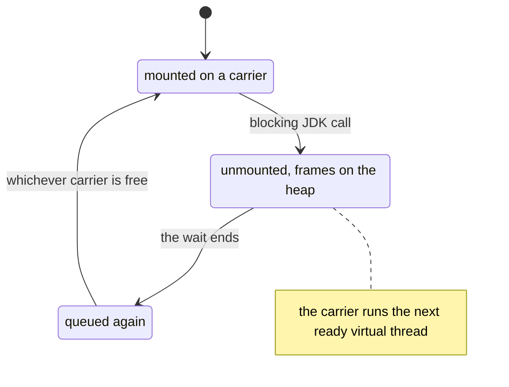

# 6.7.1. Lightweight Threads for High Concurrency

A quote service ran its request handlers on a fixed pool of 200 platform threads. Each request
spends about 100 ms waiting on two downstream calls, so the service topped out at 2,000 requests a
second, and at the evening peak requests queued behind the pool. The team switched the handlers to
`Executors.newVirtualThreadPerTaskExecutor()` and the ceiling went away. In the same week the
health check started timing out whenever a few large PDF reports rendered, CPU use rose because
every request now built its own invoice parser, and heap use at the peak jumped.

Each of these follows from what a virtual thread is and what it costs. The examples run on Java 21,
on a machine with 20 cores.

## A Virtual Thread That Waits Gives Its Carrier Back, So a Few Platform Threads Run Thousands of Requests

Ten thousand requests each wait one second for a downstream reply, each on its own virtual thread.
The JVM is started with `-Djdk.virtualThreadScheduler.parallelism=1`, which gives the scheduler a
single platform thread to run them on. Before you look at the output: how long does it take?

```java
Set<String> carriers = ConcurrentHashMap.newKeySet();
try (var executor = Executors.newVirtualThreadPerTaskExecutor()) {
    for (int request = 0; request < 10_000; request++) {
        executor.submit(() -> {
            carriers.add(carrier());
            Thread.sleep(1_000);              // the downstream call
            carriers.add(carrier());
            return null;
        });
    }
}
```

```text
10,000 requests waiting 1 s each: 1,054 ms, carriers used: [ForkJoinPool-1-worker-1]
```

`carrier()` reads the part of `Thread.currentThread().toString()` after the `@`, which names the
platform thread running the virtual thread at that moment. One platform thread carried all 10,000
waits, and they overlapped.

A virtual thread is a Java object that holds the task's call stack. To run, it is **mounted** on a
**carrier**: a platform thread of the JDK's scheduler, a `ForkJoinPool` separate from the common
pool. By default it has one carrier per processor. When the code calls a blocking operation of the
JDK (`sleep`, a `ReentrantLock`, a queue's `take`, a socket read),
the JDK copies the virtual thread's frames to the heap and **unmounts** it, and the carrier picks
up the next virtual thread that is ready. When the wait ends, the virtual thread is queued again
and resumes on whichever carrier is free. `Thread.currentThread()` always returns the virtual
thread, never its carrier.



A pool of platform threads limits throughput to threads ÷ wait time: 200 threads waiting 100 ms
each serve 2,000 requests a second, however idle the CPU is, and keeping such a pool keeps that
ceiling. With virtual threads the limit moves to what the downstream services and the heap can
take.

> **Java 21 pins.** A virtual thread that blocks inside `synchronized`, or in a native method,
> keeps its carrier (unit 6.4.1). With one carrier, ten requests sleeping 100 ms inside
> `synchronized` took 1,023 ms on Java 21 and 130 ms on Java 25: JDK 24 removed the
> `synchronized` case (JEP 491), while native frames still pin. Unit 6.7.2 covers how to find
> pinning.

## A Virtual Thread That Computes Keeps Its Carrier: Java 21 Has No Time Slice

A virtual thread leaves its carrier only when it blocks, yields or ends. Here the scheduler has two carriers
(`parallelism=2`, as in a container limited to two CPUs). A health check on a virtual thread wakes
every 10 ms and records how late it woke. Two request handlers then each render a report, about a
second of arithmetic with no blocking, first on their own virtual threads and then by handing the
render to a platform pool of two threads and waiting for the result:

```java
Thread.ofVirtual().start(() -> {         // a request handler
    try {
        if (offload) {
            Future<Long> report = cpu.submit(NoTimeSlice::render);
            sink = report.get();         // the handler waits; its carrier is free
        } else {
            sink = render();             // the handler computes on its carrier
        }
    } catch (Exception e) {
        throw new RuntimeException(e);
    } finally {
        rendered.countDown();
    }
});
```

```text
renders on the handlers' virtual threads: health check up to 999 ms late
renders handed to a 2-thread platform pool: health check up to 0 ms late
```

The operating system shares a CPU among platform threads by giving each a time slice and
switching when it runs out. The virtual-thread scheduler doesn't: JEP 444 says it "does not
currently implement time sharing", and it does not add carriers when all of them are busy
computing. The two
renders held both carriers for the whole second, and the health check, ready after 10 ms, had
nowhere to run. In the second run the handlers were waiting in `get()`, a blocking call, so they
gave their carriers back. The renders still used two cores, but on threads the OS slices.

In production the liveness probe misses
its deadline and the orchestrator restarts a healthy instance. Every request whose downstream
reply has arrived waits for a free carrier before it can send its answer, so latency jumps for
requests that compute nothing. Work that keeps a core busy for more than a few milliseconds goes to
a platform pool sized to the cores, and the virtual thread waits for it.

<!-- practice 1 -->

## A Waiting Virtual Thread Keeps Its Stack, and Everything It References, on the Heap

A platform thread reserves its stack as native memory when it starts, 1 MB of address space by
default on Linux x64. A virtual thread's frames live in heap objects while it waits, so it costs what its
stack holds. Here 100,000 virtual threads wait for a reply at a given call depth, in the third run
each also keeping a reference to a 16 KB request body, and the program measures the heap after a GC:

```java
static void handle(int depth, int bodyBytes, CountDownLatch parked, CountDownLatch reply) throws InterruptedException {
    if (depth > 1) {
        handle(depth - 1, bodyBytes, parked, reply); // one frame per layer: filter, controller, service, client...
        return;
    }
    byte[] body = new byte[bodyBytes];            // the request body, still referenced while we wait
    parked.countDown();
    reply.await();                                // waiting for the downstream reply
    if (body.length < 0) throw new AssertionError();
}
```

```text
100,000 waiting at depth   1, holding      0 bytes:    75 MB of heap,    793 bytes each
100,000 waiting at depth 100, holding      0 bytes:   868 MB of heap,  9,106 bytes each
100,000 waiting at depth  20, holding 16,384 bytes: 1,789 MB of heap, 18,764 bytes each
```

A shallow virtual thread costs under a kilobyte, and each frame adds tens of bytes (the
depth-100 figure varied between 4.7 and 9.1 KB from run to run). A
local variable in a waiting frame keeps its object reachable, so the request body, the parsed
JSON, and the result list built so far stay on the heap for as long as the request waits.

The pool of 200 also capped memory: at most 200 requests in flight, their bodies and stacks
about 3.6 MB here. With a virtual thread per request nothing limits it, and a burst of 100,000 slow
uploads needs 1,789 MB. With a 1 GB heap, 100,000 such requests ended in `OutOfMemoryError`,
thrown in whichever thread allocated next, `main` included. Decide how many requests may be in
flight from the memory each one holds and from what the downstream can take, and enforce it where
requests enter, with a `Semaphore` (unit 6.4.1), not with a pool of threads.

<!-- practice 3 -->

## One Thread per Task Means Nothing Per-Thread Is Reused: Pool the Expensive Object, Not the Thread

The quote service keeps an `InvoiceParser`, which is not thread-safe and takes about 1 ms to build,
in a `ThreadLocal`. On the old pool each thread built one and reused it. Here are 2,000 requests,
each parsing an invoice and then waiting 50 ms to store the result, on three executors, and then
on virtual threads that borrow a parser from a queue of 50:

```java
static final ThreadLocal<InvoiceParser> PARSER = ThreadLocal.withInitial(InvoiceParser::new);

IntFunction<Callable<Void>> perThread = id -> () -> {
    PARSER.get().parse(id);
    Thread.sleep(50);                         // store the result
    return null;
};
IntFunction<Callable<Void>> borrowed = id -> () -> {
    InvoiceParser parser = parsers.take();    // waits while all 50 are in use
    try {
        parser.parse(id);
    } finally {
        parsers.put(parser);
    }
    Thread.sleep(50);
    return null;
};
```

```text
newFixedThreadPool(50)                   parsers built:     50,  2,020 ms
newVirtualThreadPerTaskExecutor()        parsers built:  2,000,    190 ms
newFixedThreadPool(50, virtual factory)  parsers built:     50,  2,013 ms
virtual threads, 50 parsers in a queue   parsers built:     50,     57 ms
```

A `ThreadLocal` value lives as long as its thread. On a pool, where 50 threads run 2,000 tasks, it
works as a cache of 50 parsers. With a thread per task each value is built for one task and
dropped with the thread: 2,000 parsers built, two seconds of CPU. The 20 cores hid it here; at the peak it shows up as CPU and allocation per request.

Putting virtual threads in a fixed pool of 50 kept 50 parsers but also limited the service to 50
requests at a time: 2,013 ms, as slow as the platform pool (unit 6.4.1). A fixed pool hands every
task to the same 50 threads, so their thread-locals survive and 50 is the limit; a waiting virtual
thread frees its carrier, not its place in the pool. The scarce thing is the parser, so the last run pools the parser: 50 built, and
the thread-per-task speed kept. An object that is thread-safe, such as a `DateTimeFormatter`, needs
no pool at all: share one instance.

> **Scoped values.** `ScopedValue` (JEP 446) passes a value down a call chain and to the threads
> that a `StructuredTaskScope` forks. It is a preview API in Java 21 and final in Java 25 (JEP 506).
> It replaces a `ThreadLocal` used to carry context, not one used as a cache.

<!-- practice 2 -->

## Summary

- **A waiting virtual thread gives its carrier back.** A few platform threads run thousands of
  waiting requests, so a pool of threads no longer has to cap throughput (Java 21 pins in
  `synchronized` and native code).
- **A computing virtual thread keeps its carrier: there is no time slice.** Long CPU work on
  virtual threads stalls every other virtual thread; hand it to a platform pool sized to the cores.
- **A waiting virtual thread keeps its stack and everything it references on the heap.** Limit
  requests in flight by memory and downstream capacity, at the entry, with a `Semaphore`.
- **Nothing per-thread is reused with a thread per task.** A `ThreadLocal` stops being a cache;
  pool the expensive object, never the virtual threads.

## Reference

**Creating virtual threads (Java 21, as ran):**

| Call | Gives |
|---|---|
| `Thread.startVirtualThread(r)` | a started virtual thread, no name |
| `Thread.ofVirtual().name("quote-", 7).start(r)` | a started virtual thread named `quote-7`; the builder counts up |
| `Thread.ofVirtual().unstarted(r)` | a virtual thread in state `NEW`; `start()` it later |
| `Thread.ofVirtual().name("feed-", 0).factory()` | a `ThreadFactory` of virtual threads `feed-0`, `feed-1`, … |
| `Executors.newVirtualThreadPerTaskExecutor()` | an `ExecutorService` that starts one unnamed virtual thread per task |
| `Executors.newThreadPerTaskExecutor(factory)` | the same with threads from `factory`, for names |
| `t.isVirtual()` | `true` for a virtual thread |

**Fixed properties of a virtual thread (Java 21, as ran):**

| Property | Value |
|---|---|
| `isDaemon()` | always `true`; `setDaemon(false)` throws `IllegalArgumentException` |
| `getPriority()` | always 5 (`NORM_PRIORITY`); `setPriority` has no effect |
| `getThreadGroup().getName()` | `VirtualThreads` |
| `Thread.currentThread()` inside it | the virtual thread itself |

**Scheduler (JEP 444; JDK system properties, not part of the Java SE API):**

| Property | Effect |
|---|---|
| `jdk.virtualThreadScheduler.parallelism` | number of carriers; defaults to the number of available processors |
| `jdk.virtualThreadScheduler.maxPoolSize` | how far the scheduler may grow temporarily when some operations hold a carrier (some file I/O, `Object.wait`) |

## Challenges

1. Your handlers call a JSON library that takes 30 ms of CPU for the largest payloads and 0.2 ms
   for the usual ones. Where is the line above which you hand the work to a platform pool, and how
   would you measure it on your own service?
2. Size the `Semaphore` at the entry of an upload service: what do you measure per request, and
   what happens to the request that doesn't get a permit?
3. A library you depend on caches a buffer per thread in a `ThreadLocal` and never removes it.
   What does moving its callers to virtual threads cost, and what can you do without changing the
   library?

## Design Note: Why Java Kept the Thread

Other platforms answered the cost of blocked threads with a new programming model: callbacks,
futures, `async` and `await`. Each splits a request's code into pieces that run on whatever thread
is free, loses the stack trace across the pieces, and splits the libraries into blocking and
non-blocking kinds. Java made the existing `Thread` cheap instead, so existing blocking code, its debuggers
and its thread dumps keep working.

The price is that every habit built on threads being scarce has to be checked again. Pools stop
being the way to limit load, thread-locals stop being caches, a monitor held across a wait cost a
carrier until JDK 24, and the scheduler can't take a carrier back from code that never waits.

## Code Examples

- Test: [VirtualThreadBasicsTest.java](src/test/java/com/github/msorkhpar/claudejavatutor/virtualthreads/VirtualThreadBasicsTest.java)
- Source: [VirtualThreadBasics.java](src/main/java/com/github/msorkhpar/claudejavatutor/virtualthreads/VirtualThreadBasics.java)
