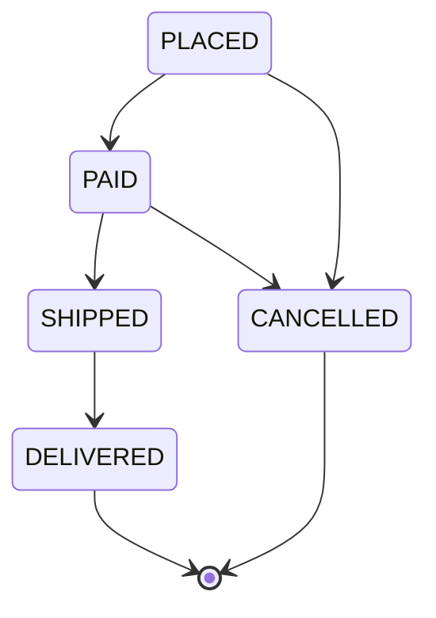

# 7.2.5. Use Cases and Examples

A customer cancelled an order and got a refund. An hour later the warehouse's "shipped" event
arrived, the handler wrote its status into the order, and the parcel went out anyway. The status
field was an enum, and an enum field accepts any constant, in any order. An enum can enforce
which states may follow which, but only if you put the table somewhere.

Here are four jobs enums do in production code: the singleton, flag sets, state machines and
configuration keyed by a constant. What an enum can't do is unit 7.2.1. Enums can't be generic
(JEP 301 proposed it and was withdrawn; unit 7.2.2), constructor arguments and constant-specific
bodies are unit 7.2.3, and generic methods on an enum are unit 7.2.4.

## An Enum With One Constant Is a Singleton That Reflection and Serialization Can't Copy

The usual singleton is a class with a private constructor and one static instance. This one hands
out order ids:

```java
import java.io.Serializable;
import java.util.concurrent.atomic.AtomicLong;

final class IdSequence implements Serializable {
    static final IdSequence INSTANCE = new IdSequence();
    private final AtomicLong next = new AtomicLong();
    private IdSequence() {}
    long nextId() { return next.incrementAndGet(); }
}
```

```java
import java.util.concurrent.atomic.AtomicLong;

enum Ids {
    INSTANCE;
    private final AtomicLong next = new AtomicLong();
    long nextId() { return next.incrementAndGet(); }
}
```

Before reading the output, predict how many instances of each exist after a serialization round
trip and after a reflective call to the private constructor. The program writes each `INSTANCE` to
an `ObjectOutputStream` and reads it back, then calls `getDeclaredConstructors()[0]`,
`setAccessible(true)` and `newInstance(...)`:

```text
class: deserialized == INSTANCE? false
class: reflected  == INSTANCE? false
enum:  deserialized == INSTANCE? true
enum:  reflection: java.lang.IllegalArgumentException: Cannot reflectively create enum objects
```

The private constructor stops other code from writing `new IdSequence()`, nothing more.
Deserialization builds a new object without calling it, and `setAccessible` opens it. The
reflected copy's counter starts at zero and the deserialized one resumes from the value written,
so two parts of the service hand out the same ids and the
second insert fails on a duplicate key. A `readResolve` method returning `INSTANCE` fixes the
round trip; it does nothing against the reflective call.

The enum needs neither. `Constructor.newInstance` refuses any enum class, and an enum is
serialized as its name and read back with `valueOf`, so the reader gets the constant that already
exists in its own JVM. Its fields don't travel. Here one JVM takes 41 ids and writes `INSTANCE` to
a file, and a second JVM reads it:

```text
writer: next id would be 42
reader: same constant? true, nextId() = 1
```

If the state matters elsewhere, store it yourself. Every thread shares the constant's fields, which is why the counter is an `AtomicLong`. And code that names
`Ids.INSTANCE` can't be handed another implementation in a test: let the enum implement an
interface and pass the interface around.

<!-- practice 4 -->

## EnumSet Is a Typed Bit Mask, and a Shared One Must Be Unmodifiable

Permissions as `int` flags look cheap, but nothing ties a flag to its family:

```java
static final int READ = 1, WRITE = 2, DELETE = 4;
static final int NOTIFY_EMAIL = 1, NOTIFY_SMS = 2;      // another family, same bits
```

```java
int mask = READ | WRITE;
int oops = NOTIFY_EMAIL | NOTIFY_SMS;                // compiles: it's just an int
```

```text
mask = 3, canDelete = false
notification flags as permissions: canDelete = false, mask = 3
```

A user's notification settings passed as permissions compile, run and give read-write access, and
the log shows `3`. With `enum Permission { READ, WRITE, DELETE }` and an `EnumSet`, the same
mistake doesn't compile, and the set prints its names:

```text
WrongFamily.java:12: error: incompatible types: Set<Notify> cannot be converted to Set<Permission>
        System.out.println(canDelete(alerts));
                                     ^
```

```text
set = [READ, WRITE], canDelete = false
java.util.RegularEnumSet
```

The type costs nothing at run time. The `EnumSet` javadoc describes a bit vector with
constant-time basic operations, a typesafe alternative to `int`-based bit flags. In the JDK's source, a set of an enum with up to 64
constants is a `RegularEnumSet`, which keeps one `long`. When the set must be stored, store
the names (`READ,WRITE`), not the ordinals or a mask built from them: inserting a constant shifts
every later bit, as unit 7.2.1 shows for ordinals.

`EnumSet` is mutable, and `final` fixes only the reference. The `Permission` enum in this module's
example code declares `public static final Set<Permission> READ_ONLY = EnumSet.of(READ)`, and one
caller starts a guest from it:

```java
Set<Permission> guest = Permission.READ_ONLY;      // "start from read-only"
guest.add(Permission.WRITE);                      // ...and grant one more to this guest
```

```text
READ_ONLY is now [READ, WRITE]
auditor can write: true
```

The `EnumSet.of` call ran once, when the class was initialized; every user of the field holds that one
set. Every role built on `READ_ONLY` can now write, until the JVM restarts. Wrap shared sets with
`Collections.unmodifiableSet`, so the `add` throws `UnsupportedOperationException`, and build a
user's set as a copy: `EnumSet.copyOf(READ_ONLY)`. `copyOf(Collection)` takes the enum type from the first element, so an empty collection that isn't
itself an `EnumSet` throws `IllegalArgumentException: Collection is empty`. Start from
`EnumSet.noneOf(Permission.class)` and `addAll` instead when the source can be empty.

<!-- practice 1 -->

## A State Machine Keeps Its Transitions in an EnumMap Filled After the Constants Exist

The natural place for "what may follow" seems to be the constructor:

```java
import java.util.EnumSet;
import java.util.Set;

enum OrderStatus {
    PLACED(EnumSet.of(PAID, CANCELLED)),
    PAID(EnumSet.of(SHIPPED, CANCELLED)),
    SHIPPED(EnumSet.of(DELIVERED)),
    DELIVERED(EnumSet.noneOf(OrderStatus.class)),
    CANCELLED(EnumSet.noneOf(OrderStatus.class));

    final Set<OrderStatus> next;
    OrderStatus(Set<OrderStatus> next) { this.next = next; }
}
```

```text
OrderStatus.java:5: error: illegal forward reference
    PLACED(EnumSet.of(PAID, CANCELLED)),
                      ^
```

javac reports five of these. When `PLACED` is built, `PAID` doesn't exist yet. Java 21's javac
refuses the qualified form `OrderStatus.PAID` too, and a lambda `() -> EnumSet.of(PAID, CANCELLED)`
as well. Constant-specific bodies that return the set from a method compile, since a method runs
later.They spread the table over every constant, though.

The constants are initialized first, in declaration order, so a static block after them sees
every one. Fill an `EnumMap` there:

```java
import java.util.Collections;
import java.util.EnumMap;
import java.util.EnumSet;
import java.util.Map;
import java.util.Set;

enum OrderStatus {
    PLACED, PAID, SHIPPED, DELIVERED, CANCELLED;

    private static final Map<OrderStatus, Set<OrderStatus>> NEXT = new EnumMap<>(OrderStatus.class);
    static {                                     // runs after every constant exists
        NEXT.put(PLACED, EnumSet.of(PAID, CANCELLED));
        NEXT.put(PAID, EnumSet.of(SHIPPED, CANCELLED));
        NEXT.put(SHIPPED, EnumSet.of(DELIVERED));
        NEXT.put(DELIVERED, EnumSet.noneOf(OrderStatus.class));
        NEXT.put(CANCELLED, EnumSet.noneOf(OrderStatus.class));
        NEXT.replaceAll((from, next) -> Collections.unmodifiableSet(next));
    }

    boolean canMoveTo(OrderStatus target) {
        return NEXT.get(this).contains(target);
    }

    OrderStatus moveTo(OrderStatus target) {
        if (!canMoveTo(target)) throw new IllegalStateException(this + " -> " + target);
        return target;
    }

    static Map<OrderStatus, Set<OrderStatus>> table() { return Collections.unmodifiableMap(NEXT); }
}
```

The whole lifecycle is one table, printed in declaration order because an `EnumMap` is an array
indexed by ordinal. The opening story, first as the handler wrote it and then through `moveTo`:

```text
blind write: SHIPPED
moveTo: java.lang.IllegalStateException: CANCELLED -> SHIPPED, status stays CANCELLED
{PLACED=[PAID, CANCELLED], PAID=[SHIPPED, CANCELLED], SHIPPED=[DELIVERED], DELIVERED=[], CANCELLED=[]}
```



A terminal state needs a
row too, an empty set: a constant added later with no row makes `NEXT.get` return `null`, and
`canMoveTo` throws a `NullPointerException` on the first order that reaches it. The `EnumSet.allOf`
check of the next section, run on `NEXT` at startup, catches that before any order does.

`moveTo` checks at run time. Unit 2.5.3 builds the same lifecycle with a record per state, where
shipping an unpaid order doesn't compile and each state carries its own data. The enum keeps what
the records lose: `values()`, the `EnumMap` table, and a status column that holds a name.

<!-- practice 2 -->

## Enum-Keyed Configuration Belongs in an EnumMap Checked for Every Key at Startup

A notification service reads a rate limit per channel from a properties file
(`limit.EMAIL=500`, `limit.SMS=20`) into an `EnumMap<Channel, Integer>`. A release adds
`Channel.PUSH`, and nobody adds `limit.PUSH` to the file. The service starts cleanly. Hours
later the first push notification fails:

```text
loaded {EMAIL=500, SMS=20}
first push: Cannot invoke "java.lang.Integer.intValue()" because the return value of "java.util.Map.get(Object)" is null
```

A map answers a missing key with `null`, so the error waits for the first caller. Since the enum
lists every key the map must hold, the loader can check them all before it returns:

```java
Set<Channel> missing = EnumSet.allOf(Channel.class);
missing.removeAll(m.keySet());
if (!missing.isEmpty()) throw new IllegalStateException("no limit for " + missing);
```

```text
at startup: no limit for [PUSH]
```

The deploy fails, with the channel's name, before any traffic. The shorter
`EnumSet.complementOf(EnumSet.copyOf(m.keySet()))` gives `[PUSH]` here too, but an `EnumMap`'s key
set is not an `EnumSet`, so on an empty file it throws `Collection is empty` instead of naming
every channel. A key that names no constant, such as `limit.EMIAL`, makes `Channel.valueOf` throw
`IllegalArgumentException`; catch it and report the key.

When the values are constants in code rather than a file, a `switch` expression with no
`default` gives the same guarantee at compile time: adding `PUSH` breaks the build when the
switch is recompiled (unit 1.2.5).

<!-- practice 3 -->

## Summary

- **An enum singleton can't be copied.** `Constructor.newInstance` refuses enums and
  deserialization returns the existing constant; its fields don't travel, and every thread shares
  them.
- **`EnumSet` is a bit mask with a type.** A set from another enum doesn't compile, it prints
  names, and a shared one must be unmodifiable or one caller's `add` changes everyone's. Store
  names, not ordinals.
- **A state machine keeps its transitions in an `EnumMap` filled in a static initializer.** A
  constant can't name a later one in its arguments, and a state without a row gives `null`.
- **Enum-keyed configuration is an `EnumMap` checked against `EnumSet.allOf` at load**, so a new
  constant without a value stops the deploy rather than the first request.

## Reference

**`EnumSet` and `EnumMap` (javadoc, Java 21):**

| Call or situation | Result |
|---|---|
| `EnumSet.noneOf(E.class)` / `allOf(E.class)` | empty / full set; both mutable |
| `EnumSet.of()` with no arguments | does not compile |
| `EnumSet.copyOf(collection)` | `IllegalArgumentException` if the collection is empty and not an `EnumSet` |
| `EnumSet.complementOf(set)` | the constants not in `set` |
| adding `null` to an `EnumSet`, `put(null, v)` on an `EnumMap` | `NullPointerException` |
| iteration order of both | declaration order |
| `EnumMap.get(key)` for a key with no entry | `null` |
| concurrent writes | not synchronized; wrap with `Collections.synchronizedSet`/`Map` |
| `Collections.unmodifiableSet(enumSet).add(x)` | `UnsupportedOperationException` |

**Singleton forms (Java 21, run):**

| Attack | Class with private constructor | Enum |
|---|---|---|
| `setAccessible(true)` + `newInstance` | a second instance | `IllegalArgumentException: Cannot reflectively create enum objects` |
| serialize and read back | a second instance, unless `readResolve` returns `INSTANCE` | the existing constant; fields not serialized |

## Challenges

1. Your permission sets are stored as an `int` mask column in 40 million rows. Plan the move to
   names: what runs during the migration, and what does a reader of half-migrated data see?
2. The order lifecycle gains `RETURNED` and `REFUNDED`. Where would you write the test that
   proves every state has a row and every terminal state is intended?
3. A Spring bean and an enum singleton both give one instance per JVM. For an id generator that
   must be faked in tests, which do you choose, and what does the other cost?

## Design Note: An Enum Fixes Its Instances When the Class Is Compiled

Every use case on this page rests on one property: the set of instances is closed and known to
javac. That is what lets `newInstance` refuse to build one more, lets `EnumSet` give each constant one
bit, and lets an `EnumMap` be an array. The cost is that the set can only change with a release.
Permissions that an administrator defines at run time, or workflow states that a customer
configures, don't fit an enum; they belong in data, with the checks this page gets from the
compiler written by hand.

## Code Examples

- Implementation: [EnumUseCases.java](src/main/java/com/github/msorkhpar/claudejavatutor/enhancedenums/EnumUseCases.java)
- Tests: [EnumUseCasesTest.java](src/test/java/com/github/msorkhpar/claudejavatutor/enhancedenums/EnumUseCasesTest.java)
