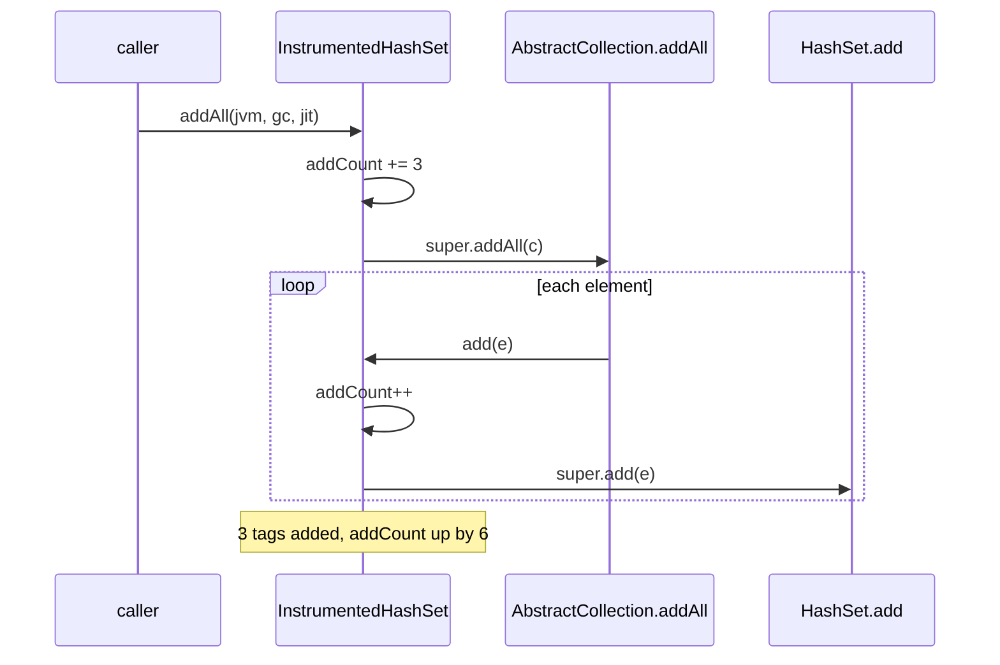

# 8.4.1. Definition and Purpose of Composition over Inheritance

The editors' dashboard says "tags submitted: 7" for an article that has four tags. The author
typed one tag and picked three from the suggestion list, which the tag widget sends in one `addAll`.
The analytics team uses this count to decide whether suggestions are worth keeping. Its tags live in
this class, whose unit test (three `add` calls) passes:

```java
import java.util.Collection;
import java.util.HashSet;

/** An article's tags; getAddCount() feeds the "tags submitted" metric. */
public class InstrumentedHashSet<E> extends HashSet<E> {
    private int addCount = 0;

    @Override
    public boolean add(E e) {
        addCount++;
        return super.add(e);
    }

    @Override
    public boolean addAll(Collection<? extends E> c) {
        addCount += c.size();
        return super.addAll(c);
    }

    public int getAddCount() {
        return addCount;
    }
}
```

Each method counts what it receives, once. Before reading on, work out where the extra three
come from.

## HashSet's addAll Calls add, So a Subclass That Counts in Both Counts Each Element Twice

```java
InstrumentedHashSet<String> tags = new InstrumentedHashSet<>();
tags.add("java");                          // typed by the author
tags.addAll(List.of("jvm", "gc", "jit"));  // picked from suggestions
System.out.println("tags: " + tags.size() + ", tags submitted: " + tags.getAddCount());
```

```text
tags: 4, tags submitted: 7
```

`HashSet` has no `addAll` of its own. It inherits this one from `AbstractCollection` (JDK 21 and
25 source):

```java
public boolean addAll(Collection<? extends E> c) {
    boolean modified = false;
    for (E e : c)
        if (add(e))
            modified = true;
    return modified;
}
```

`super.addAll(c)` runs that loop on our object, so `add(e)` reaches `InstrumentedHashSet.add`
(unit 2.1.4 shows the mechanism with `TreeSet`): three counted in `addAll`, three again in `add`.
Every batch inflates the metric by its own size.



The subclass is correct only if it knows which of `HashSet`'s methods call which, and `HashSet`
doesn't say: the loop is documented only as `AbstractCollection`'s implementation note, two
levels up. This is the fragile base class problem: the subclass depends on its superclass's
implementation, not its contract.

## Counting Only in add Fixes HashSet and Breaks ArrayList: the Count Follows Code the Subclass Can't See

The quick fix is to delete the `addAll` override, since "`addAll` goes through `add` anyway".
Here are the same overrides on two superclasses, with and without `addAll`, each given three
elements through `addAll`:

```text
addAll of 3 elements, counted in   extends HashSet   extends ArrayList
add and addAll                     6                 3
add only                           3                 0
```

`ArrayList` overrides `addAll`
with a `System.arraycopy` of the argument's array and never calls `add`, so a counting list that
trusts `add` misses every batch.

On `HashSet` the "add only" version is right as long as `HashSet` keeps inheriting
`AbstractCollection.addAll`. If a later JDK gives `HashSet` an `addAll` of its own, as `ArrayList`
has, batches stop being counted, and the subclass still compiles and passes its `add` tests.
`AbstractCollection`'s `@implSpec` describes that class's code, not a promise from `HashSet`.

An `addAll` override that loops over `c` calling `this.add`, without `super.addAll`, counts right
on both, because it no longer uses the superclass's `addAll` at all. That is reimplementing the
superclass method, which works here only because `addAll` needs nothing but `add`.

## A Forwarding Wrapper Counts Each Element Once over Any Set, Because the Set's Own Calls Stay Inside It

Instead of being a `HashSet`, the counter can hold a `Set` in a field and pass every call on to
it. The forwarding part is written once per interface:

```java
import java.util.Collection;
import java.util.Iterator;
import java.util.Objects;
import java.util.Set;

/** Implements Set by forwarding every call to the set it wraps. */
public class ForwardingSet<E> implements Set<E> {
    private final Set<E> s;

    public ForwardingSet(Set<E> s) { this.s = Objects.requireNonNull(s); }

    @Override public int size() { return s.size(); }
    @Override public boolean isEmpty() { return s.isEmpty(); }
    @Override public boolean contains(Object o) { return s.contains(o); }
    @Override public Iterator<E> iterator() { return s.iterator(); }
    @Override public Object[] toArray() { return s.toArray(); }
    @Override public <T> T[] toArray(T[] a) { return s.toArray(a); }
    @Override public boolean add(E e) { return s.add(e); }
    @Override public boolean remove(Object o) { return s.remove(o); }
    @Override public boolean containsAll(Collection<?> c) { return s.containsAll(c); }
    @Override public boolean addAll(Collection<? extends E> c) { return s.addAll(c); }
    @Override public boolean retainAll(Collection<?> c) { return s.retainAll(c); }
    @Override public boolean removeAll(Collection<?> c) { return s.removeAll(c); }
    @Override public void clear() { s.clear(); }

    @Override public boolean equals(Object o) { return o == this || s.equals(o); }
    @Override public int hashCode() { return s.hashCode(); }
    @Override public String toString() { return s.toString(); }
}
```

and the counter extends it with the same two overrides as before:

```java
import java.util.Collection;
import java.util.Set;

/** Counts every element offered to the set it wraps. */
public class InstrumentedSet<E> extends ForwardingSet<E> {
    private int addCount = 0;

    public InstrumentedSet(Set<E> s) { super(s); }

    @Override
    public boolean add(E e) {
        addCount++;
        return super.add(e);
    }

    @Override
    public boolean addAll(Collection<? extends E> c) {
        addCount += c.size();
        return super.addAll(c);
    }

    public int getAddCount() {
        return addCount;
    }
}
```

The same four tags, through `new InstrumentedSet<>(backing)` where `backing` is a new set of
each of three implementations:

```text
HashSet        tags: 4, tags submitted: 4, backing set: [jvm, java, jit, gc]
TreeSet        tags: 4, tags submitted: 4, backing set: [gc, java, jit, jvm]
LinkedHashSet  tags: 4, tags submitted: 4, backing set: [java, jvm, gc, jit]
```

`InstrumentedSet.addAll` counts three and calls `ForwardingSet.addAll`, which calls
`s.addAll(c)`. The `HashSet`'s loop still calls `add`, but on the `HashSet`, a different object
whose `add` is `HashSet`'s own. Nothing the wrapped set does internally can reach the counter.
The wrapper is a view: what goes in through it lands in `backing`.

Because the wrapper takes any `Set`, the implementation behind it can change without touching the
counter or its callers (unit 8.4.3 swaps a `HashMap` for a `ConcurrentHashMap` this way). Adding
behaviour around an object of the same interface is the decorator pattern (unit 9.2.2).

The price is the forwarding class, one line per method of the interface, and the type: an
`InstrumentedSet` is not a `HashSet`, so a method declared to take a `HashSet` won't accept it.

## javac Makes a Forwarding Class Implement Set's Methods, Not equals and hashCode

`Set` declares `equals` and `hashCode`, but `Object` already implements them, as it does
`toString`, so a forwarding class without its last three lines compiles cleanly:

```java
Set<String> saved = Set.of("java", "jvm");          // a tag set stored earlier
Set<Set<String>> seen = new HashSet<>(List.of(saved));
Set<String> wrapper = new InstrumentedSet<>(new HashSet<>(List.of("java", "jvm")));
System.out.println("wrapper.equals(saved):  " + wrapper.equals(saved));
System.out.println("saved.equals(wrapper):  " + saved.equals(wrapper));
System.out.println("seen.contains(wrapper): " + seen.contains(wrapper));
System.out.println("log line: tags=" + wrapper);
```

Without `equals`, `hashCode` and `toString` in `ForwardingSet`:

```text
wrapper.equals(saved):  false
saved.equals(wrapper):  true
seen.contains(wrapper): false
log line: tags=InstrumentedSet@5cad8086
```

With them:

```text
wrapper.equals(saved):  true
saved.equals(wrapper):  true
seen.contains(wrapper): true
log line: tags=[jvm, java]
```

`Set.equals` promises that two sets with the same elements are equal. `saved` keeps that promise:
it checks that the wrapper is a `Set` of the same size containing the same elements. The wrapper
inherits `Object`'s identity check, so the answer depends on which side is asked, which breaks
the symmetry `equals` requires (unit 1.5.1). The log line is `Object.toString`. The lookup in `seen` misses because the wrapper's
identity hash code differs from `saved`'s, so the lookup never compares the two, and code that asks "have we seen this tag set
before?" answers no every time.

Forwarding `equals` as `s.equals(o)` makes the wrapper equal to every set the wrapped set is
equal to, and `hashCode` must be forwarded with it, or the hash lookup still misses. `Map.equals`
makes the same promise about mappings, so a forwarding `Map` without the two methods fails the
same way: `wrapper.equals(Map.of("x", 1))` is false while `Map.of("x", 1).equals(wrapper)` is
true.

<!-- practice 1 -->

## Extend a Class Through the Hook It Documents: LinkedHashMap Calls removeEldestEntry from put and putAll

Inheritance still fits when the subclass is a genuine kind of the superclass, and the superclass
was designed for extension: its javadoc says which overridable method it calls, and when.

A gateway keeps the last three request ids it has seen, to spot client retries. A map of recent
ids is a `Map`, and `LinkedHashMap` was built to be extended into one. One version bounds it at
three entries by overriding `put`:

```java
import java.util.LinkedHashMap;

/** Keeps the last three ids by overriding put. */
class RecentIdsByPut extends LinkedHashMap<String, Long> {
    @Override
    public Long put(String id, Long seenAt) {
        Long previous = super.put(id, seenAt);
        if (size() > 3) remove(keySet().iterator().next());   // drop the eldest
        return previous;
    }
}
```

the other through the hook `LinkedHashMap` offers:

```java
import java.util.LinkedHashMap;
import java.util.Map;

/** The last three request ids seen, for spotting retries; evicts through the documented hook. */
class RecentIds extends LinkedHashMap<String, Long> {
    @Override
    protected boolean removeEldestEntry(Map.Entry<String, Long> eldest) {
        return size() > 3;
    }
}
```

Each gets `r-101` to `r-105` through five `put` calls and, in a new map, through one `putAll` (a
batch replayed after a restart):

```text
RecentIdsByPut  after 5 put: [r-103, r-104, r-105]   after putAll of 5: [r-101, r-102, r-103, r-104, r-105]
RecentIds       after 5 put: [r-103, r-104, r-105]   after putAll of 5: [r-103, r-104, r-105]
```

`putAll` doesn't call `put`: `HashMap`, which `LinkedHashMap` extends, inserts each entry through
an internal method, so the override never runs and the map grows with every replay. That is the
`ArrayList` problem again.

`removeEldestEntry` comes with the promise the `put` override lacked. Its javadoc says: "This
method is invoked by `put` and `putAll` after inserting a new entry into the map." Three things
make it a hook:

- it is `protected`, so only subclasses (and `java.util`) can call it;
- its javadoc names the methods that call it, so the subclass relies on documented behaviour;
- its default, `return false`, does nothing, so a plain `LinkedHashMap` is unaffected.

A designed base also makes the methods that must not change `final`: the template method of
unit 2.3.1. The bound is behaviour every caller of `RecentIds` accepts: a `put` can make an older
key's `get` return `null`.

<!-- practice 2 -->

<!-- practice 3 -->

## Summary

- **`HashSet.addAll` calls `add`.** A subclass that counts in both counts every batch twice, and
  a test that only calls `add` passes.
- **Counting in fewer methods moves the bug.** The count depends on which methods the superclass
  calls internally: right on `HashSet`, zero for batches on `ArrayList`, and open to change in
  any JDK release.
- **A forwarding wrapper counts once over any `Set`.** The wrapped set's internal calls stay on
  the wrapped set, so only `Set`'s contract matters.
- **A forwarding class must forward `equals` and `hashCode`.** javac doesn't ask for them, and
  without them equality depends on which side is asked and hash lookups miss.
- **Extend when the superclass documents its hook.** `removeEldestEntry` is called from `put`
  and `putAll` by contract; an override of `put` is skipped by `putAll`.

## Reference

**Which overridable method a JDK method calls on itself (Java 21 and 25 source):**

| Method | Calls | Documented for subclasses |
|---|---|---|
| `HashSet.addAll` (inherited from `AbstractCollection`) | `add` once per element | in `AbstractCollection`'s `@implSpec`, not in `HashSet` |
| `ArrayList.addAll` | no `add`: copies the argument's array | no |
| `TreeSet.addAll` | `add`, except a sorted set into an empty one (unit 2.1.4) | no |
| `HashMap.putAll`, `LinkedHashMap.putAll` | no `put` | no |
| `LinkedHashMap.put`, `putAll` | `removeEldestEntry` after inserting a new entry | yes, in `removeEldestEntry` |
| `AbstractSet.removeAll` (inherited by `HashSet`) | `remove` when the argument is smaller than the set; otherwise the iterator's `remove` | in `AbstractSet`'s javadoc ("This implementation…") |

**Inheritance and forwarding compared, as run on this page:**

| | `extends HashSet` | `ForwardingSet` wrapper |
|---|---|---|
| depends on | `HashSet`'s internal calls | `Set`'s contract |
| works over | `HashSet` only | any `Set` |
| `equals`, `hashCode` | inherited, correct | must be forwarded by hand |
| passes where a `HashSet` is required | yes | no |

## Challenges

1. `AbstractSet.removeAll` calls `remove` for a small argument and the iterator's `remove` for a
   large one. Write a `HashSet` subclass that logs every removal, and find the sizes for which its
   log is wrong.
2. A framework requires your entity to extend its base class, and you need a count of writes to
   one of its collections. Where do you put the counter so a framework upgrade can't change it?
3. `Collection` gained default methods in Java 8, among them `removeIf`. Which of
   `ForwardingSet`'s methods does `removeIf` on the wrapper go through, and what does that mean
   for a wrapper that counts removals?

## Design Note: Why HashSet Isn't Final

Making a published class `final` breaks every subclass that already exists, so `HashSet`,
`ArrayList` and `HashMap` stay open to subclassing. They are not designed for it: they document
no self-calls of their own and offer no hooks, which leaves the JDK free to change which of their
methods call which, and a subclass that overrides a public method breaks without warning when it
does. A documented hook binds the JDK instead: once `LinkedHashMap` documented that `putAll`
calls `removeEldestEntry`, every later `putAll` has to keep calling it.

## Code Examples

- Source: [CompositionBasics.java](src/main/java/com/github/msorkhpar/claudejavatutor/compositioninheritance/CompositionBasics.java)
- Test: [CompositionBasicsTest.java](src/test/java/com/github/msorkhpar/claudejavatutor/compositioninheritance/CompositionBasicsTest.java)
