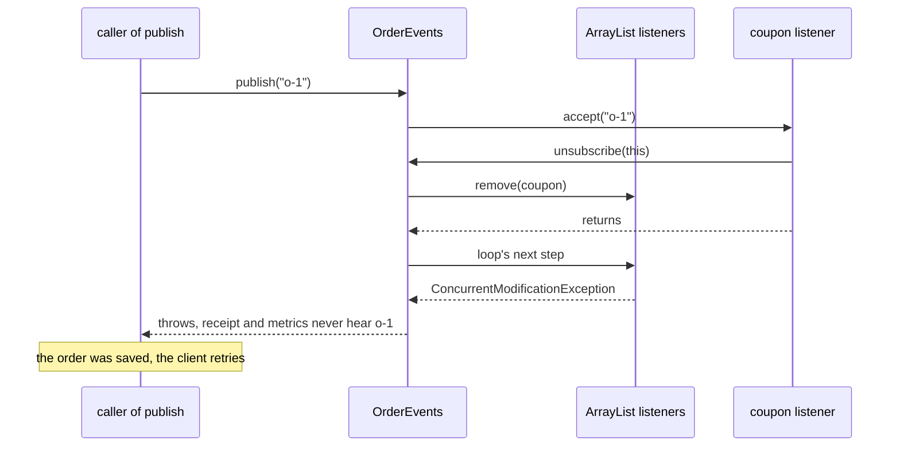

# 9.3.2. Observer Pattern

The order service tells other components about each placed order through a list of listeners:
receipts, loyalty points, metrics. Last week the first order after every restart failed with
`ConcurrentModificationException`, although it had been saved, and the client's retry saved it
again. For two hours guests got no receipts, and the log had a loyalty error for every guest order.
The admin console's heap grows by about a megabyte for each report screen anyone opens and
closes.

Observer is a list of callbacks that a subject calls when something happens. Each of those
failures comes from a decision the list makes: what it walks, what it does when a callback throws,
how a callback leaves, and how long it keeps one.

## A Listener That Unsubscribes During a Dispatch Changes the List Being Walked

The subject behind the order service:

```java
import java.util.List;
import java.util.function.Consumer;

/** Tells other components about each placed order. */
final class OrderEvents {
    private final List<Consumer<String>> listeners;

    OrderEvents(List<Consumer<String>> listeners) { this.listeners = listeners; }

    void subscribe(Consumer<String> l) { listeners.add(l); }
    void unsubscribe(Consumer<String> l) { listeners.remove(l); }
    int count() { return listeners.size(); }

    void publish(String orderId) {
        for (Consumer<String> l : listeners) l.accept(orderId);
    }
}
```

After a restart, the first order earns a welcome coupon. The listener that sends it has no work
left after that, so it unsubscribes itself:

```java
@Override
public void accept(String orderId) {
    System.out.println("  welcome coupon for " + orderId);
    events.unsubscribe(this);
}
```

With an `ArrayList` behind `OrderEvents`, what happens to the receipt and metrics listeners for the
first order? Three runs publish `o-1` and `o-2`: coupon registered first, coupon registered second,
and coupon first on a `CopyOnWriteArrayList`:

```text
ArrayList, coupon first:
  welcome coupon for o-1
  publish(o-1) threw java.util.ConcurrentModificationException
  receipt for o-2
  metrics count o-2
ArrayList, coupon second:
  receipt for o-1
  welcome coupon for o-1
  receipt for o-2
  metrics count o-2
CopyOnWriteArrayList, coupon first:
  welcome coupon for o-1
  receipt for o-1
  metrics count o-1
  receipt for o-2
  metrics count o-2
```

With the coupon first, the loop's next step throws, the receipt and metrics listeners never hear
about `o-1`, and the exception reaches the code that called `publish` after the order was saved.
That caller reports a failure, and the client retries an order that exists. With the coupon
second, nothing throws, and the metrics listener silently misses `o-1`: the list shrank under the
iterator, which then took itself to be at the end. Unit 6.5.3 explains both outcomes from the
iterator's counter and the copy-on-write snapshot.



A listener can't know where it sits in the list, so the subject must make leaving safe. A
`CopyOnWriteArrayList` does: a dispatch walks the array it started with, so a listener
removed during a dispatch still gets that event and none after it, and one added during it starts
with the next. Copying the list at the start of `publish` does the same. Listener lists change
rarely and are read on every event, the load a copy-on-write list is built for.

`synchronized` on `publish` is no substitute: the removal comes from the same thread, which already
holds the lock, so the `ArrayList` still throws. It also calls every listener under the subject's
lock, which unit 5.3.4 shows deadlocking once a listener takes a lock of its own.

<!-- practice 1 -->

## One Listener's Exception Skips the Listeners After It and Reaches the Publisher

The loyalty listener throws for a guest order, which has no customer. It was registered before the
receipt listener:

```java
static void placeOrder(Order order) {
    System.out.println("  saved " + order.id());
    for (Consumer<Order> l : listeners) l.accept(order);
}
```

```text
one loop over the listeners:
  saved o-7
  placeOrder threw java.lang.IllegalStateException: no loyalty account for a guest
```

The receipt listener was never called, and `placeOrder`, which had saved the order, threw. The
listeners don't know about each other, and the subject doesn't know what they do, so neither can
decide that loyalty points matter more than receipts. A loop with no `try` decides it anyway: one
failure ends the dispatch for every listener registered after it. The publisher then reports a
failed order that succeeded, with the same retry as in the previous section.

So the subject catches around each call, reports the failure, and goes on:

```java
for (Consumer<Order> l : listeners) {
    try {
        l.accept(order);
    } catch (RuntimeException e) {
        System.out.println("  listener failed on " + order.id() + ": " + e.getMessage());
    }
}
```

```text
a try/catch around each listener:
  saved o-7
  listener failed on o-7: no loyalty account for a guest
  receipt for o-7
```

The JDK's own `java.beans.PropertyChangeSupport` doesn't do this either: it calls its listeners in
one loop with no `try`. With the same two listeners:

```text
java.beans.PropertyChangeSupport:
  firePropertyChange threw java.lang.IllegalStateException: no loyalty account for a guest
```

Report the failure where someone will see it: a logger, or an error handler the subject was given.
A catch that swallows it turns the guest-order bug into missing loyalty points nobody can trace.

<!-- practice 2 -->

## A Listener Is Removed by the Reference It Was Added With, and a Second Lambda Is Another Object

`unsubscribe` ends in `List.remove(Object)`, which looks for an element `equals` to its argument.
A lambda or method reference doesn't override `equals`, so only the same object matches. Three
removals that look right, and one that is:

```java
events.subscribe(id -> System.out.println("audit " + id));
events.unsubscribe(id -> System.out.println("audit " + id));

// in a Dashboard
void open() { events.subscribe(this::onOrder); }
void close() { events.unsubscribe(this::onOrder); }

// pcs is a java.beans.PropertyChangeSupport
pcs.addPropertyChangeListener(evt -> System.out.println(evt));
pcs.removePropertyChangeListener(evt -> System.out.println(evt));

// events3 is another OrderEvents
Consumer<String> audit = id -> System.out.println("audit " + id);
events3.subscribe(audit);
events3.unsubscribe(audit);
```

```text
lambda removed with the same lambda text: 1 left
this::onOrder removed with this::onOrder: 1 left (a == b false, a.equals(b) false)
PropertyChangeSupport: 1 left
removed with the reference it was added with: 0 left
```

Each evaluation of `this::onOrder` created a new object (`a` and `b` are two of them), so the
dashboard's `close()` passes an object the list has never seen, and `remove` returns a `false`
nobody checks. The dashboard looks as if it cleans up after itself.

Keep the reference in a field and pass that field to `unsubscribe`, or let the subject hand back
something that removes the registration, so the caller can't pass the wrong object:

```java
AutoCloseable subscribe(Consumer<String> listener) {
    Consumer<String> entry = listener::accept;         // a new object for each registration
    listeners.add(entry);
    return () -> listeners.remove(entry);
}
```

```text
same listener subscribed twice, one handle closed: 1 left
other handle closed twice: 0 left
```

Each registration gets its own entry, so a handle removes exactly its own registration.

<!-- practice 3 -->

## The Subject Keeps Every Listener, and Everything It Captures, Until It Is Removed

A report screen in the admin console subscribes `this::refresh` when it opens, to update its 1 MB
of report data on each order, and its `close()` doesn't unsubscribe. We open and close 200 screens,
keep a `WeakReference` to each, and call `System.gc()`. A weak reference is cleared once nothing
else can reach its object, so the uncleared ones count the screens still held:

```java
for (int i = 0; i < 200; i++) {
    ReportScreen screen = new ReportScreen(unsubscribeOnClose);
    screen.open();
    screen.close();                                  // the user closed it; nothing else refers to it
    closed.add(new WeakReference<>(screen));
}
System.gc();
```

```text
never unsubscribed:    listeners 200, closed screens reachable after GC 200, heap used 202 MB
unsubscribed on close: listeners   0, closed screens reachable after GC   0, heap used 4 MB
```

The subject outlives the screens. Its list holds each method reference, the reference holds its
screen, and the screen holds its data, so nothing a closed screen owns can be collected, and every
order still refreshes 200 screens nobody can see. The second run's `close()` removes the listener it
kept in a field. In a heap dump this shows as a screen class whose instance
count grows with each open, every instance reachable through the subject's list.

Holding listeners through weak references moves the failure rather than removing it. A lambda
that captures a variable, registered in place, has no other reference, so the first collection
clears it, and the listener stops without an error:

```text
weakly held lambda received [o-1]
```

Pair each `subscribe` with the code that ends its owner, such as a screen's `close()`, and give that code something to close.

## When a Subscriber Can't Keep Up, a Flow Publisher Makes the Producer Wait or Drop

Every dispatch so far runs the listeners on the publisher's thread, so a listener that takes
10 ms adds 10 ms to every order. Handing events to another thread moves that delay into a queue,
and while orders arrive faster than the listener handles them, an unbounded queue grows until the
heap runs out. `java.util.concurrent.Flow` (Java 9) lets a
subscriber say how many items it can take, and `SubmissionPublisher` is the JDK's publisher for it.
This subscriber spends 10 ms on each order and asks for one at a time, behind a buffer of 8:

```java
public void onSubscribe(Flow.Subscription s) { subscription = s; s.request(1); }
public void onNext(String orderId) {
    try { Thread.sleep(10); } catch (InterruptedException e) { Thread.currentThread().interrupt(); }
    handled.incrementAndGet();
    subscription.request(1);                       // ready for the next one
}
```

One run publishes 100 orders with `submit`, another with `offer` and a handler that counts drops:

```text
submit: buffer 8, 100 submitted in 939 ms, max lag 9
        handled 100
offer:  100 offered in 4 ms, dropped 91
        handled 9
```

`submit` blocks while the buffer is full, so the producer runs at the subscriber's pace and nothing
is lost. `offer` returns at once and hands what doesn't fit to the drop handler. Which one is a
business decision: orders must not be dropped, while a price display can skip a tick. A subscriber
whose `onNext` throws has its subscription cancelled and gets the exception through `onError`; in
a run of ten items with two subscribers, the other one still received all ten.

## Summary

- **A listener that unsubscribes during a dispatch changes the list being walked.** On an
  `ArrayList` the dispatch throws or skips the next listener; a `CopyOnWriteArrayList` or a copy
  makes leaving safe.
- **One listener's exception skips the listeners after it and reaches the publisher.** Catch and
  report around each call; `PropertyChangeSupport` doesn't.
- **A listener is removed by the reference it was added with.** A second lambda or `this::m` is
  another object, so the removal silently does nothing; keep the reference or return a handle.
- **The subject keeps every listener, and what it captures, until it is removed.** Unsubscribe
  when the owner closes; weak references lose listeners that nothing else holds.
- **A `Flow` publisher bounds what waits for a slow subscriber.** `submit` waits, `offer` drops.

## Reference

**Changing an `OrderEvents`-style list during a dispatch (Java 21):**

| List | A listener removes itself | A listener adds another |
|---|---|---|
| `ArrayList`, for-each | `ConcurrentModificationException`, or the next listener is skipped | `ConcurrentModificationException` |
| `CopyOnWriteArrayList`, or a copy taken before the loop | it still gets this event, no later ones | the new one starts with the next event |

**Removing a listener:**

| Registered as | Removed with | Removed |
|---|---|---|
| a lambda | the same lambda written again | no |
| `this::m` | `this::m` written again | no |
| a variable or field | the same variable or field | yes |
| anything, through a handle per registration | the handle's `close()` | exactly that registration |

**`SubmissionPublisher` when a subscriber's buffer is full (javadoc):**

| Method | Does |
|---|---|
| `submit(item)` | blocks until there is room |
| `offer(item, onDrop)` | calls `onDrop`; if it returns `true`, tries once more, otherwise drops |
| `offer(item, timeout, unit, onDrop)` | waits up to the timeout first, then as `offer` |

## Challenges

1. A listener unsubscribes another listener, not itself, during a dispatch. With a copy-on-write
   list, the other one still gets the current event. When does that matter, and how would you make
   the removal take effect at once?
2. Your subject catches and logs every listener failure. One listener now fails on every event and
   fills the log. What should happen after its hundredth failure, and who decides?
3. Measure a `CopyOnWriteArrayList` of 10,000 listeners that subscribe and leave at the rate users
   log in and out. At what churn does copying on every write cost more than the dispatches?

## Design Note: Synchronous Dispatch Puts Every Listener's Cost on the Publisher

A listener list calls its listeners on the publisher's thread, inside the publisher's call. That
keeps events in order and needs no threads, and it is why the failures of the first two sections
reached the publisher: a listener's unsubscribing and its exception happen inside `publish`.
Moving dispatch to another thread separates them, and raises the questions `Flow` answers: how
much to buffer, and what to do when the buffer is full.

The JDK's first answer, `java.util.Observable`, has been deprecated since Java 9. Its javadoc calls
its event model "quite limited", says the order of its notifications is unspecified, and points to
`java.beans`, the concurrent collections and the `Flow` API instead.

## Code Examples

- Test: [ObserverPatternTest.java](src/test/java/com/github/msorkhpar/claudejavatutor/behavioralpatterns/ObserverPatternTest.java)
- Source: [ObserverPattern.java](src/main/java/com/github/msorkhpar/claudejavatutor/behavioralpatterns/ObserverPattern.java)
