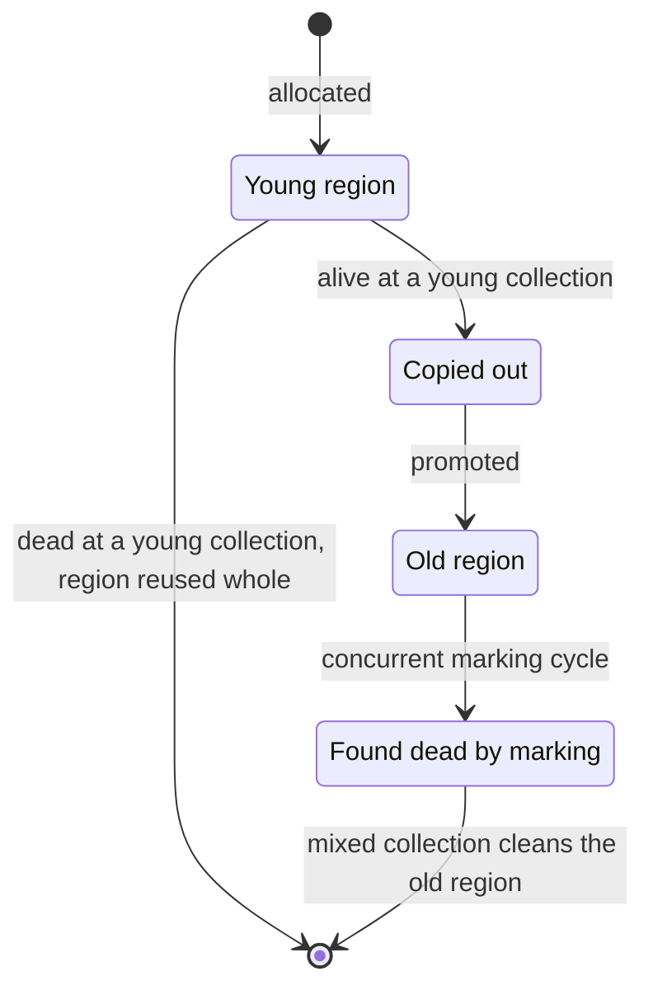

# 10.2.2. Garbage Collection Algorithms

A pricing service runs with a 1 GB heap. It keeps a 400 MB cache of price lists and allocates a
few kilobytes per request, and its p99 latency has spikes of tens of milliseconds. One colleague
wants ZGC because "it has no pauses", another wants Parallel because "it has the best
throughput", and a third adds `System.gc()` after every cache reload. None of them has read the GC
log.

Every run here is Java 21 (Temurin 21.0.12) on one machine with 20 CPUs. Absolute pause times vary
with hardware, heap and version; compare the runs with each other. Where objects live and what
`OutOfMemoryError` looks like is unit 10.2.1.

## A Young Collection Costs What Survives, Not What Was Allocated

This program allocates 8 GB of 1 KB arrays. Each array stays in a ring of `window` slots, so it
lives until `window` more arrays have been allocated:

```java
public class GcLoad {
    public static void main(String[] args) {
        int window = Integer.parseInt(args[0]);
        long totalMb = Long.parseLong(args[1]);
        long count = totalMb * 1024;                 // number of 1 KB arrays
        byte[][] alive = new byte[window][];
        long start = System.nanoTime();
        long sum = 0;
        for (long i = 0; i < count; i++) {
            byte[] b = new byte[1024];
            b[0] = (byte) i;
            alive[(int) (i % window)] = b;           // the array it replaces becomes garbage
            sum += alive[(int) ((i * 7) % window)] == null ? 0 : 1;
        }
        long ms = (System.nanoTime() - start) / 1_000_000;
        System.out.printf("window %,d: allocated %,d MB in %,d ms (%d)%n", window, totalMb, ms, sum % 2);
    }
}
```

With a window of 1,000, about 1 MB is alive at any moment; with 200,000, about 200 MB. How do the
pauses compare? We ran each window with
`java -Xms1g -Xmx1g -Xlog:gc:file=gc.log GcLoad <window> 8000` on G1, the default collector, and
summed each log's `Pause` lines with a short script. The first run of each:

```text
window 1,000: allocated 8,000 MB in 421 ms (1)
logs/gen-1000-1.log: pauses 14, total 12.9 ms, longest 2.0 ms
   Pause Young (Normal)           14  total     12.9 ms  longest    2.0 ms
window 200,000: allocated 8,000 MB in 1,684 ms (1)
logs/gen-200000-1.log: pauses 97, total 1251.0 ms, longest 51.3 ms
   Pause Cleanup                  12  total      1.5 ms  longest    0.2 ms
   Pause Remark                   12  total      5.8 ms  longest    0.7 ms
   Pause Young (Concurrent Start)   12  total    210.5 ms  longest   40.2 ms
   Pause Young (Mixed)            12  total    252.0 ms  longest   31.6 ms
   Pause Young (Normal)           37  total    515.7 ms  longest   32.4 ms
   Pause Young (Prepare Mixed)    12  total    265.6 ms  longest   51.3 ms
```

Over three runs: 14 pauses and 12–13 ms in total for the small window, 90–99 pauses and
508–1251 ms for the large one. Two young collections from the first log:

```text
[0.150s][info][gc] GC(2) Pause Young (Normal) (G1 Evacuation Pause) 614M->2M(1024M) 0.715ms
[0.391s][info][gc] GC(12) Pause Young (Normal) (G1 Evacuation Pause) 614M->2M(1024M) 0.871ms
```

G1 splits the heap into regions. A young collection copies the live objects out of the young
regions and reuses those regions whole. It never visits the 612 MB of dead arrays, so its cost follows the 2 MB that survive.
That is the bet a generational collector makes: most objects die young, so collecting the young
part often is cheap. With the 200,000 window almost every young object is still alive at the
collection, so each one is copied, then promoted (moved to old regions), and later found dead there by a
concurrent marking cycle, after which mixed collections clean the old regions.



"Alive" means reachable from a root: a local variable of a running method, a static field, a
thread. Nothing counts references, so two objects that refer only to each other are garbage:

```java
Node a = new Node(), b = new Node();
a.next = b;
b.next = a;                                           // each is referenced by the other
WeakReference<Node> watchA = new WeakReference<>(a);
a = null;
b = null;
System.gc();
System.out.println("cycle collected: " + (watchA.get() == null));
```

```text
cycle collected: true
```

The costly objects live a little while, such as a batch held across a few requests. They are
copied in the young generation and then marked in the old one.

## Each Collector Puts the Cost Somewhere: Pauses, Stalls or CPU

The pricing service as a program: a 400 MB cache that changes slowly, plus 16 GB of request data,
each array kept for the next 20,000 allocations:

```java
import java.util.HashMap;
import java.util.Map;

public class GcMix {
    public static void main(String[] args) {
        int liveMb = Integer.parseInt(args[0]);
        int window = Integer.parseInt(args[1]);
        long totalMb = Long.parseLong(args[2]);
        Map<Integer, byte[]> cache = new HashMap<>();
        for (int i = 0; i < liveMb * 1024; i++) cache.put(i, new byte[1024]);
        byte[][] recent = new byte[window][];
        long start = System.nanoTime();
        long count = totalMb * 1024, sum = 0;
        for (long i = 0; i < count; i++) {
            byte[] b = new byte[1024];
            b[0] = (byte) i;
            recent[(int) (i % window)] = b;
            if ((i & 1023) == 0) cache.put((int) (i % (liveMb * 1024L)), new byte[1024]); // the cache changes slowly
            sum += b[0];
        }
        System.out.printf("cache %d MB, window %,d: allocated %,d MB in %,d ms (%d)%n",
                liveMb, window, totalMb, (System.nanoTime() - start) / 1_000_000, sum & 1);
    }
}
```

We ran `GcMix 400 20000 16000` five times under each collector, with `-Xms1g -Xmx1g
-Xlog:gc,gc+phases:file=gc.log` (with `-Xlog:gc` alone, ZGC's pause lines don't appear). Each cell
is the range over the five runs; CPU is user plus system time of the whole JVM:

| Collector (flag) | Pauses | Total pause | Longest pause | Allocation stalls | Loop | CPU |
|---|---|---|---|---|---|---|
| G1 (default) | 47–61 | 114–173 ms | 6.8–11.7 ms | none | 830–1038 ms | 2.5–3.5 s |
| Parallel (`-XX:+UseParallelGC`) | 65 | 861–1187 ms | 45.9–53.4 ms | none | 1490–1911 ms | 11.6–12.7 s |
| Serial (`-XX:+UseSerialGC`) | 65 | 536–653 ms | 94.3–122.1 ms | none | 1085–1305 ms | 1.4–1.6 s |
| ZGC (`-XX:+UseZGC`) | 93–102 | about 1 ms | under 0.1 ms | 29–30 stalls, 561–623 ms in total | 1565–1710 ms | 4.3–5.3 s |
| Generational ZGC (`-XX:+UseZGC -XX:+ZGenerational`, see the note below) | 217–290 | 1–4 ms | under 0.1 ms | none | 854–1153 ms | 2.4–3.1 s |

Lines from each first run, decorations cut, collector's name in front:

```text
G1        GC(0) Pause Young (Normal) (G1 Evacuation Pause) 52M->52M(1024M) 8.285ms
Parallel  GC(3) Pause Full (Ergonomics) 737M->450M(981M) 46.660ms
Serial    GC(1) Pause Young (Allocation Failure) 523M->450M(989M) 120.548ms
Serial    GC(4) Pause Full (Allocation Failure) 723M->450M(989M) 59.896ms
ZGC       Allocation Stall (main) 21.356ms
ZGC       GC(2) Pause Relocate Start 0.009ms
```

**ZGC's pauses are tiny, and the application still waited.** Single-generation ZGC marks the whole
heap, including the 400 MB cache, in every cycle. The request data filled the heap faster than a
cycle finished, so the allocating thread stopped in `Allocation Stall` until the cycle freed
memory: about 20 ms at a time, 30 times per run, longer than G1's longest pause. A latency
dashboard sees those as pauses whatever the log calls them. Generational ZGC collects the young
objects on their own, kept up with the same program, and never stalled.

**Parallel was the slowest and used the most CPU.** With 450 MB live in a 1 GB heap, its sizing
policy predicted that a young collection's survivors would not fit in the old generation, and
ran a full collection instead: in every run 62 of its 65 pauses are `Pause Full (Ergonomics)`,
each marking the whole cache with 15 GC threads. With `-Xmx2g`, in one run, the same program had
44 young pauses, no full one, 240 ms of pauses in total and 2.9 s of CPU.

**Serial had the longest pauses and the least CPU.** One thread does all the work, with the
application stopped. In every run its two longest pauses (80–122 ms) are the first two young
collections, which copy the freshly built cache into the old generation.

> **Versions differ.** On Java 21 ZGC is single-generation unless `-XX:+ZGenerational` is given.
> JDK 23 made generational the default (JEP 474) and JDK 24 removed the single-generation mode
> (JEP 490): on Java 25 the flag prints `Ignoring option ZGenerational; support was removed in 24.0`.

## System.gc() Is a Request, and JVM Flags Decide What It Does

After each reload, the third colleague's code calls `System.gc()` "to clean up". This program
holds 300 MB, creates a `WeakReference` to an object nothing else holds, and times the call:

```java
for (int i = 0; i < 300 * 1024; i++) cache.put(i, new byte[1024]);   // 300 MB that stays
WeakReference<Object> weak = new WeakReference<>(new Object());       // garbage from the start
long start = System.nanoTime();
System.gc();
long ms = (System.nanoTime() - start) / 1_000_000;
System.out.println("System.gc() returned after " + ms + " ms, weak referent cleared: "
        + (weak.get() == null));
```

With `-Xlog:gc`, under five flag sets (each followed by the GC lines the call caused, then the
program's line):

```text
G1 (default):
[0.115s][info][gc] GC(7) Pause Full (System.gc()) 346M->322M(1200M) 18.710ms
System.gc() returned after 18 ms, weak referent cleared: true
-XX:+DisableExplicitGC:
System.gc() returned after 0 ms, weak referent cleared: false
-XX:+ExplicitGCInvokesConcurrent:
[0.100s][info][gc] GC(7) Pause Young (Concurrent Start) (System.gc()) 348M->352M(1944M) 3.840ms
System.gc() returned after 21 ms, weak referent cleared: true
-XX:+UseParallelGC:
[0.106s][info][gc] GC(2) Pause Young (System.gc()) 347M->344M(768M) 4.776ms
[0.137s][info][gc] GC(3) Pause Full (System.gc()) 344M->321M(768M) 30.643ms
System.gc() returned after 35 ms, weak referent cleared: true
-XX:+UseZGC -XX:+ZGenerational:
[0.257s][info][gc] GC(0) Major Collection (System.gc()) 372M(4%)->338M(3%) 0.088s
System.gc() returned after 87 ms, weak referent cleared: true
```

The javadoc says the call "suggests" a collection, with no guarantee of what it reclaims. On G1 and Parallel the
best effort is a full, stop-the-world collection of the whole heap, so every reload adds a pause
for all request threads (18–40 ms over two runs of each), and it reclaims nothing the collector would not have reclaimed on its own later. With `-XX:+DisableExplicitGC`, which some deployments set for that reason, the
call does nothing at all and the weak reference stays uncleared. A test that relies on `System.gc()` to clear a reference fails on a machine that sets this flag. With `ExplicitGCInvokesConcurrent` or ZGC the pause is short, but the calling thread still
waits for the whole cycle.

## A WeakHashMap Entry Goes Only When Nothing Else Reaches Its Key

A `WeakHashMap` holds its keys through weak references and its values strongly. A weak reference
is cleared by the first collection that traces its object and finds it reachable only through
weak references. The program builds three maps with three kinds of key:

```java
import java.util.Map;
import java.util.WeakHashMap;

public class WeakKeys {
    record Session(String id) {}
    record Audit(Session session, String note) {}

    public static void main(String[] args) throws InterruptedException {
        Map<Object, Object> plain = new WeakHashMap<>();
        Map<Object, Object> literalKey = new WeakHashMap<>();
        Map<Object, Object> backRef = new WeakHashMap<>();

        Session s1 = new Session("s-17"), s2 = new Session("s-18");
        plain.put(s1, "note");
        literalKey.put("s-17", "note");                       // a string literal: the class keeps it
        backRef.put(s2, new Audit(s2, "note"));               // the value refers to its key
        System.out.printf("before:  plain %d, literal key %d, value -> key %d%n",
                plain.size(), literalKey.size(), backRef.size());

        s1 = null;                                            // the last strong references outside the maps
        s2 = null;
        System.gc();
        System.out.printf("after gc: plain %d, literal key %d, value -> key %d%n",
                plain.size(), literalKey.size(), backRef.size());
        Thread.sleep(100);
        System.out.printf("100 ms on: plain %d, literal key %d, value -> key %d%n",
                plain.size(), literalKey.size(), backRef.size());
    }
}
```

```text
before:  plain 1, literal key 1, value -> key 1
after gc: plain 1, literal key 1, value -> key 1
100 ms on: plain 0, literal key 1, value -> key 1
```

Only the plain map lost its entry. A string literal is interned and stays reachable while the
class that uses it is loaded, so it never becomes weakly reachable. In the third map the value refers to its key, and the map
holds the value strongly, so the key is reachable from the map itself. That map leaks like a
`HashMap`.

The plain entry also did not go at the collection. The collector cleared the weak reference, then
the JDK's reference-handler thread put it on the map's queue, and the map removes entries for
queued references on its next call. So `size()` still said 1 right after `System.gc()`
returned: the removal races with the caller on any machine, and code that checks for it has to
wait. Unit 9.3.2 shows the opposite failure: a listener held
only weakly is lost at the first collection.

<!-- practice 1 -->

## A Soft Cache Survives Collections While There Is Room, and Empties When an Allocation Doesn't Fit

The javadoc leaves clearing a `SoftReference` to the collector. It asks only that every soft
reference be cleared before an `OutOfMemoryError`, and that recently created or used ones be
cleared last. Ten 4 MB entries in a soft cache, with a 64 MB heap:

```java
List<SoftReference<byte[]>> cache = new ArrayList<>();
for (int i = 0; i < 10; i++) cache.add(new SoftReference<>(new byte[4 << 20]));  // 10 x 4 MB
System.gc();
System.out.println("after System.gc():        " + alive(cache) + " of 10 cached");

List<byte[]> work = new ArrayList<>();
for (int mb = 4; ; mb += 4) {
    work.add(new byte[4 << 20]);                    // the application needs memory
    int left = alive(cache);
    if (left < 10) {
        System.out.println("after " + mb + " MB more allocated: " + left + " of 10 cached");
        break;
    }
}
```

```text
after System.gc():        10 of 10 cached
after 12 MB more allocated: 0 of 10 cached
```

The same in all three runs with `-Xmx64m`; with `-XX:+UseSerialGC` it took 20 MB, and then also
0 of 10. A full `System.gc()` with room to spare kept every entry. Once 12 MB more had been
allocated, none of the ten was left.

HotSpot decides by age and room: a soft reference survives roughly
`-XX:SoftRefLRUPolicyMSPerMB` (default 1000) milliseconds per MB of free heap since its last
`get()`. With that flag set to 0, the same `System.gc()` left 4 and 3 of 10 in two runs. As the
heap fills, the allowance shrinks towards nothing, and a collection that still can't make room
clears every soft reference.

So a soft cache empties at once under memory pressure, when recomputing every entry hurts most.
A map with a size bound (an LRU map with a maximum size) evicts the entries you choose, when you
choose.

> **Collectors differ.** On generational ZGC the same program printed between 0 and 7 of 10 after
> `System.gc()` in six runs.

## A Cleaner Runs After a Collection Finds Its Object, So close() Is the Release You Can Count On

`finalize()` is deprecated for removal. Its replacement, `java.lang.ref.Cleaner`, runs an action on
its own thread once the registered object becomes phantom reachable: no strong, soft or weak
reference reaches it any more. A buffer that releases native memory registers a release action
and calls it from `close()`; a second buffer's action is a lambda that reads its own field:

```java
import java.lang.ref.Cleaner;
import java.lang.ref.WeakReference;

public class Cleaners {
    static final Cleaner CLEANER = Cleaner.create();

    /** The cleaning action: it knows the name, not the buffer. */
    record Release(String name) implements Runnable {
        public void run() { System.out.println("  released " + name); }
    }

    static final class Buffer implements AutoCloseable {
        private final Cleaner.Cleanable cleanable;
        Buffer(String name) { cleanable = CLEANER.register(this, new Release(name)); }
        @Override public void close() { cleanable.clean(); }
    }

    static final class CapturingBuffer {
        private final String name;
        CapturingBuffer(String name) {
            this.name = name;
            CLEANER.register(this, () -> System.out.println("  released " + this.name));
        }
    }

    public static void main(String[] args) throws InterruptedException {
        try (Buffer b = new Buffer("b-2")) {
            System.out.println("closing b-2");
        }
        new Buffer("b-1");                                    // never closed
        WeakReference<CapturingBuffer> c = new WeakReference<>(new CapturingBuffer("c-1"));
        if (args.length == 0) {
            System.out.println("System.gc()");
            System.gc();
        }
        Thread.sleep(200);
        System.out.println("c-1 still reachable: " + (c.get() != null));
    }
}
```

```text
closing b-2
  released b-2
System.gc()
  released b-1
c-1 still reachable: true
```

Run with an argument, so that no collection happens, and with `-Xlog:gc`:

```text
[0.002s][info][gc] Using G1
closing b-2
  released b-2
c-1 still reachable: true
```

`b-2` was released by `close()`, at once; `clean()` runs the action at most once, so a collection
later does not release it again. The forgotten `b-1` was released only after a collection found
it. In the second run, with no collection before the JVM exited, it was never released. A forgotten buffer
that has reached the old generation waits for an old-generation collection, holding its native
memory until then.

`c-1` is never released. The lambda reads `this.name`, so it holds the buffer, and the `Cleaner`
holds the lambda, so the buffer stays reachable from the `Cleaner` for the life of the JVM. The
action must hold only what it needs to release, as `Release` does with the name.

<!-- practice 2 -->

<!-- practice 3 -->

## Summary

- **A young collection costs what survives.** Short-lived garbage is nearly free; objects that
  live through a few collections are copied, promoted and marked again.
- **Each collector puts the cost somewhere.** G1 in pauses of a few milliseconds, Serial and
  Parallel in longer ones, single-generation ZGC in allocation stalls when the heap fills faster
  than it collects; the log and the CPU time show which.
- **`System.gc()` is a request.** On G1 and Parallel it is a full stop-the-world collection; with
  `-XX:+DisableExplicitGC` it does nothing.
- **A `WeakHashMap` entry goes only when nothing else reaches its key**, and only after the
  reference is queued, not at the collection.
- **A soft cache survives collections while there is room, and empties when an allocation doesn't
  fit.** HotSpot keeps recently used soft references longer when the heap has room, and clears
  them all when a collection can't free enough.
- **A `Cleaner` runs only after a collection finds its object**, and never if its action holds the
  object. `close()` is the release.

## Reference

**Reference types (Java 21 javadoc, and the runs above):**

| Type | `get()` | Cleared |
|---|---|---|
| strong (a field, a local) | — | never, while reachable from a root |
| `SoftReference` | the object until cleared | at the collector's discretion; all of them before an `OutOfMemoryError` |
| `WeakReference` | the object until cleared | by the first collection that traces the object and finds it only weakly reachable |
| `PhantomReference` | always `null` | enqueued after the object becomes phantom reachable; the base of `Cleaner` |

**Flags used on this page (Java 21):**

| Flag | Effect |
|---|---|
| `-XX:+UseG1GC`, `-XX:+UseParallelGC`, `-XX:+UseSerialGC`, `-XX:+UseZGC` | selects the collector; G1 is the default |
| `-XX:+ZGenerational` | generational mode of ZGC (default from JDK 23, the only mode from JDK 24) |
| `-Xlog:gc` | one line per collection (with its pause, for a stop-the-world collection); `-Xlog:gc,gc+phases` adds ZGC's pauses |
| `-Xlog:gc:file=gc.log` | the same, to a file |
| `-XX:+DisableExplicitGC` | `System.gc()` does nothing |
| `-XX:SoftRefLRUPolicyMSPerMB=n` | how long, per MB of free heap, an unused soft reference survives (default 1000 ms) |
| `-XX:+ExplicitGCInvokesConcurrent` | `System.gc()` starts a concurrent cycle on G1 instead of a full collection |

**Log lines (Java 21, `-Xlog:gc`):**

| Line | Meaning |
|---|---|
| `Pause Young (Normal)` | G1 young collection |
| `Pause Young (Concurrent Start)`, `Pause Remark`, `Pause Cleanup`, `Pause Young (Mixed)` | G1's old-generation cycle |
| `Pause Full (Ergonomics)` | Parallel's full collection chosen by its sizing policy |
| `Pause Full (System.gc())` | a full collection from `System.gc()` |
| `Allocation Stall (thread)` | a ZGC thread waited for memory |

## Challenges

1. Rerun `GcMix` under single-generation ZGC with `-Xmx2g`, then `-Xmx4g`. At what heap size do
   the allocation stalls stop, and what does the extra heap cost the service?
2. `GcMix`'s window of 20,000 is the request data's lifetime. Find the window at which G1's young
   pauses start to grow, and say what in a real service sets that lifetime.
3. A library you depend on calls `System.gc()` after loading its data. Which flag would you set,
   what does it change for the library, and what would you check before setting it in production?
4. Your image cache uses `SoftReference`s and empties under load. Design a replacement and say
   what it does when the heap is nearly full.

## Design Note: Why Java Never Promises When an Object Is Collected

Java collects by reachability and leaves the timing to the collector. That freedom is what
lets G1 skip the dead young objects, ZGC move objects while the application runs, and Parallel
spend fifteen threads on a full collection. Each collector meets its own goal because nothing in
the language says when an unreachable object goes.

The cost falls on everything that wants to act on collection. `finalize()` ran late or never, and
was deprecated. A `Cleaner`, a `WeakHashMap` and a soft cache inherit the same uncertainty: they act
after some later collection, on another thread, and `System.gc()` can't force it because it is only
a request. Code that must release something at a known time does it explicitly, with `close()`.

## Code Examples

- Test: [GarbageCollectionTest.java](src/test/java/com/github/msorkhpar/claudejavatutor/memorymanagement/GarbageCollectionTest.java)
- Source: [GarbageCollection.java](src/main/java/com/github/msorkhpar/claudejavatutor/memorymanagement/GarbageCollection.java)
