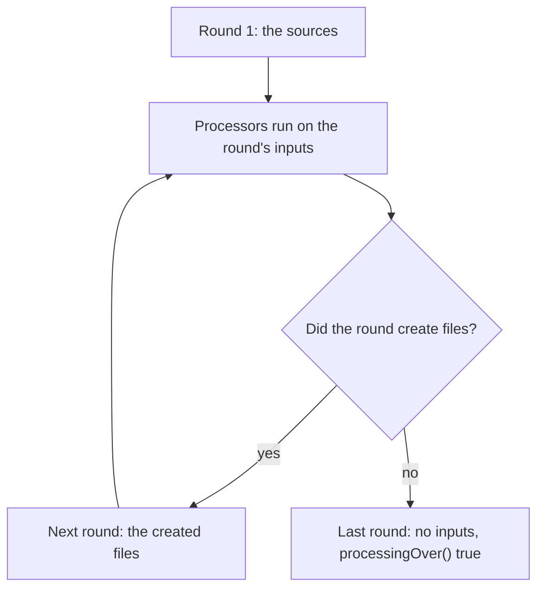

# 10.4.4. Annotation Processing and Code Generation

The order service finds its commands at startup: it scans the class path for classes marked
`@Command("refund")`, `@Command("audit")` and so on, and creates each one through its no-arg
constructor. A refactoring made `Audit`'s constructor private. The build passed, every test that
didn't create an `Audit` passed, and the service failed in production on the first `audit`
request.

An annotation processor moves that work into the compile. javac runs it; it writes the registry
as Java source and can refuse the bad class before anything ships. Declaring annotations is unit
10.4.2 and retention is unit 10.4.3: a processor reads source, so `RetentionPolicy.SOURCE` is
enough for `@Command`. Reading annotations at run time through reflection is units 10.3.1 to
10.3.4.

## A Processor Is Code javac Runs During the Compile, and What It Adds Is New Source Files

The annotation, and a processor that writes the registry, `app.CommandIndex`, as a `switch` over
the command names:

```java
package proc;

import java.lang.annotation.*;

@Retention(RetentionPolicy.SOURCE)
@Target(ElementType.TYPE)
public @interface Command {
    String value();
}
```

```java
package proc;

import java.io.IOException;
import java.io.Writer;
import java.util.Set;
import javax.annotation.processing.*;
import javax.lang.model.SourceVersion;
import javax.lang.model.element.*;

@SupportedAnnotationTypes("proc.Command")
@SupportedSourceVersion(SourceVersion.RELEASE_21)
public class IndexProcessor extends AbstractProcessor {

    @Override
    public boolean process(Set<? extends TypeElement> annotations, RoundEnvironment round) {
        if (annotations.isEmpty()) return false;
        StringBuilder cases = new StringBuilder();
        for (Element e : round.getElementsAnnotatedWith(Command.class)) {
            String name = e.getAnnotation(Command.class).value();
            String type = ((TypeElement) e).getQualifiedName().toString();
            cases.append("            case \"").append(name)
                 .append("\" -> new ").append(type).append("();\n");
        }
        try (Writer w = processingEnv.getFiler().createSourceFile("app.CommandIndex").openWriter()) {
            w.write("""
                package app;

                public final class CommandIndex {
                    public static Runnable create(String name) {
                        return switch (name) {
                %s            default -> throw new IllegalArgumentException(name);
                        };
                    }
                }
                """.formatted(cases));
        } catch (IOException ex) {
            processingEnv.getMessager().printMessage(javax.tools.Diagnostic.Kind.ERROR, ex.toString());
        }
        return true;
    }
}
```

The application has `Refund`, marked `@Command("refund")`, and a `Main` that calls
`CommandIndex.create(args[0]).run()`. No file in the application declares `CommandIndex`. The
processor is compiled first, on its own, and named when the application is compiled (`out/proc`
is on `-cp` too, because the sources import `proc.Command`):

```text
$ javac -d out/proc proc/src/proc/*.java
$ javac -processorpath out/proc -cp out/proc -processor proc.IndexProcessor \
        -s out/gen -d out/app app/src/app/*.java
$ cat out/gen/app/CommandIndex.java
package app;

public final class CommandIndex {
    public static Runnable create(String name) {
        return switch (name) {
            case "refund" -> new app.Refund();
            default -> throw new IllegalArgumentException(name);
        };
    }
}
$ java -cp out/app app.Main refund
refund issued
```

`getElementsAnnotatedWith` returns `Element`s from `javax.lang.model`, the compiler's view of the
declarations. The application's classes aren't compiled yet, so there are no `Class` objects. The file
the `Filer` creates is compiled along with the sources, which is why `Main` compiled. With
`-proc:none` the same compile fails:

```text
app/src/app/Main.java:5: error: cannot find symbol
        CommandIndex.create(args[0]).run();
        ^
  symbol:   variable CommandIndex
  location: class Main
1 error
```

A processor can also be found without `-processor`, through a file
`META-INF/services/javax.annotation.processing.Processor` in its jar that names the class: the
`ServiceLoader` file of unit 8.1.5.

> **Discovery changed after Java 21.** With that jar only on `-cp`, javac 21 ran the processor and
> printed a note that "a future release of javac may disable annotation processing unless at least
> one processor is specified by name (-processor), or a search path is specified
> (--processor-path, --processor-module-path), or annotation processing is enabled explicitly
> (-proc:only, -proc:full)". javac 25, given the same command, ran no processor and failed with
> the `cannot find symbol` above. Name the processor or the processor path in the build, or pass
> `-proc:full`.

## An Error Reported at the Element Makes javac Point at the User's Line

Now `Audit` from the opening is in the sources, with its private constructor. Before reading on:
where does the compile fail, and which file does the error name?

```text
out/gen/app/CommandIndex.java:6: error: Audit() has private access in Audit
            case "audit" -> new app.Audit();
                            ^
1 error
```

The build fails, but the error is in a file the developer never wrote and may not know exists. The processor should check what the generated
code needs, and report a problem through the `Messager`, passing the element that has it:

```java
if (!hasPublicNoArgConstructor(type)) {
    processingEnv.getMessager().printMessage(Diagnostic.Kind.ERROR,
            "@Command class needs a public no-arg constructor", type);
    continue;
}
```

Here `type` is the `TypeElement`, and `hasPublicNoArgConstructor` looks through `ElementFilter.constructorsIn(type.getEnclosedElements())`
for one with no parameters and the `public` modifier. The same compile:

```text
app/src/app/Audit.java:6: error: @Command class needs a public no-arg constructor
public class Audit implements Runnable {
       ^
1 error
```

A message of kind `ERROR` fails the compile: javac exited with 1 and wrote no class files. A
`WARNING` or a `NOTE` leaves the build passing, unless it runs with `-Werror`.

Without the element argument the location is lost: javac printed
`error: @Command class needs a public no-arg constructor` with no file and no line, and in a large
build you can't tell which class. Throwing from `process` stops javac with
`An annotation processor threw an uncaught exception.` and a stack trace through
`com.sun.tools.javac`, and exit code 3 instead of 1.

<!-- practice 1 -->

## Processing Runs in Rounds, and a Generated File Is Processed in the Next One

A second processor in the build, `CrudProcessor`, generates a delete command for every entity
marked `@Crud`. For `Customer` it writes:

```java
package app;

@proc.Command("delete-customer")
public class DeleteCustomer implements Runnable {
    public void run() { System.out.println("customer deleted"); }
}
```

That class carries `@Command`, but it doesn't exist when `IndexProcessor` reads the sources. Here
the index processor keeps every `@Command` it sees in a field, `found`, and logs each call with a
call counter and the simple names of the round's root elements and `@Command` classes:

```java
processingEnv.getMessager().printMessage(Diagnostic.Kind.NOTE,
        "round " + roundNo + ": roots " + roots + ", @Command " + commands
        + ", over=" + round.processingOver());
```

```text
Note: round 1: roots [Customer, Main, Refund], @Command [Refund], over=false
Note: round 2: roots [DeleteCustomer], @Command [DeleteCustomer], over=false
Note: round 3: roots [], @Command [], over=true
```

Round 1 hands the processors the sources. Every file created in a
round is an input of the next round, so `DeleteCustomer` arrives in round 2, where its `@Command`
is seen. Rounds go on until one creates nothing, and then a last round runs with no inputs and
`processingOver()` true.



The `Processor` javadoc adds that a processor called in one round is called in every later
round, including the last, even with no annotations for it, and that javac creates the processor
object once per compile, not once per round. That is why `found` carries the commands from round
to round.

## The Filer Creates Each File Once and Never Replaces a Class That Exists

The first section's processor returns early only when `annotations` is empty, so it writes
`CommandIndex` in every call that has `@Command` classes. With `CrudProcessor` in the build, that
is rounds 1 and 2:

```text
Note: round 1: roots [Customer, Main, Refund], @Command [Refund], over=false
Note: round 2: roots [CommandIndex, DeleteCustomer], @Command [DeleteCustomer], over=false
error: javax.annotation.processing.FilerException: Attempt to recreate a file for type app.CommandIndex
Note: round 3: roots [], @Command [], over=true
1 error
```

A file can be created once per compile; the second `createSourceFile` throws. The build
broke only because another processor's output carried `@Command`: a project without `@Crud`
builds fine with the same processor. Had the second write been skipped instead, the index would
have compiled without `delete-customer`.

The fix keeps collecting in every round and writes once, when `processingOver()` is true:

```text
Note: round 3: roots [], @Command [], over=true
warning: File for type 'app.CommandIndex' created in the last round will not be subject to annotation processing.
1 warning
$ java -cp out/app app.Main delete-customer
customer deleted
```

`CommandIndex` has no annotations, so no processor needs to see it, and javac still compiled it.
With `-Werror` the same compile failed on that warning, so a build that sets it must write the file
earlier, from a round it can tell is the last to bring `@Command` classes. A generated file whose annotations a processor must see has to be
written before the last round.

The same rule protects the user's classes. A processor that creates a source file named
`app.Refund`, to replace it with a version that logs, gets:

```text
app/src/app/Refund.java:6: error: javax.annotation.processing.FilerException: Attempt to recreate a file for type app.Refund
public class Refund implements Runnable {
       ^
1 error
```

The `Filer` javadoc counts the initial inputs as created by a "zeroth round", so they can't be
created again. Nor can a processor edit a class in place: `Element` has only getters. (Lombok adds
methods to the classes being compiled by working on javac's internal syntax trees, outside this
API.) The `Filer` javadoc's alternative is to generate a subclass of the user's class, or a
superclass that the user's class names in its own `extends`.

<!-- practice 2 -->

<!-- practice 3 -->

## Summary

- **A processor is code javac runs during the compile.** It reads declarations, not objects, and
  what it adds are new files that compile with the sources. Name it with `-processor` or a
  processor path: javac 25 no longer runs one found only on the class path.
- **Report errors through the `Messager` with the element.** javac then points at the user's
  line. Without the element there is no location, and an error in generated code points at a
  file nobody wrote.
- **Processing runs in rounds.** A generated file is processed in the next round, and one
  processor object sees every round, the last with `processingOver()` true.
- **The `Filer` creates each file once and never replaces an input.** An aggregate file written
  per round fails with `FilerException` once a later round brings more; collect in a field and
  write once.

## Reference

**javac options for processing (javac 21):**

| Option | Effect |
|---|---|
| `-processor a.B,c.D` | runs these processors, skipping discovery |
| `-processorpath`, `--processor-path` | where processors are looked up; without it, the class path |
| `-proc:none` | no processing |
| `-proc:only` | processing only: generated sources written, no class files |
| `-s dir` | where generated sources go; without it, the `-d` directory |
| `-Akey=value` | an option for `processingEnv.getOptions()`; a key no processor lists in `@SupportedOptions` gets a warning |

**What happened in the runs on this page (javac 21 unless noted):**

| Situation | Result |
|---|---|
| processor jar with a services file, on `-cp` only | javac 21: runs, with a note; javac 25: doesn't run |
| `@SupportedSourceVersion(RELEASE_21)` under javac 25 | `warning: Supported source version 'RELEASE_21' ... less than -source '25'` |
| `Messager` `ERROR` with an element | error at the element's file and line; exit code 1; no class files |
| `Messager` `ERROR` without an element | `error:` with no file or line |
| exception thrown from `process` | "An annotation processor threw an uncaught exception", stack trace, exit code 3 |
| `createSourceFile` twice for one name | `FilerException: Attempt to recreate a file for type ...` |
| `createSourceFile` for a type in the sources | the same `FilerException`, reported at that type |
| a source file created when `processingOver()` is true | compiled, with a warning that it won't be processed |

## Challenges

1. The check found a private constructor. List what else `new X()` in generated code needs from
   `X` (not abstract, not an inner class, type arguments), and which of these a `Messager` check
   reports more clearly than the compile of the generated file.
2. Your build compiles only the files that changed. The aggregate index then sees only those
   files' `@Command` classes. What do the `Filer`'s "originating elements" give an incremental
   build, and what must still be compiled in full?
3. Compare a build with `IndexProcessor` to a startup scan with reflection, for a service with
   400 commands: measure the compile time added and the startup time saved on your machine.

## Design Note: Why a Processor Can Only Add Files

JSR 269 gives a processor a read-only model of the program and a `Filer` that refuses to touch
the inputs. The API offers no way to change a class the developer wrote, and generated code sits
in files that can be opened, read and diffed.

The cost falls on the design of the user's code: code that wants generated behaviour must call a
generated class (`CommandIndex.create`) or extend one. Lombok changes the class itself, which ties
it to javac's internals.

## Code Examples

- Test: [AnnotationProcessingTest.java](src/test/java/com/github/msorkhpar/claudejavatutor/annotations/AnnotationProcessingTest.java)
- Source: [AnnotationProcessing.java](src/main/java/com/github/msorkhpar/claudejavatutor/annotations/AnnotationProcessing.java)
