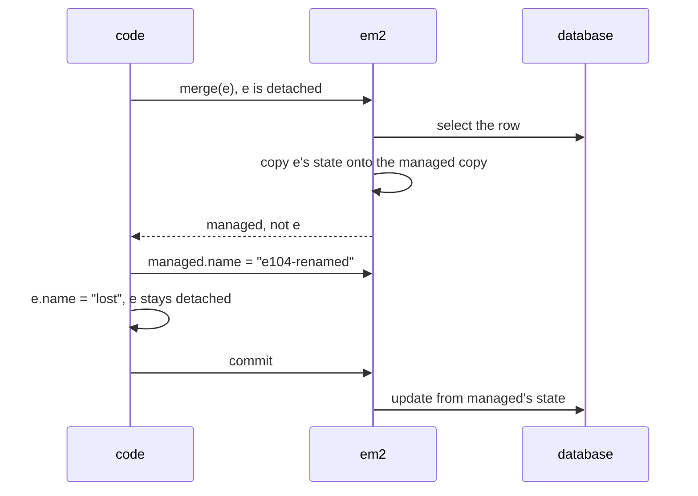

# 10.7.2. ORM (Object-Relational Mapping) Frameworks

The staff directory lists 200 departments with a head count for each. Its code is one JPQL query
and a loop that calls `department.getEmployees().size()`. The database log shows 201 statements
for each page view.

An ORM such as Hibernate, the most used implementation of the JPA specification, writes SQL for
you while you work with objects. It decides when to query, when to write and which object you get
back. Every output on this page comes from
Hibernate ORM 6.4.4 (JPA 3.1) on H2 2.2.224 in memory, run on Java 21. Plain JDBC is unit 10.7.1;
transactions and `@Version` are unit 10.7.3.

## A Connection That Counts Statements

The examples read the statement count from a JDBC `Connection` wrapped in a dynamic proxy
(unit 9.2.3) that records the SQL of every statement it prepares:

```java
import java.lang.reflect.Proxy;
import java.sql.Connection;
import java.util.ArrayList;
import java.util.List;

/** Wraps a JDBC Connection so that every statement it prepares is recorded. */
public final class Counting {
    public static final List<String> SQL = new ArrayList<>();

    public static Connection wrap(Connection real) {
        return (Connection) Proxy.newProxyInstance(Connection.class.getClassLoader(),
                new Class<?>[] {Connection.class}, (proxy, method, args) -> {
                    if (method.getName().startsWith("prepare")) SQL.add((String) args[0]);
                    try {
                        return method.invoke(real, args);
                    } catch (java.lang.reflect.InvocationTargetException e) {
                        throw e.getCause();
                    }
                });
    }

    public static int since(int mark) { return SQL.size() - mark; }
}
```

Hibernate gets its connections from a `ConnectionProvider` that returns
`Counting.wrap(DriverManager.getConnection("jdbc:h2:mem:orm;DB_CLOSE_DELAY=-1"))`. The two
entities:

```java
import jakarta.persistence.*;
import java.util.ArrayList;
import java.util.List;

@Entity
public class Department {
    @Id Long id;
    String name;
    @OneToMany(mappedBy = "department")            // LAZY is the default for a collection
    List<Employee> employees = new ArrayList<>();

    protected Department() {}
    Department(long id, String name) { this.id = id; this.name = name; }
}
```

```java
import jakarta.persistence.*;
import java.math.BigDecimal;

@Entity
public class Employee {
    @Id Long id;
    String name;
    BigDecimal salary;
    @ManyToOne(fetch = FetchType.LAZY) Department department;

    protected Employee() {}
    Employee(long id, String name, String salary, Department d) {
        this.id = id; this.name = name; this.salary = new BigDecimal(salary); this.department = d;
    }
}
```

The data: Sales, Support and Research with three employees each (ids 101 to 109), and Legal with
none.

## A Lazy Association Costs One Query per Parent Unless the Query Fetches It

Pause before the output: how many statements does this loop run?

```java
List<Department> ds = em.createQuery("select d from Department d order by d.id", Department.class)
        .getResultList();
System.out.println(ds.stream().map(d -> d.name + "=" + d.employees.size()).collect(Collectors.joining(" ")));
```

```text
Sales=3 Support=3 Research=3 Legal=0
plain query: 4 departments, 5 statements
```

One statement for the departments, then one per department. `employees` is lazy, so the query
filled it with a placeholder collection, and `size()` on each placeholder ran its own `select ...
from Employee where department_id=?`. That is the N+1 pattern: the count grows with the rows, and
with 200 departments it is the 201 statements of the directory page.

The fix is to say in the query what you will touch. `join fetch` loads the collection in the same
statement:

```java
ds = em.createQuery("select d from Department d join fetch d.employees order by d.id", Department.class)
        .getResultList();
```

```text
Sales=3 Support=3 Research=3
join fetch: 3 departments, 1 statements
  select d1_0.id,e1_0.department_id,e1_0.id,e1_0.name,e1_0.salary,d1_0.name from Department d1_0 join Employee e1_0 on d1_0.id=e1_0.department_id order by d1_0.id
```

One statement, but Legal is gone: `join fetch` is an inner join, so a department with no employees
returns no row, and the directory silently stops listing it. `left join fetch` keeps it:

```text
Sales=3 Support=3 Research=3 Legal=0
left join fetch: 4 departments, 1 statements
```

The joined result has a row per employee (nine, plus one for Legal in the left join), and
Hibernate 6.4 still returned each department once, with its collection filled from its rows.

Making the association eager doesn't remove the extra queries. `Ticket` has `@ManyToOne Department
department` with no `fetch` attribute, which in JPA means `EAGER`. Three tickets, each in a
different department:

```text
3 tickets, 4 statements
  select t1_0.id,t1_0.department_id from Ticket t1_0
  select d1_0.id,d1_0.name from Department d1_0 where d1_0.id=?
  select d1_0.id,d1_0.name from Department d1_0 where d1_0.id=?
  select d1_0.id,d1_0.name from Department d1_0 where d1_0.id=?
```

A JPQL query runs the SQL its text describes, and an eager association it doesn't fetch is loaded
right after, one select per department the persistence context doesn't already hold (with
department 1 loaded beforehand, the same query ran 3 statements). Eager only moves the N queries to the moment the
query runs, including for callers that never read the department.

<!-- practice 1 -->

## One Persistence Context Holds One Object per Row

An `EntityManager` keeps a **persistence context**: a map from entity type and id to the one object
it handed out for that row. Two `find`s and a query for the same department:

```java
Department a = em.find(Department.class, 1L);
Department b = em.find(Department.class, 1L);
Department c = em.createQuery("select d from Department d where d.name = 'Sales'", Department.class)
        .getSingleResult();
System.out.println("a == b: " + (a == b) + ", a == c: " + (a == c) + ", statements: " + Counting.since(mark));
EntityManager other = emf.createEntityManager();
Department x = other.find(Department.class, 1L);
System.out.println("other unit of work: a == x: " + (a == x) + ", a.equals(x): " + a.equals(x));
```

```text
a == b: true, a == c: true, statements: 2
other unit of work: a == x: false, a.equals(x): false
```

The second `find` looked in the map and ran no SQL. The query did run, because only the database
can say which rows match a `where`, but for the row it found Hibernate returned the object already
in the map. The other `EntityManager` has its own map and its own object, and `Department` doesn't
override `equals`, so they aren't equal either. Two contexts that each change "the same" department
write two versions of it; which one wins is unit 10.7.3.

Another connection renames department 1 and commits, and the first `EntityManager` runs
`select d from Department d where d.id = 1` into `again`:

```text
after another connection renamed it: again == a: true, name: Sales, statements: 1
after refresh: Revenue
```

The query read the new name from the table and threw it away, because the context already holds an
object for that id and won't overwrite your in-memory state with a row. An `EntityManager` kept
open across requests serves the old name until `refresh(a)` or `clear()`.

<!-- practice 2 -->

## Flush Writes What Differs From the Snapshot Taken at Load

There is no `update()` in JPA. When Hibernate loads an entity, it keeps a second copy of its
attribute values, the **snapshot**. At flush, which happens at commit, on `flush()`, and before a
JPQL query on a table with pending changes, it compares every managed entity with its snapshot.
Hibernate's internal `PersistenceContext.getEntry(e).getLoadedState()`, not meant for application
code, shows the copy:

```text
snapshot of 101: [Department@27db45f, e101, 50101.00], entity now: 51101.00
```

Three employees are loaded in one transaction. One gets a raise, one gets a name equal to its own
but in a new `String`, and one is not touched:

```java
Employee raised = em.find(Employee.class, 101L);
Employee renamed = em.find(Employee.class, 102L);
Employee untouched = em.find(Employee.class, 103L);
raised.salary = raised.salary.add(new BigDecimal("1000"));
renamed.name = new String(renamed.name);           // equal value, different object
```

```text
statements at commit: 1
  update Employee set department_id=?,name=?,salary=? where id=?
```

One `UPDATE`, for employee 101. The comparison is by value, so the new `String` equal to the old
one is not a change, and an entity nobody touched costs a comparison but no statement. The
statement lists every column, not only `salary`; Hibernate's `@DynamicUpdate` on the entity makes
it list only the changed ones.

Every managed entity holds two copies of its state, and every flush compares all of them. A batch job that loads 100,000 rows into one `EntityManager` to change
ten of them keeps 100,000 snapshots and compares them at every flush; flushing and clearing the
context every few hundred rows keeps it small.

<!-- practice 3 -->

## Only Managed Objects Are Checked, and merge Returns a Different One

Dirty checking walks the persistence context, so an object that left it is invisible. Employee 104
is loaded, its `EntityManager` is closed, and its salary is set to 99000. A new `EntityManager`
commits one transaction without touching it, then a second one that merges it:

```java
Employee managed = em2.merge(e);
managed.name = "e104-renamed";
e.name = "lost";
em2.getTransaction().commit();
```

```text
commit without merge: 0 statements
merge: managed == e: false, statements: 2
  select e1_0.id,e1_0.department_id,e1_0.name,e1_0.salary from Employee e1_0 where e1_0.id=?
  update Employee set department_id=?,name=?,salary=? where id=?
row now: e104-renamed 99000.00
```

The first commit wrote nothing: the changed object is **detached**, managed by no context. `merge`
loaded the row into the new context, copied the detached object's state onto that managed copy,
and returned the copy; `e` stays detached. So the salary from before the merge reached the table,
and `"lost"`, set on `e` after it, did not. Code that calls `em.merge(e)` and keeps using `e` loses
every later change.



## A Lazy Association Loads Only While Its Persistence Context Is Open

A service finds department 2 and returns it, and its `EntityManager` closes. The view then asks for
the employees:

```text
initialized before close: false
org.hibernate.LazyInitializationException: failed to lazily initialize a collection of role: Department.employees: could not initialize proxy - no Session
```

The placeholder collection loads through the context that created it, and that context is closed.
Hibernate throws rather than return an empty list, which would show Support as a department with
nobody in it. Fetching the collection in the query before the context closes works:

```text
fetched in the query, after close: 3
```

As with N+1, the code that runs the query has to know what the caller will read. A DTO built
inside the transaction makes that explicit in the return type.

<!-- practice 4 -->

## Summary

- **A lazy association costs one query per parent unless the query fetches it.** `join fetch`
  drops parents without children; `left join fetch` keeps them. `EAGER` still runs the N queries.
- **One persistence context holds one object per row.** `find` for a loaded id runs no SQL, a query
  returns the object already held, and a row changed by someone else stays stale until `refresh`.
- **Flush writes what differs from the snapshot taken at load.** An equal value is no change;
  every managed entity costs a second copy and a comparison per flush.
- **Only managed objects are checked.** A detached change is written only through `merge`; only
  the object `merge` returns is managed, and changes made to the argument afterwards are lost.
- **A lazy association loads only while its context is open.** After that it throws
  `LazyInitializationException`; fetch what the caller needs before returning.

## Reference

**Default fetch type (JPA 3.1 annotations' `fetch` attribute):**

| Annotation | Default |
|---|---|
| `@ManyToOne`, `@OneToOne` | `EAGER` |
| `@OneToMany`, `@ManyToMany` | `LAZY` |

**Which calls run SQL (Hibernate 6.4, as run here):**

| Call | Statement |
|---|---|
| `find` for an id already in the context | none |
| `find` for a new id | one `select` |
| JPQL query | always; matching rows already in the context come back as the held object, old state kept |
| first access to a lazy collection | one `select`, or `LazyInitializationException` if the context is closed |
| commit / flush | one `UPDATE` per managed entity whose values differ from its snapshot |
| `merge` of a detached entity not in the context | one `select`, then an `UPDATE` at flush if the state differs |

**Entity states (JPA):** new (never persisted), managed (in an open context, dirty-checked),
detached (its context closed or cleared, not checked), removed (`remove` called, deleted at flush).

## Challenges

1. A report loads 50 orders, each with lines and a customer. Write the one query that loads it all,
   then count its rows for orders of 20 lines. When is two queries better than one?
2. A nightly job updates 2 million rows through JPA. Where do you call `flush()` and `clear()`, and
   what breaks for code that still holds an entity from before the `clear()`?
3. Open one `EntityManager` per HTTP request and another per application. List what each sees
   when another instance of the service changes a row.

## Design Note: The Persistence Context Is a Unit of Work

Hibernate records changes in the context and writes them at flush, so a transaction that changes
one field ten times with no flush in between sends one `UPDATE`, and code that reads an entity twice gets one object with one state. The identity map
and the snapshot follow from that design.

The price is that the context is state with a lifetime, and the bugs on this page come from that
lifetime being wrong. A context kept open too long serves stale rows and grows without bound; one
closed too early makes lazy collections throw and changes to detached objects disappear.

## Code Examples

- Implementation: [OrmPatterns.java](src/main/java/com/github/msorkhpar/claudejavatutor/javapersistence/OrmPatterns.java)
- Tests: [OrmPatternsTest.java](src/test/java/com/github/msorkhpar/claudejavatutor/javapersistence/OrmPatternsTest.java)
