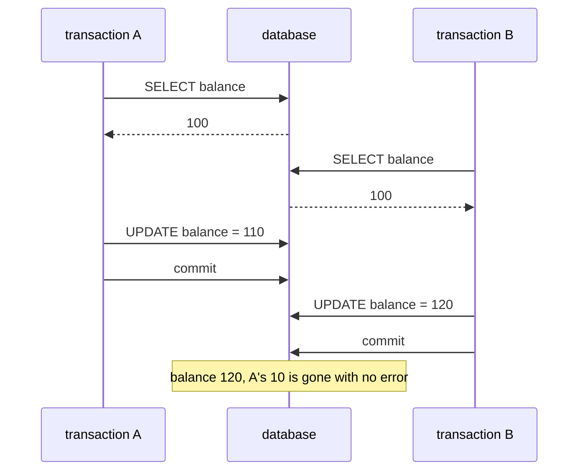

# 10.7.3. Transactions and Database Concurrency Control

Two top-ups for wallet 7, one of 10 and one of 20, reach two instances of the payments service in
the same millisecond. Each instance turns off auto-commit (unit 10.7.1), reads the balance, adds
its amount in Java, writes the result and commits. Both return 200 and log `committed`. The
wallet started at 100 and now shows 120, and nothing failed.

A transaction commits or rolls back its statements together. It does not, by itself, stop another
transaction from changing the same rows in between. Every run here uses H2 2.2.224, in-memory.

## A Tool That Opens Two Transactions and Shows Who Waits

Every example runs two or three connections to one in-memory database in one JVM. A lock wait is
visible to the database, so the tool asks it, through H2's `INFORMATION_SCHEMA.SESSIONS`, instead
of guessing from time:

```java
import java.sql.*;
import java.util.HashMap;
import java.util.Map;
import java.util.concurrent.*;

/** A fresh in-memory H2 database, transactions on separate connections, and who waits for whom. */
public final class Db {
    private final String url;
    private final Connection monitor;
    private final Map<Connection, Integer> sessions = new HashMap<>();

    public Db(String name) throws SQLException {
        url = "jdbc:h2:mem:" + name + ";DB_CLOSE_DELAY=-1";
        monitor = DriverManager.getConnection(url);
        update(monitor, "CREATE TABLE wallet(id INT PRIMARY KEY, balance INT NOT NULL, version INT NOT NULL)");
        update(monitor, "INSERT INTO wallet VALUES (7, 100, 0), (8, 100, 0)");
    }

    /** A connection whose statements form one transaction until commit() or rollback(). */
    public Connection tx() throws SQLException {
        Connection c = DriverManager.getConnection(url);
        c.setAutoCommit(false);
        sessions.put(c, queryInt(c, "SELECT SESSION_ID()"));
        return c;
    }

    public int session(Connection c) {
        return sessions.get(c);
    }

    /** Asks H2 which session holds the lock `waiter` is blocked on; 0 if it isn't blocked within 5 s. */
    public int blockerOf(Connection waiter) throws SQLException {
        long end = System.nanoTime() + TimeUnit.SECONDS.toNanos(5);
        while (System.nanoTime() < end) {
            int blocker = queryInt(monitor,
                    "SELECT COALESCE(BLOCKER_ID, 0) FROM INFORMATION_SCHEMA.SESSIONS WHERE SESSION_ID = ?",
                    session(waiter));
            if (blocker != 0) return blocker;
        }
        return 0;
    }

    /** Runs work on a daemon thread, so this thread can watch it wait. */
    public static <T> Future<T> inBackground(Callable<T> work) {
        FutureTask<T> task = new FutureTask<>(work);
        Thread t = new Thread(task);
        t.setDaemon(true);
        t.start();
        return task;
    }

    public static int queryInt(Connection c, String sql, Object... args) throws SQLException {
        try (PreparedStatement p = bind(c, sql, args); ResultSet r = p.executeQuery()) {
            return r.next() ? r.getInt(1) : -1;
        }
    }

    public static int update(Connection c, String sql, Object... args) throws SQLException {
        try (PreparedStatement p = bind(c, sql, args)) {
            return p.executeUpdate();
        }
    }

    private static PreparedStatement bind(Connection c, String sql, Object... args) throws SQLException {
        PreparedStatement p = c.prepareStatement(sql);
        for (int i = 0; i < args.length; i++) p.setObject(i + 1, args[i]);
        return p;
    }
}
```

Calls on one thread run in the order written. A statement that blocks runs through
`inBackground`, and `blockerOf` returns once H2 reports the wait. The examples statically import
`Db`'s methods and `TimeUnit.SECONDS`, each starts on a fresh `Db`, and the fragments leave out
their final printout. Every output is from Java 21.

## Read, Compute in Java, Write Back Loses an Update Under READ COMMITTED

A and B both read 100. A writes 110 and commits. What does READ COMMITTED, H2's default, do when
B writes 120?

```java
Db db = new Db("lost");
Connection a = db.tx(), b = db.tx();                 // READ COMMITTED, H2's default
int seenByA = queryInt(a, "SELECT balance FROM wallet WHERE id = 7");
int seenByB = queryInt(b, "SELECT balance FROM wallet WHERE id = 7");
update(a, "UPDATE wallet SET balance = ? WHERE id = 7", seenByA + 10);
a.commit();
update(b, "UPDATE wallet SET balance = ? WHERE id = 7", seenByB + 20);
b.commit();
```

```text
A read 100, B read 100, balance now 120
```

It lets B write. READ COMMITTED only promises that B reads committed data, and 100 was committed
when B read it. The `UPDATE` sets a constant computed in Java, and the database can't tell that it
came from a stale read. A's 10 is gone with no error.



A `synchronized` block around the read and the write (unit 6.2.1) excludes threads of one JVM,
and the two top-ups ran on two instances. The compound action belongs with the owner of the state
(unit 8.3.2), and here the owner is the database. When the new value is a function of the old
one, one statement does it:

```java
update(a, "UPDATE wallet SET balance = balance + 10 WHERE id = 7");
Future<Integer> topUpB = inBackground(() -> update(b, "UPDATE wallet SET balance = balance + 20 WHERE id = 7"));
System.out.println("B is blocked by session " + db.blockerOf(b) + "; A is session " + db.session(a));
a.commit();
topUpB.get(5, SECONDS);
b.commit();
```

```text
B is blocked by session 4; A is session 4
balance now 130
```

A's `UPDATE` locked the row until A ended. B's `UPDATE` waited, then read the committed 110 and
added 20.

## SELECT ... FOR UPDATE Makes the Second Reader Wait for the First Commit

Often the new value needs Java: a daily limit, a fee table, a currency rule. Then the read has to
be the statement that locks:

```java
int seenByA = queryInt(a, "SELECT balance FROM wallet WHERE id = 7 FOR UPDATE");
Future<Integer> seenByB = inBackground(() -> queryInt(b, "SELECT balance FROM wallet WHERE id = 7 FOR UPDATE"));
System.out.println("B is blocked by session " + db.blockerOf(b) + "; A is session " + db.session(a));
update(a, "UPDATE wallet SET balance = ? WHERE id = 7", seenByA + 10);
a.commit();
int bRead = seenByB.get(5, SECONDS);
update(b, "UPDATE wallet SET balance = ? WHERE id = 7", bRead + 20);
b.commit();
```

```text
B is blocked by session 4; A is session 4
A read 100, B read 110, balance now 130
```

The lock belongs to the read. Code that reads with a plain `SELECT` and locks just before writing
has already computed from the stale value.

The lock lasts until `commit()` or `rollback()`. An early return on "insufficient funds" that
skips both leaves the row locked while the connection stays open. Every other top-up of that
wallet then waits, and with H2's default the wait ended after about 2 seconds in the lock timeout
shown in the page's last section.

<!-- practice 1 -->

## A Version Column Turns a Lost Update into an Update Count of 0

A lock shouldn't be held while a person edits a form for five minutes: every other writer of the
row waits that long. A version column lets the
write itself check that nothing changed since the read:

```java
/** Reads balance and version, then writes only if the version is still the one it read. */
static void topUp(String who, Connection c, int amount, Runnable beforeWrite) throws SQLException {
    for (int attempt = 1; ; attempt++) {
        int balance, version;
        try (PreparedStatement p = c.prepareStatement("SELECT balance, version FROM wallet WHERE id = 7");
             ResultSet r = p.executeQuery()) {
            r.next();
            balance = r.getInt(1);
            version = r.getInt(2);
        }
        beforeWrite.run();
        int count = update(c, "UPDATE wallet SET balance = ?, version = version + 1 WHERE id = 7 AND version = ?",
                balance + amount, version);
        System.out.printf("%s attempt %d: read balance %d, version %d; update count %d%n",
                who, attempt, balance, version, count);
        if (count == 1) {
            c.commit();
            return;
        }
        c.rollback();                                     // someone else wrote first: read again
    }
}
```

A tops up 10, and A's `beforeWrite` runs B's whole top-up of 20, once, between A's read and A's
write:

```java
AtomicBoolean once = new AtomicBoolean();
topUp("A", a, 10, () -> {
    if (once.compareAndSet(false, true)) {
        try { topUp("B", b, 20, () -> { }); } catch (SQLException e) { throw new RuntimeException(e); }
    }
});
```

```text
B attempt 1: read balance 100, version 0; update count 1
A attempt 1: read balance 100, version 0; update count 0
A attempt 2: read balance 120, version 1; update count 1
balance now 130, version 2
```

Nothing is thrown: the update count is the only signal, and code that ignores what
`executeUpdate()` returns loses A's top-up as before. The retry must read again, because version 0
matches nothing on every attempt. Every writer must increment the version, or the next check
passes against a changed row. JPA's `@Version` generates this statement and turns count 0
into an exception (unit 10.7.2).

The write can still wait. Here A has run its version-checked `UPDATE` and not committed when B's
arrives; then A commits:

```text
B is blocked by session 4; A is session 4
B's update count: 0
```

B waited for A's row lock, and then its version check failed against A's commit.

<!-- practice 2 -->

## An Isolation Level Is What Your Database Does, and on H2 None Stops Write Skew

The SQL standard defines the three lower levels by the anomalies each must prevent, and
SERIALIZABLE as equivalent to some serial order of the transactions. This program runs five
interleavings of two transactions, `t[0]` as A and `t[1]` as B, after `setTransactionIsolation`
on both. The phantom check is typical:

```java
int first = queryInt(t[1], "SELECT COUNT(*) FROM wallet WHERE balance >= 100");
update(t[0], "INSERT INTO wallet VALUES (9, 500, 0)");
t[0].commit();
int second = queryInt(t[1], "SELECT COUNT(*) FROM wallet WHERE balance >= 100");
```

The other four: B reads a row A changed but hasn't committed (dirty); B reads a row twice around
A's commit (non-repeatable); the lost update of the first section; and write skew. Two wallets of
one family must keep 100 between them. Each transaction reads the total, 200, sees that taking 90
leaves 110, and takes 90 from its own wallet.

```text
level             dirty      non-repeatable  phantom    lost update       write skew
READ_UNCOMMITTED  yes (999)  yes (100, 150)  yes (2, 3) yes (120)         yes (20)
READ_COMMITTED    no (100)   yes (100, 150)  yes (2, 3) yes (120)         yes (20)
REPEATABLE_READ   no (100)   no (100, 100)   no (2, 2)  no, B gets 40001  yes (20)
SERIALIZABLE      no (100)   no (100, 100)   no (2, 2)  no, B gets 40001  yes (20)
```

**H2's REPEATABLE READ is a snapshot.** B sees the database as of its first read, so the inserted
row never appears. The standard allows a phantom at this level, and H2 prevents it.

**The second writer of a changed row is refused.** At REPEATABLE READ and SERIALIZABLE, B's
`UPDATE` of a row that A changed and committed after B's snapshot fails with SQLState 40001, and
the message says `Deadlock detected` though nothing waited. B got the same 40001 at REPEATABLE
READ with `balance = balance + 20`, and with `SELECT ... FOR UPDATE`, once its snapshot had
started. Code at these levels treats 40001 as "run the transaction again", like the deadlock in
the page's last section.

**SERIALIZABLE let write skew through.** The family's wallets hold 20. No serial order of the two
transactions produces that: whichever ran second would have seen 110 and refused. So H2's
SERIALIZABLE is not serializable in the standard's sense. Each
transaction wrote a different row, so there was no write conflict for H2 to refuse. At READ
COMMITTED, reading both wallets with `FOR UPDATE` made B wait, then see 110 and refuse.

> **Databases differ.** Only H2 ran here. Other databases implement these levels with other
> locking and snapshot rules, so run the same five interleavings against the database you ship
> on before you rely on a level.

<!-- practice 5 -->

## A Failed Statement Undoes Only Itself; a Savepoint Undoes the Group

A nightly import writes each order and its lines in one transaction, into `orders(id)` and
`line(order_id, sku NOT NULL)`. Order 1's second line has no SKU:

```java
update(c, "INSERT INTO orders VALUES (1)");
update(c, "INSERT INTO line VALUES (1, 'MUG')");
try {
    update(c, "INSERT INTO line VALUES (1, NULL)");
} catch (SQLException e) {
    System.out.println("order 1: " + e.getSQLState() + " " + e.getMessage().lines().findFirst().get());
}
// order 2 the same, inside a savepoint; order 3 is fine
Savepoint beforeOrder2 = c.setSavepoint();
try {
    update(c, "INSERT INTO orders VALUES (2)");
    update(c, "INSERT INTO line VALUES (2, 'CAP')");
    update(c, "INSERT INTO line VALUES (2, NULL)");
} catch (SQLException e) {
    c.rollback(beforeOrder2);
}
update(c, "INSERT INTO orders VALUES (3)");
update(c, "INSERT INTO line VALUES (3, 'PEN')");
c.commit();
```

```text
order 1: 23502 NULL not allowed for column "SKU"; SQL statement:
committed: order 1 with 1 line(s)
committed: order 3 with 1 line(s)
rollback(savepoint) after commit: 90063 Savepoint is invalid: "SYSTEM_SAVEPOINT_0"; SQL statement:
```

On H2 the failed `INSERT` undid only itself. The transaction stayed open, and the commit kept
order 1 with one of its two lines: an order the warehouse will ship short. `rollback(savepoint)`
undid every statement since the savepoint, order 2's header and its good line included, and left
the transaction open for order 3. A savepoint ends with its transaction: after the commit,
rolling back to it fails with 90063.

A savepoint set once, before the loop, would undo every order since the start, the good ones
too. It goes at the start of each group of statements that must stand or fall together.

<!-- practice 3 -->

## On H2, a Lock Timeout Fails One Statement; a Deadlock Rolls Back the Whole Transaction

Both happen when a transaction can't get a lock, and H2 answers them differently. First a lock
timeout: B's session runs `SET LOCK_TIMEOUT 500`, so it waits at most 500 ms. A holds wallet 7 with
`FOR UPDATE`. B
credits wallet 8, tries to debit wallet 7, and then commits:

```text
after 501 ms: JdbcSQLTimeoutException, SQLState HYT00, Timeout trying to lock table "WALLET"; SQL statement:
B committed; wallet 8 = 105, wallet 7 = 100
```

The message says "table", but only one row was locked. The timeout failed B's statement and
nothing else: B's credit was still in the transaction, and the commit wrote it without its debit.

Now a deadlock. A moves 10 from wallet 7 to wallet 8, B moves 5 from wallet 8 to wallet 7, and
each has made its debit when it asks for the other's row. `creditA` runs A's credit to wallet 8,
then A's commit, on its own thread, and returns once A waits. B's catch does what many retry helpers do, and retries the
statement that failed:

```java
update(a, "UPDATE wallet SET balance = balance - 10 WHERE id = 7");   // A: 10 from 7 to 8
update(b, "UPDATE wallet SET balance = balance - 5 WHERE id = 8");    // B: 5 from 8 to 7
Future<Integer> credit = creditA(db, a);
try {
    update(b, "UPDATE wallet SET balance = balance + 5 WHERE id = 7");
} catch (SQLException e) {
    System.out.println("B: " + e.getClass().getSimpleName() + ", SQLState " + e.getSQLState());
    System.out.println("   " + e.getMessage().lines().findFirst().get());
    credit.get(5, SECONDS);
    update(b, "UPDATE wallet SET balance = balance + 5 WHERE id = 7"); // retry the statement that failed
}
b.commit();
```

```text
B is session 5
A is blocked by session 5
B: JdbcSQLTransactionRollbackException, SQLState 40001
   Deadlock detected. The current transaction was rolled back. Details: "WALLET"; SQL statement:
wallet 7 = 95, wallet 8 = 110, total 205
```

H2 found the cycle at once and rolled back B's whole transaction, debit included, which let A
finish. B's retried credit ran in a new transaction, and the commit wrote it alone: the two
wallets hold 205, and 5 was created. H2 chose B in every run here; don't build on which side it
picks.

A transaction that got 40001 no longer exists, so the retry rolls back and runs it again from its
first statement. A's debit of wallet 7 has run before this loop:

```java
for (int attempt = 1; ; attempt++) {
    try {
        update(b, "UPDATE wallet SET balance = balance - 5 WHERE id = 8");
        if (attempt == 1) creditA(db, a);                               // force the crossing once
        update(b, "UPDATE wallet SET balance = balance + 5 WHERE id = 7");
        b.commit();
        System.out.println("B attempt " + attempt + ": committed");
        break;
    } catch (SQLException e) {
        if (!"40001".equals(e.getSQLState())) throw e;
        System.out.println("B attempt " + attempt + ": " + e.getSQLState());
        b.rollback();
    }
}
```

```text
A is blocked by session 5
B attempt 1: 40001
B attempt 2: committed
wallet 7 = 95, wallet 8 = 105, total 200
```

Every retry rolls back and starts again from the first statement, and only for failures a rerun
can fix. A `CHECK` violation from the same input fails again on every attempt. After a lock
timeout the transaction is still open on H2, so the caller rolls it back before deciding to
retry. Taking a transfer's rows in one order, lower id first, keeps two transfers from crossing
(unit 6.2.1 does the same for Java locks). The retry is still needed for REPEATABLE READ's 40001
and for code that ignores the order.

> **Databases differ here too.** What a lock timeout or a deadlock undoes is the database's
> choice; only H2 ran here. Check yours before relying on the open transaction after a timeout.

<!-- practice 4 -->

## Summary

- **Read, compute in Java, write back loses an update under READ COMMITTED.** The `UPDATE` writes
  a constant computed from a stale read, and a JVM lock can't see the other instance. One
  statement (`balance = balance + ?`) or a lock on the read fixes it.
- **`SELECT ... FOR UPDATE` makes the second reader wait for the first commit,** then read the
  new value. The lock is held until `commit()` or `rollback()`, on every path.
- **A version column turns a lost update into an update count of 0.** Check the count, increment
  the version on every write, and read again before retrying.
- **An isolation level is what your database does.** On H2, REPEATABLE READ is a snapshot; at it
  and at SERIALIZABLE a second writer gets 40001 "Deadlock detected"; SERIALIZABLE let write skew
  through.
- **A failed statement undoes only itself on H2; a savepoint undoes the group.** One savepoint
  per group of statements that must stand or fall together.
- **On H2, a lock timeout fails one statement; a deadlock rolls back the whole transaction.** A
  retry rolls back and reruns the whole transaction, and only for failures a rerun can fix.

## Reference

**What H2 2.2.224 raised in these runs:**

| Situation | Exception | SQLState / code | The transaction afterwards |
|---|---|---|---|
| lock wait longer than `LOCK_TIMEOUT` | `JdbcSQLTimeoutException` | HYT00 / 50200 | open; earlier statements kept |
| deadlock between two transactions | `JdbcSQLTransactionRollbackException` | 40001 | rolled back |
| REPEATABLE READ or SERIALIZABLE, row changed after the snapshot | `JdbcSQLTransactionRollbackException` | 40001 | rolled back |
| `NOT NULL` violated | `JdbcSQLIntegrityConstraintViolationException` | 23502 | open; earlier statements kept |
| `rollback(savepoint)` after commit | `JdbcSQLNonTransientException` | 90063 | — |

**JDBC calls (`java.sql.Connection` javadoc):**

| Call | Effect |
|---|---|
| `setAutoCommit(false)` | statements are grouped into one transaction until `commit()` or `rollback()` |
| `setTransactionIsolation(level)` | changes the level; called mid-transaction, the result is implementation-defined |
| `setSavepoint()` / `setSavepoint(name)` | creates a savepoint in the current transaction |
| `rollback(savepoint)` | undoes the changes made after the savepoint |
| `releaseSavepoint(savepoint)` | removes the savepoint and the ones after it |

H2 settings used here: `SET LOCK_TIMEOUT <ms>` for the session (without it, a wait ended after
about 2 seconds); `INFORMATION_SCHEMA.SESSIONS.BLOCKER_ID`, the session a blocked session waits
for. H2's default level is READ COMMITTED.

## Challenges

1. A wallet top-up must refuse to go over a daily limit kept in another table. Which rows does the
   transaction lock, and what does a concurrent change of the limit see?
2. Measure how many top-ups per second one hot wallet takes with `FOR UPDATE`, with a version
   column and retry, and with `balance = balance + ?`, at 2, 8 and 32 concurrent writers.
3. Fix the family-wallet write skew three ways on H2: lock both wallets, a `family` row that both
   transactions update, and a check inside one `UPDATE`. Which one still works when a third
   wallet joins the family?

## Design Note: Why the Victim Loses Its Whole Transaction

When two transactions wait for each other, one must give up a lock it holds, and a row lock
protects a change the transaction made. H2 undoes all of the victim's changes rather than guess
which of its earlier statements the rest depend on, and says so in the SQLState. It reports a
write conflict under a snapshot with the same 40001, and the remedy is the same: the
transaction's reads are stale.

A transaction therefore has to be a unit the code can run again from the start: no e-mail sent, no
message published and no in-memory counter changed before the commit, because the retry does it a
second time. Code that retries just the failed statement creates money after a deadlock, and code
that commits after a timeout writes half a transfer. Roll back, and run the whole transaction
again.

## Code Examples

- Implementation: [TransactionControl.java](src/main/java/com/github/msorkhpar/claudejavatutor/javapersistence/TransactionControl.java)
- Tests: [TransactionControlTest.java](src/test/java/com/github/msorkhpar/claudejavatutor/javapersistence/TransactionControlTest.java)
